# Design: Components, Classes and Sequences (To Do 7-8)

Covers R29 (main software components), R30 (low-level class diagrams) and R31 (sequence diagrams). Built from the
[SRS](srs.md) (FR-x.y, NFR-n, error table of section 5), the [use cases](use_cases.md) (UC-1 to UC-14), the
requirements R1-R37 ([requirements.md](requirements.md)), the validated decisions D1-D32
([decisions.md](decisions.md); **D5 and D26 are superseded by D30 and not used**; D10 / F4 is deferred; D31 records
the open points of section 9, all validated on 23/11; D32 (24/11) accepts every network and labels each check-in
campus / Apple relay / off campus) and the
libraries tested in the [tools report](tools_report.md). All diagrams are Mermaid (D14).

Design rules followed throughout:

- **KISS and no over-design** (R17, lesson from Ex1): every class below has a role in at least one use case, and
  every abstraction (interface) has a reason that exists *today* (it is named next to it).
- **Compose, do not rewrite** (R18): Flask, stdlib `sqlite3` / `hmac` / `ipaddress` / `csv` / `zipfile`,
  `qrcode`, OpenCV YuNet, `openpyxl`, `anthropic`, `faster-whisper`; snippets proven in `tools_tests/` are reused.
- **No personal data** (R16, D21): no name, ID, e-mail, photo or IP address is ever stored.
- **Testable offline** (D25, NFR-12): time, client IP and every external service are injectable.

## 1. Architecture overview

### 1.1 Layers

The application is one Python 3.13 / Flask process (D2) on the lecturer's laptop, organised in four layers. A layer
only calls the layer below it; the web layer is thin (parse the request, call one service method, render).

| Layer | Content | Depends on |
|---|---|---|
| **Web** (`app/web/`) | Flask blueprints `student_routes`, `lecturer_routes`, `api_routes` (JSON for polling, D4); Jinja templates; helpers `device_token()`, `client_ip()`, `lecturer_required`; one error handler for `AppError` (D23) | Services |
| **Services** (`app/services/`) | Domain logic of each feature: rules of D30, D7, D9, D11, D28, D29 | Repositories, ports |
| **Repositories** (`app/repositories/`) | All SQL, one class per aggregate (D3) | `Database` (stdlib `sqlite3`) |
| **Adapters** (`app/adapters/`) | Thin wrappers around external libraries and services, each behind a port (interface) | OpenCV YuNet, `anthropic`, GitHub, `faster-whisper`, `qrcode` |

Cross-cutting core (`app/`): `Config` (environment variables), `Clock` (time port), `Database`, `errors.py`
(exception hierarchy), and the **composition root** `create_app()` that builds every object once and injects it
(constructor injection, no framework).

### 1.2 Component and deployment diagram

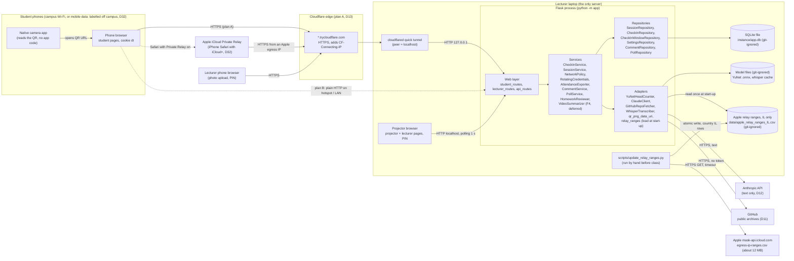

Data flows that matter for privacy (R16, D21): photos and videos travel phone/laptop -> Flask, are processed in
memory (or a temporary file for the video) and discarded; only the face count D is stored. Client IPs are read from
the request, compared with the campus allow-list and the Apple relay ranges (D32) and forgotten; a check-in stores
only its origin label `network_origin` (`campus` / `apple_relay` / `off_campus`). No location is ever asked (D5, R16). Only text (public repository extracts, a transcript) is sent to the Anthropic API.
The relay-range script downloads a public Apple file and sends nothing.

### 1.3 Interfaces between components

| From -> To | Interface | Data |
|---|---|---|
| Phone -> Web | HTTP(S) HTML forms; cookie `dt` (random device token, D6 amended by D31: cookie only) | QR token in URL path, nickname, 3-digit code, comment text, vote, repository URL |
| Projector / lecturer browser -> Web | HTML + JSON polling (`fetch` every 1 s for the projector, 2.5 s otherwise, D4 amended by D31) | QR image (PNG data URI) + code; live table; comments; poll results |
| Web -> Services | Python method calls with plain types (`str`, `int`, `bytes`); results are frozen dataclasses | See section 3 |
| Services -> Repositories | Python method calls; repositories return dataclasses, never `sqlite3.Row` | Entities of section 5 |
| Services -> Adapters | Ports (`typing.Protocol`): `HeadCounter`, `LLMClient`, `RepoFetcher`, `Transcriber`; plus `Clock` | `bytes` image -> `int`; prompt `str` -> `str`; URL -> `RepoExtract`; file path -> transcript `str` |
| cloudflared -> Web | HTTP on localhost, header `CF-Connecting-IP` | The phone's public IP (trusted only from a loopback peer, FR-1.3); for an iPhone with Private Relay, an Apple egress IP (D32) |
| Relay file -> `create_app` | `load_relay_ranges(path) -> list[IPNetwork]`, called once at start-up (D32) | CSV lines `range,country,region,city,` (subset of Apple's file, country IL); only the range column is used |
| `update_relay_ranges.py` -> Apple | HTTPS GET with stdlib `urllib`, timeout, size cap; run by hand, never by the app | Apple's public egress CSV in; nothing sent out |

## 2. Components and responsibilities

| # | Component (module) | Responsibility | Main classes / functions | FR | UC |
|---|---|---|---|---|---|
| C1 | Core (`app/config.py`, `clock.py`, `db.py`, `errors.py`, `__init__.py`) | Read configuration from env vars, give time, open SQLite, define user-facing errors, build and wire the app | `Config`, `Clock`, `SystemClock`, `Database`, `AppError` family, `create_app()` | FR-6.3, NFR-8, NFR-10, NFR-12 | all |
| C2 | Web layer (`app/web/`) | HTTP routes, templates, device-token cookie, client-IP resolution call, lecturer PIN gate, error rendering | `student_routes`, `lecturer_routes`, `api_routes`, `device_token()`, `client_ip()`, `lecturer_required` | FR-1.7, FR-6.1, FR-6.2, NFR-1, NFR-11 | all, UC-14 |
| C3 | Check-in (F1) | Network origin classification (campus ranges, Apple relay ranges IL, else off campus; empty allow-list refuses all, D32), rotating QR token and code, 1-minute window, attempt limit, one check-in per device, origin flag | `NetworkPolicy`, `NetworkOrigin`, `load_relay_ranges()`, `parse_egress_csv()`, `RotatingCredentials`, `CheckInService` | FR-1.2-FR-1.12, FR-1.19 | UC-2, UC-6 |
| C4 | Sessions, head count, live table (F1) | Open/close the single session, projector state, summary N / D / status, photo count | `SessionService`, `ConsistencyResult`, `HeadCounter` / `YuNetHeadCounter`, `qr_png_data_uri()` | FR-1.1, FR-1.5, FR-1.8, FR-1.13-FR-1.17 | UC-1, UC-3, UC-4, UC-5 |
| C5 | Export (F1) | Offline spreadsheet CSV + XLSX | `AttendanceExporter` | FR-1.18 | UC-5 |
| C6 | Attendance storage (F1) | SQL for sessions, check-ins and device nicknames, check-in windows, lecturer settings lists | `SessionRepository`, `CheckInRepository`, `CheckInWindowRepository`, `SettingsRepository` | FR-1.3, FR-1.4, FR-1.11, FR-1.12 | UC-1-UC-6 |
| C7 | Comments (F2) | Post anonymous comments, list them newest first | `CommentService`, `CommentRepository` | FR-2.1-FR-2.4 | UC-7, UC-8 |
| C8 | Polls (F3) | One open poll, 2-4 options, one vote per device, live counts | `PollService`, `PollRepository` | FR-3.1-FR-3.4 | UC-9-UC-11 |
| C9 | Homework review (F5) | Fetch public repositories, cap text, LLM review with anonymised comparison | `HomeworkReviewer`, `RepoFetcher` / `GitHubRepoFetcher`, `LLMClient` / `ClaudeClient` | FR-5.1-FR-5.5 | UC-13 |
| C10 | Video summary (F4, **deferred**, D10) | Local transcription + one LLM call | `VideoSummarizer`, `Transcriber` / `WhisperTranscriber`, `LLMClient` | FR-4.1-FR-4.4 | UC-12 |
| C11 | Hosting (external process) | Public HTTPS URL to the laptop (plan A); plan B LAN needs nothing (but is unusable on the campus Wi-Fi, which isolates clients: D13 note, D32) | `cloudflared tunnel --url http://127.0.0.1:<port>` | FR-6.3, NFR-9 | UC-1, UC-2 |
| C12 | Relay range updater (offline script, D32) | Download Apple's Private Relay egress CSV, keep one country, validate, write the small git-ignored file atomically | `scripts/update_relay_ranges.py` (`main(argv, fetch)`), reuses `parse_egress_csv()` | FR-1.19 | UC-6 (preparation) |

No background job, queue or scheduler exists: every rule with time (10 s, 15 s, 5 s, 1 min) is evaluated lazily at
request time with the injected `Clock` (D25), and the long calls of F4/F5 run inside the request (the lecturer uses
the laptop at `localhost`, so no tunnel timeout applies to F4; F5 takes about 5-30 s, below the tunnel's 100 s
limit).

### 2.1 Routes (web layer, thin)

| Blueprint | Route | Service call | PIN | FR / UC |
|---|---|---|---|---|
| `student_routes` | `GET /` | none (menu) | no | FR-6.2 |
| | `GET /c/<qr_token>` | `CheckInService.start` | no | FR-1.2, FR-1.6, FR-1.7, FR-1.12 / UC-2 |
| | `POST /checkin` | `CheckInService.confirm` | no | FR-1.7-FR-1.11 / UC-2 |
| | `GET /checkin` (no token, e.g. from the menu) | `SessionService.current`; none -> `NoOpenSessionError`, else `QrRequiredError` ("Scan the QR code on the projector.", 400) | no | UC-2 3c |
| | `GET, POST /comments` | `CommentService.post` | no | FR-2.1, FR-2.4 / UC-7 |
| | `GET /poll`, `POST /poll/vote` | `PollService.current`, `PollService.vote` | no | FR-3.2 / UC-10 |
| | `GET, POST /review` | `HomeworkReviewer.review` | no | FR-5.1-FR-5.4 / UC-13 |
| `lecturer_routes` | `GET, POST /lecturer/login` | PIN check (`hmac.compare_digest`) | - | FR-6.1 / UC-14 |
| | `GET /lecturer` | `SessionService.current`, `summary` | yes | FR-1.14 / UC-5 |
| | `POST /lecturer/sessions`, `POST /lecturer/sessions/close` | `SessionService.open_session`, `close_session` | yes | FR-1.1, FR-1.13 / UC-1, UC-3 |
| | `GET /lecturer/projector` | page only (data by polling) | yes | FR-1.5, FR-1.8 / UC-1 |
| | `GET, POST /lecturer/sessions/<id>/photo` | `SessionService.record_head_count` | yes | FR-1.15-FR-1.17 / UC-4 |
| | `GET /lecturer/export.xlsx`, `/lecturer/export/checkins.csv`, `/lecturer/export/summary.csv` | `AttendanceExporter` | yes | FR-1.18 / UC-5 |
| | `GET, POST /lecturer/allow-list` | `NetworkPolicy.ranges`, `save_ranges` (invalid input: page re-shown with the typed text, HTTP 400, stored list kept), `relay_range_count` ("Apple Private Relay list: N ranges loaded" or "not loaded", D32). Uses the registry instance `services["network"]`, never a new `NetworkPolicy` (it would have no relay ranges) | yes | FR-1.4, FR-1.19 / UC-6 |
| | `GET /lecturer/comments` | page only | yes | FR-2.2 / UC-8 |
| | `GET, POST /lecturer/polls`, `POST /lecturer/polls/<id>/close` | `PollService.create`, `close` | yes | FR-3.1, FR-3.4 / UC-9, UC-11 |
| | `GET, POST /lecturer/peers` | `HomeworkReviewer.peer_repos`, `set_peer_repos` | yes | FR-5.5 (OI-1, D31) |
| | `GET, POST /lecturer/video` (deferred) | `VideoSummarizer.summarize` | yes | FR-4.1-FR-4.4 / UC-12 |
| `api_routes` (JSON) | `GET /api/projector` | `SessionService.projector_state` + `qr_png_data_uri` | yes | FR-1.5, FR-1.8 |
| | `GET /api/sessions/<id>/attendance` | `SessionService.summary`; each row `{nickname, checked_in_at, network_origin}` with `network_origin` in `"campus"`, `"apple_relay"`, `"off_campus"`, plus top-level `off_campus_n` and `apple_relay_n` (D32) | yes | FR-1.14, FR-1.16, FR-1.19 |
| | `GET /api/comments` | `CommentService.recent` | yes | FR-2.2 |
| | `GET /api/polls/<id>/results` | `PollService.get` | yes | FR-3.3 |
| | `GET /api/poll/current` | `PollService.current` | no | FR-3.2 |

Helpers (functions, not classes, because they hold no state):

- `device_token() -> str`: returns the `dt` cookie or creates `secrets.token_urlsafe(16)` and sets it
  (HttpOnly, SameSite=Lax, 1 year). Server-set cookies are not shortened by Safari's tracking prevention.
- `client_ip() -> str`: `NetworkPolicy.resolve_client_ip(request.remote_addr, request.headers.get("CF-Connecting-IP"))`.
  In tests the IP is injected with the Flask test client (`environ_base={"REMOTE_ADDR": ...}` and headers) (D25).
- `lecturer_required`: decorator; redirects to `/lecturer/login` if `session["lecturer"]` is not set (FR-6.1).
- Error handler: `AppError` -> page (or JSON `{"error": message}` under `/api/`) with `user_message` and its
  HTTP status; any other exception -> logged with traceback, user sees "Something went wrong. Please try again."
  (D23, NFR-10). Flask debug is off (NFR-8).
- Hardening in `create_app` (code facts, no new requirement): `after_request` adds `X-Frame-Options: DENY` and
  `X-Content-Type-Options: nosniff` to every response; the Flask session cookie is `SameSite=Lax` (like the `dt`
  cookie); `MAX_CONTENT_LENGTH` is 25 MB (an upload above it is refused by Flask before the route runs); the
  `werkzeug` logger is set to `ERROR`, so its access log (peer address, QR token in the URL) is never written (D21).
- `create_app(config, *, clock=None, head_counter=None, llm=None, fetcher=None, **fakes)`: every external
  dependency can be injected (D25); a missing one gets its real implementation (`SystemClock`, `YuNetHeadCounter`,
  `ClaudeClient`, `GitHubRepoFetcher`). `**fakes` overrides any other entry of the services registry.

## 3. Classes

### 3.1 Class inventory

**20 classes for the implemented scope** (F1, F2, F3, F5 and core) **+ 2 for F4 (deferred)**, plus 5 small ports
(interfaces), the exception family and frozen dataclasses for entities and values. Test fakes live in `tests/fakes.py`
and are not production classes.

| Area | Classes (one responsibility each) |
|---|---|
| Core (3) | `Config`, `SystemClock`, `Database` |
| F1 (11) | `NetworkPolicy`, `RotatingCredentials`, `CheckInService`, `SessionService`, `ConsistencyResult`, `YuNetHeadCounter`, `AttendanceExporter`, `SessionRepository`, `CheckInRepository`, `CheckInWindowRepository`, `SettingsRepository` |
| F2 (2) | `CommentService`, `CommentRepository` |
| F3 (2) | `PollService`, `PollRepository` |
| F5 (3) | `HomeworkReviewer`, `GitHubRepoFetcher`, `ClaudeClient` (shared with F4) |
| F4, deferred (2) | `VideoSummarizer`, `WhisperTranscriber` |
| Ports (5) | `Clock`, `HeadCounter`, `LLMClient`, `RepoFetcher`, `Transcriber` |

Entities and values (frozen `@dataclass`, no behaviour except validation helpers): `AttendanceSession`, `CheckIn`,
`CheckInWindow`, `ProjectorState`, `SessionSummary`, `Comment`, `Poll`, `PollOption`, `RepoExtract`,
`ReviewResult`, `VideoSummary`, `ParsedRanges` (D32); one `Enum`: `NetworkOrigin` (D32). The relay-range loader and
parser are module functions (`app/adapters/relay_ranges.py`), not classes: they hold no state. Times are `float` epoch seconds from the `Clock`; formatting to local time happens
only in templates and the exporter.

### 3.2 Core and shared

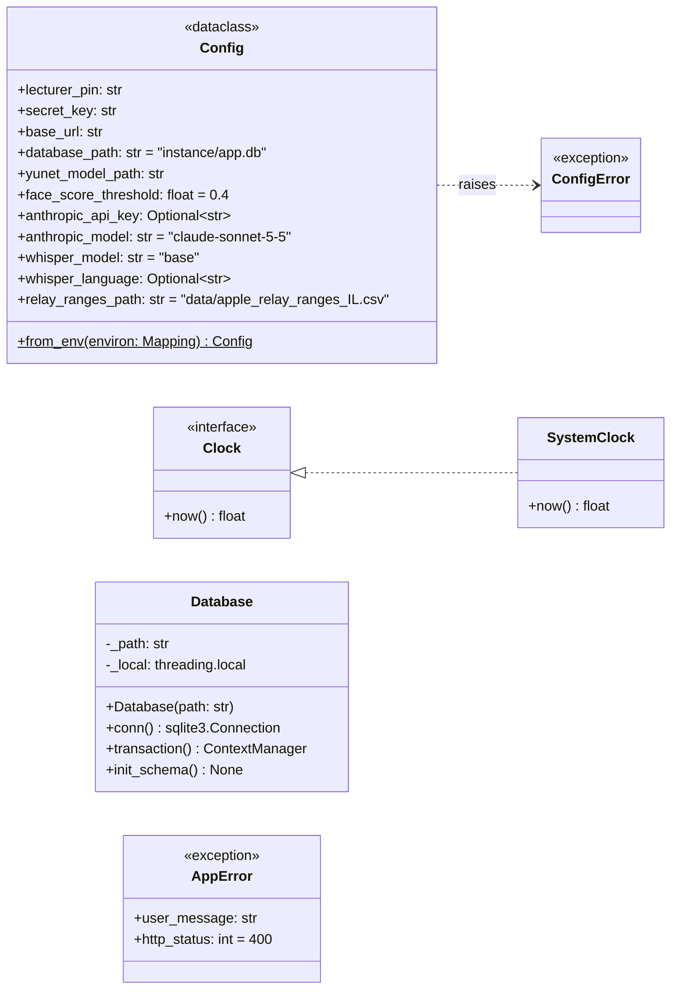

| Class | Responsibility | Public interface | Collaborators | Invariants / errors |
|---|---|---|---|---|
| `Config` | Hold all settings read from env vars (`LECTURER_PIN`, `SECRET_KEY`, `BASE_URL`, `DATABASE_PATH`, `YUNET_MODEL_PATH`, `FACE_SCORE_THRESHOLD`, `ANTHROPIC_API_KEY`, `ANTHROPIC_MODEL`, `WHISPER_MODEL`, `WHISPER_LANGUAGE`, `RELAY_RANGES_PATH` (optional, D32)) | `from_env(environ: Mapping[str, str]) -> Config` | none | PIN, secret key and base URL non-empty, else `ConfigError` at start-up (console only, never shown to users). No secret has a default value (NFR-8). |
| `Clock` (port) | Give the current time | `now() -> float` | - | Reason today: every D30 rule (10 s, 15 s, 5 s, 1 min) is tested with a `FakeClock` (D25). |
| `SystemClock` | Real time | `now() -> float` (`time.time()`) | - | - |
| `Database` | Open one SQLite connection per thread, create the schema, run transactions | `conn() -> sqlite3.Connection`, `transaction() -> ContextManager[sqlite3.Connection]` (`BEGIN IMMEDIATE`, commit or rollback), `init_schema() -> None` | stdlib `sqlite3` | Foreign keys ON, WAL mode, `busy_timeout` 5 s; `schema.sql` is idempotent (`CREATE ... IF NOT EXISTS`). Since D32, `init_schema` then calls a private `_add_column_if_missing("check_in", "network_origin", "TEXT NOT NULL DEFAULT 'campus' CHECK (network_origin IN ('campus', 'apple_relay', 'off_campus'))")` (checks `PRAGMA table_info`, runs `ALTER TABLE ... ADD COLUMN` only if absent), so a database created before T19 keeps its rows (all read as `campus`). Present reason: the existing demo / rehearsal databases. |
| `AppError` | Base of every user-facing error; carries the exact SRS message | attributes `user_message`, `http_status` | Flask error handler | Message never contains an id, token, path or exception name (D23). |

`create_app(config: Config, *, clock: Clock | None = None, head_counter: HeadCounter | None = None,
llm: LLMClient | None = None, fetcher: RepoFetcher | None = None, transcriber: Transcriber | None = None) -> Flask`
is the composition root: it builds `Database`, the repositories, the services and the real adapters for every
argument left `None`, and stores the services in `app.extensions["services"]`. Tests pass fakes. With D32 it also
calls `load_relay_ranges(config.relay_ranges_path)` once and builds **one** `NetworkPolicy(settings, relay_ranges)`,
registered as `services["network"]` and shared by `CheckInService` and the allow-list route.

### 3.3 F1 check-in (D30)

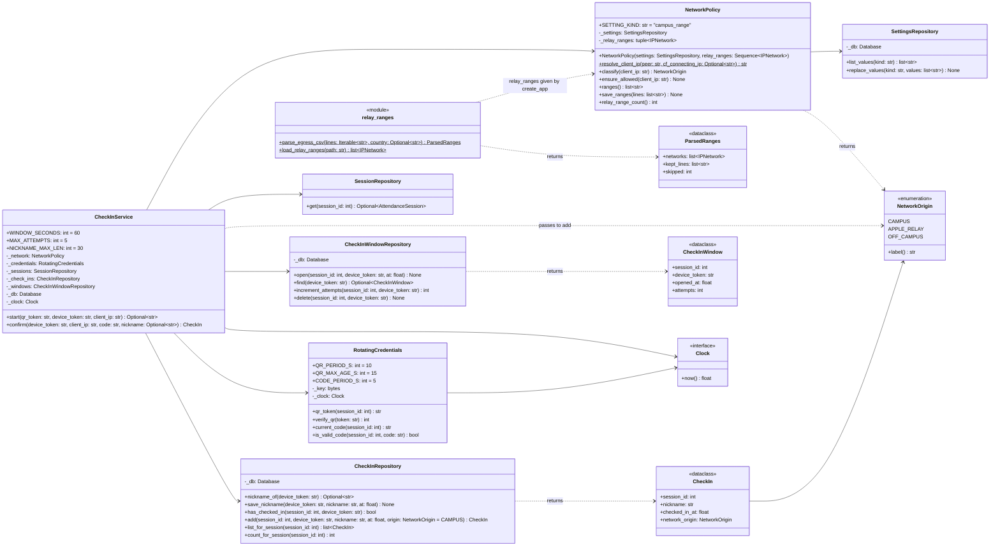

**`NetworkPolicy`** - tells from which network a request comes: the campus, Apple's iCloud Private Relay in Israel,
or elsewhere (FR-1.2-FR-1.4, FR-1.19, D30 point 1 amended by D32). It refuses only when the app is not configured
(empty campus list) or the address is malformed. Constructor `NetworkPolicy(settings, relay_ranges=())`: the relay
ranges are given once by `create_app` (already parsed `ipaddress` networks, kept as a tuple, never edited at
runtime); an empty tuple means "no relay list": relay addresses are then classified `OFF_CAMPUS`.
- `resolve_client_ip(peer, cf_connecting_ip) -> str` (static): returns the header value **only if** `peer` is a
  loopback address (`ipaddress.ip_address(peer).is_loopback`, i.e. the request came through the local `cloudflared`),
  otherwise `peer` (plan B, and spoofing attempts from any other peer). IPv4-mapped IPv6 is normalised. The header
  must be **one** address: a value that does not parse (e.g. a comma-separated list) is returned unchanged and
  `classify` then refuses it (fail closed).
- `classify(client_ip) -> NetworkOrigin` (D32), in this order: loads the campus ranges from `SettingsRepository`
  **at every call** (so an edit is used at once, FR-1.4); if the campus list is **empty**, raises `OffCampusError`
  (app not configured: fail closed, D31, kept by D32 for every origin); parses the address (IPv4-mapped IPv6 such
  as `::ffff:192.114.52.10` becomes IPv4; unparsable -> `OffCampusError`); if it is in a campus range returns
  `CAMPUS` (**campus wins** when a range is in both lists); else if it is in a relay range returns `APPLE_RELAY`;
  else returns `OFF_CAMPUS`. An address is only compared with ranges of its own IP version. These two refusals are
  the only ones left (D32).
- `ensure_allowed(client_ip) -> None`: `classify(client_ip)` with the result ignored; kept for `CheckInService.start`
  (the scan records nothing, so it does not need the origin; it still refuses an unconfigured app or a malformed
  address early) and for the existing T4 tests. **Behaviour change for T4:** an address outside the campus ranges is
  no longer refused (it is `OFF_CAMPUS`); the T4 tests "outside the ranges -> refused" are rewritten accordingly.
- `relay_range_count() -> int`: number of relay ranges loaded (0 = "not loaded"), for the allow-list page.
- `save_ranges(lines)`: strips blank lines, parses each with `ipaddress.ip_network(line, strict=False)`; any
  invalid line (a comment line such as `# campus` is invalid too, there is no comment syntax) raises
  `InvalidNetworkRangeError` and **nothing** is saved, so the stored list is not lost; otherwise stores the
  normalised CIDR strings.
- Invariants: holds network ranges only, never an individual student address (D21); the client IP is a method
  argument and is never stored or logged at INFO level; the relay ranges are read-only after construction; the
  off-campus message (`OffCampusError`) keeps its wording (D32: no change to error messages).

**`NetworkOrigin`** (`str` `Enum`, defined in `app/repositories/checkins.py` next to the `CheckIn` entity it belongs
to, so that a repository never imports a service; `NetworkPolicy` imports it) - values `CAMPUS = "campus"`,
`APPLE_RELAY = "apple_relay"`, `OFF_CAMPUS = "off_campus"`; the value is what is stored in `check_in.network_origin`.
`label() -> str` returns the human wording used by the live table and the export: `"campus"`, `"Apple relay"`,
`"off campus"`. Present reason: three outcomes must be stored, shown and counted (D32); one enum keeps the stored
codes and their wording in one place. A module function `count_origins(check_ins: list[CheckIn]) ->
dict[NetworkOrigin, int]` (same module, every member present, 0 by default) is shared by `SessionService.summary`
and `AttendanceExporter`, so the page and the file count the same way.

**`relay_ranges` module** (`app/adapters/relay_ranges.py`, D32) - reads Apple's Private Relay egress CSV format.
Two pure-ish functions, shared by the app and the update script (one parser, one format):
- `parse_egress_csv(lines: Iterable[str], country: Optional[str]) -> ParsedRanges`: blank lines are ignored; each
  other line is split on `,` and checked in this order: (a) fewer than 2 fields -> **skipped and counted** in
  `skipped`; (b) `country` given and the second field (trimmed, upper-case) differs -> ignored, not counted (so only
  the chosen country is validated: about 250 `ip_network` calls instead of 285k); (c) first field not a valid
  network (`ipaddress.ip_network(field.strip(), strict=False)`) -> skipped and counted; otherwise the network is
  appended to `networks` and the original line (without its line ending) to `kept_lines`.
- `load_relay_ranges(path: str) -> list[IPNetwork]`: reads the file (UTF-8) and returns
  `parse_egress_csv(lines, country=None).networks` (the file was already filtered by the script). **Never raises:**
  a missing or unreadable file logs one WARNING ("Apple relay list not loaded: <path>") and returns `[]`; otherwise
  one INFO line with the number of ranges loaded and of malformed lines skipped (no address of a client is ever
  logged).
- `ParsedRanges` (frozen dataclass): `networks`, `kept_lines`, `skipped`.
- Why module functions and no class: no state, two callers (`create_app`, the script); why in `adapters/`: it reads
  an external data source's format, like the other adapters.

**`scripts/update_relay_ranges.py`** (C12, D32; not imported by the app) - `main(argv: list[str] | None = None,
fetch: Callable[[str], str] = download) -> int`.
- Options: `--country` (default `IL`, two letters, upper-cased), `--output` (default
  `data/apple_relay_ranges_<COUNTRY>.csv`, i.e. the app's default `RELAY_RANGES_PATH` for `IL`; the script does not
  read `.env`).
- `download(url) -> str`: stdlib `urllib.request.urlopen(url, timeout=60)`, reads at most 50 MB (`MAX_BYTES`; the
  file is about 12 MB), decodes UTF-8; any `OSError` / `URLError` / timeout -> message on stderr, exit code 1.
- Then `parse_egress_csv(text.splitlines(), country)`; if no line is kept -> message, exit code 1 and the existing
  output file is **left untouched**; otherwise writes `kept_lines` to `<output>.tmp` in the same directory (parent
  created if needed) and `os.replace` onto the output (atomic); prints "N ranges for <country> (x IPv4, y IPv6),
  k malformed lines skipped" and returns 0. The URL is the constant `APPLE_EGRESS_URL`.
- Imports the parser like `scripts/seed_demo.py` imports the app (`sys.path` insert of the repository root).
- The output is git-ignored (`.gitignore`: `data/apple_relay_ranges_*.csv`): Apple's data is not committed (unknown
  licence, changes over time; same policy as the YuNet model).

**`RotatingCredentials`** - derives and verifies the two time-rotating proofs shown on the projector (FR-1.5,
FR-1.6, FR-1.8). Stateless: nothing is stored, so there is nothing to clean up.
- `qr_token(session_id) -> str`: `created = floor(now / 10) * 10`; payload `"qr|{session_id}|{created}"`; token =
  urlsafe base64 of `payload + HMAC-SHA256(key, payload)[:16]` (code reused from `tools_tests/token_rotation.py`;
  the signature is split **by its fixed length**, never by a separator: bug found in the tools report 2.2). All
  projector polls inside the same 10 s slot get the same token, so the QR image changes exactly every 10 s.
- `verify_qr(token) -> int`: returns the session id; raises `QrExpiredError` if decoding fails, the signature is
  wrong (`hmac.compare_digest`) or `now - created > 15`.
- `current_code(session_id) -> str`: `int.from_bytes(HMAC(key, f"code|{session_id}|{floor(now / 5)}")[:4]) % 1000`,
  zero-padded to 3 digits.
- `is_valid_code(session_id, code) -> bool`: true if `code` equals the code of the current 5 s slot or of the
  previous one (P1); false for anything else, including non-digits.
- Invariant: the key is `Config.secret_key` (env var); domain prefixes `qr|` / `code|` keep the two uses separate.

**`CheckInService`** - applies the D30 check-in rules (FR-1.2, FR-1.6-FR-1.12).
- `start(qr_token, device_token, client_ip) -> Optional[str]` (scan): in this order, `ensure_allowed(client_ip)`;
  `verify_qr`; session exists and is open (`SessionClosedError` otherwise); device not already checked in
  (`AlreadyCheckedInError`); then opens (or replaces) the window `(session, device_token, opened_at=now, attempts=0)`
  and returns the stored nickname, or `None` if the device has none (the page then shows the nickname field, FR-1.10).
- `confirm(device_token, client_ip, code, nickname) -> CheckIn`: first `origin = classify(client_ip)` (outside the
  transaction, like the former `ensure_allowed`); then, inside one `Database.transaction()`, in this order: window found and `now - opened_at <= 60` (`WindowExpiredError`); its session still open
  (`SessionClosedError`); nickname required and valid if none stored: `strip_invisible` (`app/services/text.py`) removes the Unicode
  categories Cc, Cf and Cs and the characters openpyxl refuses, then the text is stripped and must have 1-30
  characters (`EmptyNicknameError`, so a name made only of zero-width characters is refused; not counted as an
  attempt); `increment_attempts` and, if the result is above 5, delete the window and raise `TooManyAttemptsError`
  (the 6th attempt fails even with a right code, FR-1.9); `is_valid_code` (`WrongCodeError`); then save the nickname
  (first time), add the check-in with its `origin` (D32), delete the window.
  The origin recorded is the one of the **confirm** request (the one that creates the record).
- Invariants: at most one check-in per `(session, device_token)` (also a `UNIQUE` constraint, FR-1.12); no check-in
  without a valid QR scan and a valid code (FR-1.18, P3); the client IP is never passed to a repository (FR-1.3).
- `NoOpenSessionError` is raised by the route `GET /checkin` without a token when no session is open.

**Repositories** (all take `Database`; return dataclasses):
- `CheckInRepository`: tables `device` (nickname per device token, D6) and `check_in`. The nickname is saved on the
  first **successful** check-in, so a device that never completed a check-in is asked again (KISS). `add(...,
  origin=NetworkOrigin.CAMPUS)` stores `origin.value` in `network_origin`; `list_for_session` returns it as
  `CheckIn.network_origin` (an enum; the default `CAMPUS` keeps `scripts/seed_demo.py` and existing callers
  unchanged).
- `CheckInWindowRepository`: table `checkin_window`, one row per `(session, device_token)`; `open` replaces an
  existing row (a new scan gives a new 1-minute window with 0 attempts, FR-1.9 "scan the QR again");
  `find(device_token)` returns the most recent window of that device; `increment_attempts` uses
  `UPDATE ... RETURNING attempts`.
- `SettingsRepository`: table `setting_item(kind, value)`; generic list storage for lecturer-edited lists. Two kinds
  only: `"campus_range"` (`NetworkPolicy`) and `"peer_repo"` (`HomeworkReviewer`). One small class instead of two
  near-identical ones.

### 3.4 F1 session, projector, head count, live table and export

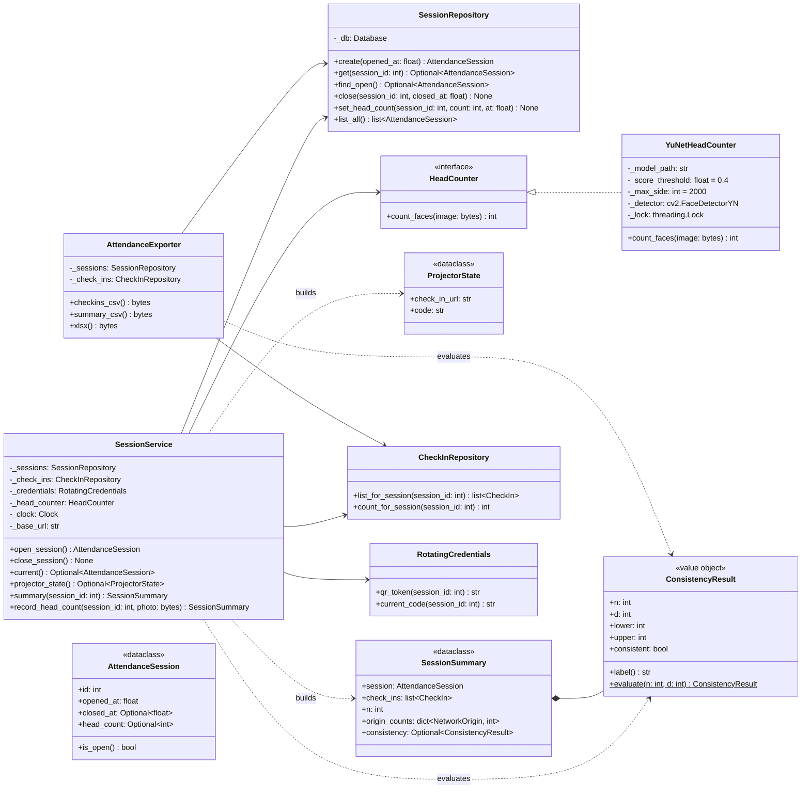

**`SessionService`** - lifecycle of the single attendance session and its summary N / D / status (FR-1.1, FR-1.5,
FR-1.8, FR-1.13-FR-1.17).
- `open_session()`: raises `SessionAlreadyOpenError` if `find_open()` returns a session (D27); the database also has
  a partial unique index (one row with `is_open = 1`).
- `close_session()`: closes the open session (no-op if none). Every later scan / confirm for it fails with
  `SessionClosedError`, and `projector_state()` returns `None`, so the projector shows no QR and no code (FR-1.13).
- `projector_state() -> Optional[ProjectorState]`: `check_in_url = f"{base_url}/c/{qr_token}"` and
  `code = current_code(session_id)`. The QR image itself is drawn by the web layer with `qr_png_data_uri()` so the
  service does not depend on `qrcode`.
- `record_head_count(session_id, photo)`: `head_counter.count_faces(photo)` -> `set_head_count` -> summary. The photo
  `bytes` live only in this call; nothing is written to disk (FR-1.17). A new photo replaces D (OI-5); there is no
  method to set D by hand (FR-1.17).
- Why head count is here and not in its own service: D is one field of the session summary; a separate service
  would only forward one call (no present reason).
- `summary(session_id)` also fills `origin_counts = count_origins(check_ins)` (D32); the attendance JSON exposes it
  as `off_campus_n` and `apple_relay_n`, and the lecturer page shows "N checked in (x off campus, y via Apple
  relay)" above the table. Each row carries `network_origin`; `poll_json.js` adds a **warning-style marker "off
  campus network"** (e.g. bold, warning colour from Pico.css) for `off_campus` and a small discreet marker "Apple
  relay" for `apple_relay`; `campus` rows have none.

**`HeadCounter`** (port) / **`YuNetHeadCounter`** - count faces on an image (FR-1.15, D7). Reason for the port today:
tests use a `FakeHeadCounter` (no model file, no OpenCV), and OpenCV is the heaviest dependency.
- `count_faces(image: bytes) -> int`: first `_check_dimensions` reads only the image header with Pillow and
  raises `UnreadablePhotoError` above 40 megapixels (`MAX_PIXELS = 40_000_000`) or if the header is unreadable,
  **before** any pixel is decoded (decompression-bomb guard); the upload itself is capped at 25 MB (2.1 hardening);
  then `cv2.imdecode` in memory; `UnreadablePhotoError` if it returns `None`; resize
  so the long side is at most 2000 px; `setInputSize`, `setScoreThreshold(0.4)`, `detect` (code reused from
  `tools_tests/head_count.py`). The detector is created lazily once (model load) and protected by a lock (OpenCV
  objects are not thread-safe). Missing model file -> `DetectorUnavailableError`.

**`ConsistencyResult`** - value object for the D7 rule (FR-1.16). `evaluate(n, d)` computes
`lower = n - max(7, ceil(0.15 * n))`, `upper = n + max(4, ceil(0.10 * n))`, `consistent = lower <= d <= upper`;
`label()` returns `"consistent"` or `"anomaly"`. Pure, no dependency: tested exhaustively at its boundaries.

**`valid_row_id(value) -> bool`** (`app/db.py`) - true if `0 <= value <= 2**63 - 1`. `SessionRepository.get` and
`PollRepository.get` return `None` for any other id, exactly like an unknown id, so a huge id in a URL gives the
normal 404 instead of an `OverflowError` (500).

**`AttendanceExporter`** - offline spreadsheet (FR-1.18, D8). Columns of `checkins_csv()`: session date, nickname,
check-in time, **network** (`campus`, `Apple relay` or `off campus`: `CheckIn.network_origin.label()`, D32) (one
row per check-in, all sessions, oldest first). `summary_csv()`: session date, check-ins (N), faces detected (D),
consistency status, **off campus**, **via Apple relay** (counts per session from `count_origins`, D32; appended last
so the existing columns keep their position). `xlsx()`: the same two tables as two sheets "Check-ins" and "Summary"
(`openpyxl`, frozen header row; code reused from `tools_tests/xlsx_roundtrip.py`). No IP and no device token column
(FR-1.3, NFR-7). Every text cell goes through a sanitiser that removes the characters openpyxl cannot write
(`ILLEGAL_CHARACTERS_RE`), so an old row with a control character cannot break the XLSX. File split: OI-6 (validated, D31).

**`qr_png_data_uri(text: str) -> str`** (function in `app/adapters/qr.py`) - draws the QR with `qrcode` as a PNG
(tested path of the tools report 2.3) and returns a `data:image/png;base64,...` URI for the projector JSON. A
function, not a class: it has no state and one caller.

### 3.5 F2 comments and F3 polls

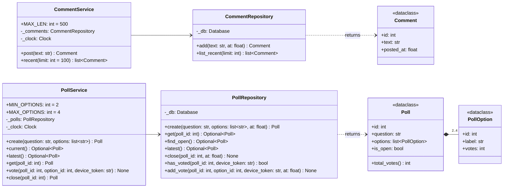

- **`CommentService`** (FR-2.1-FR-2.4, D29): `post` strips the text; empty -> `EmptyCommentError`; longer than 500
  characters -> `CommentTooLongError` (OI-11); stores text and time only. Invariant: the comment table has no
  nickname, device-token or session column, so anonymity holds by construction. "Offline" = asynchronous (D8): no
  session check at all.
- **`PollService`** (FR-3.1-FR-3.4, D9, D28): `create` trims the question and options, drops empty options, then
  requires a non-empty question and 2-4 options (`InvalidPollError`) and no open poll (`PollAlreadyOpenError`, also a
  partial unique index); `vote` raises `PollClosedError` if the poll is closed and `AlreadyVotedError` for a second
  vote of the same device token (also a primary key `(poll_id, device_token)`); no nickname is needed. `latest()`
  keeps the results of a closed poll visible (FR-3.4).

### 3.6 F5 homework review (and the shared LLM port)

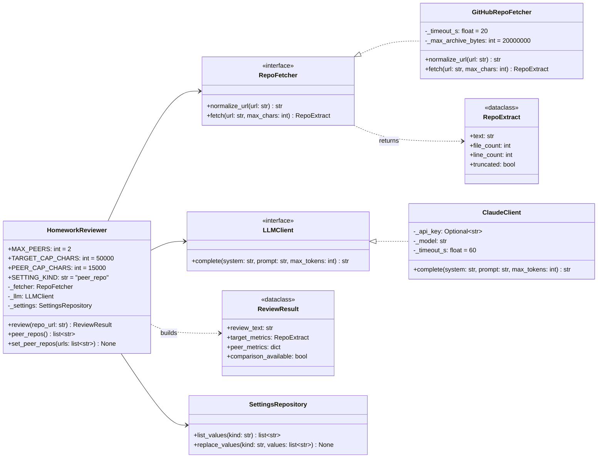

- **`GitHubRepoFetcher`** (FR-5.1, FR-5.2, D11): `normalize_url` accepts only
  `https://github.com/<owner>/<repo>` (optional `.git` or trailing `/`), else `InvalidRepoUrlError`; a non-`str`
  input, a port or a URL with userinfo (`user@github.com`) is rejected too. `fetch`
  downloads `https://codeload.github.com/<owner>/<repo>/zip/HEAD` with stdlib `urllib.request` (no token), reads the
  zip **in memory** (`zipfile`, at most 20 MB), takes the README first, then text source files (`.py .java .js .ts
  .cs .cpp .c .h .md`, skipping `node_modules`, `.git`, `venv`, `build`, `dist`) in path order until `max_chars`;
  counts files and lines of the whole archive. 404 / private / network error / too large -> `RepoUnavailableError`.
  Reason for the port: F5 tests run without network (D25).
- **`ClaudeClient`** (D12): `anthropic.Anthropic(api_key=..., timeout=60).messages.create(model, max_tokens,
  system, messages=[...])` (code reused from `tools_tests/llm_call.py`); returns the text. Missing key (None, empty or
  whitespace-only: the key is stripped), any `anthropic.APIError` or timeout -> `LLMUnavailableError` (the app still starts without a key; F1-F3 unaffected,
  NFR-9). Reason for the port: fakes in tests (no key, no cost, D25); shared by F4 and F5.
- **`HomeworkReviewer`** (FR-5.3-FR-5.5, D11, D31):
  `review(repo_url)`: normalise; fetch the target (cap 50,000 chars); take up to 2 peer URLs from the lecturer list
  (`SettingsRepository`, kind `"peer_repo"`, OI-1), skipping the target itself; fetch each (cap 15,000 chars; a peer
  that fails is skipped); build **one** prompt: a short rubric (purpose and README, structure / OOP design, code
  quality, tests, top 3 improvements) + the target labelled "Submission A" + peers labelled "Submission B",
  "Submission C" + the deterministic metrics; the system prompt forbids naming people or URLs. Before sending and
  after receiving, the owner and repository names of the peers are replaced by their labels (redaction, FR-5.4): case-insensitive, and a name glued to other text by `-`, `_` or `.`
  is masked as well (`alice-utils`), while a name inside a longer run of letters or digits is left alone.
  One `LLMClient.complete` call. If no peer could be fetched, the review is still shown with
  `comparison_available = False` and the sentence "No other submission was available for comparison." (OI-12).
- `ReviewResult` (frozen dataclass): `review_text`, `target_metrics`, `peer_metrics` (keyed by label),
  `comparison_available`; returned by `review` and rendered by `review.html`.
- Invariants: nothing of F5 is stored except the lecturer's peer URL list (local SQLite, git-ignored, D21);
  no pre-computed output exists (D1, D11).

### 3.7 F4 video summary (deferred, D10)

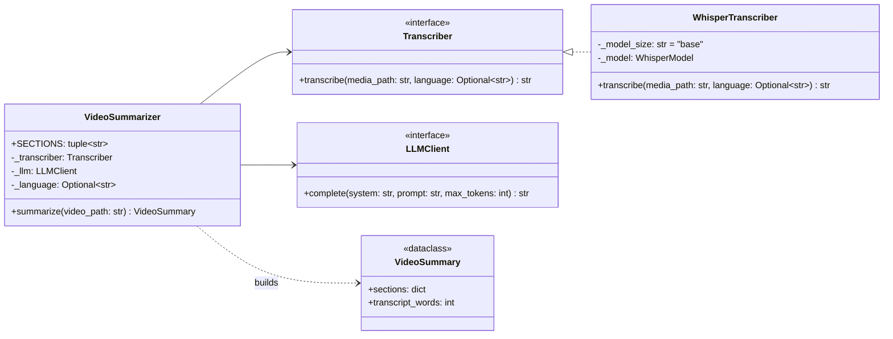

The route saves the upload to a `tempfile` (faster-whisper reads a path), calls `summarize`, and deletes the file in
a `finally` block. `WhisperTranscriber` loads `WhisperModel(size, device="cpu", compute_type="int8")` once and
transcribes with `beam_size=1, vad_filter=True` (code reused from `tools_tests/transcribe.py`; pin `av<17`). A
decoding error -> `UnreadableVideoError`; `LLMUnavailableError` is re-raised with the "summary" wording. The LLM is
asked for the four headings; the text is split on them (if a heading is missing, the whole answer is shown under
"Summary"). Exact clip length and model size: decided at the D10 revisit.

### 3.8 Exceptions (user-facing messages = SRS section 5)

```mermaid
classDiagram
  direction TB
  class AppError {
    <<exception>>
    +user_message: str
    +http_status: int
  }
  class CheckInError {
    <<exception>>
  }
  class SessionAlreadyOpenError
  class InvalidNetworkRangeError
  class PhotoError {
    <<exception>>
  }
  class CommentError {
    <<exception>>
  }
  class PollError {
    <<exception>>
  }
  class ReviewError {
    <<exception>>
  }
  class LLMUnavailableError {
    +feature: str
  }
  class UnreadableVideoError
  class WrongPinError
  AppError <|-- CheckInError
  AppError <|-- SessionAlreadyOpenError
  AppError <|-- InvalidNetworkRangeError
  AppError <|-- PhotoError
  AppError <|-- CommentError
  AppError <|-- PollError
  AppError <|-- ReviewError
  AppError <|-- LLMUnavailableError
  AppError <|-- UnreadableVideoError
  AppError <|-- WrongPinError
  CheckInError <|-- OffCampusError
  CheckInError <|-- QrExpiredError
  CheckInError <|-- WindowExpiredError
  CheckInError <|-- WrongCodeError
  CheckInError <|-- TooManyAttemptsError
  CheckInError <|-- AlreadyCheckedInError
  CheckInError <|-- SessionClosedError
  CheckInError <|-- QrRequiredError
  CheckInError <|-- NoOpenSessionError
  CheckInError <|-- EmptyNicknameError
  PhotoError <|-- UnreadablePhotoError
  PhotoError <|-- DetectorUnavailableError
  CommentError <|-- EmptyCommentError
  CommentError <|-- CommentTooLongError
  PollError <|-- InvalidPollError
  PollError <|-- PollAlreadyOpenError
  PollError <|-- AlreadyVotedError
  PollError <|-- PollClosedError
  ReviewError <|-- InvalidRepoUrlError
  ReviewError <|-- RepoUnavailableError
```

| Exception | Raised by | `user_message` (SRS section 5) | HTTP |
|---|---|---|---|
| `OffCampusError` | `NetworkPolicy.classify` (also via `ensure_allowed`), only when the campus allow-list is empty or the client address is malformed (D32) | Check-in is not available right now. Ask the lecturer. | 403 |
| `QrExpiredError` | `RotatingCredentials.verify_qr` | This QR code has expired. Scan a fresh one. | 400 |
| `WindowExpiredError` | `CheckInService.confirm` | Your check-in time ran out. Scan the QR code again. | 400 |
| `WrongCodeError` | `CheckInService.confirm` | Wrong code. Type the code shown under the QR now. | 400 |
| `TooManyAttemptsError` | `CheckInService.confirm` | Too many tries. Scan the QR code again. | 429 |
| `AlreadyCheckedInError` | `CheckInService.start`, `confirm` | You are already checked in for this class. | 409 |
| `SessionClosedError` | `CheckInService.start`, `confirm` | Attendance for this class is closed. | 409 |
| `QrRequiredError` | check-in route without token, session open | Scan the QR code on the projector. | 400 |
| `NoOpenSessionError` | check-in route without token | There is no attendance check-in right now. | 404 |
| `EmptyNicknameError` | `CheckInService.confirm` | Please choose a nickname (not your real name or ID). | 400 |
| `SessionAlreadyOpenError` | `SessionService.open_session` | A session is already open. Close it first. | 409 |
| `InvalidNetworkRangeError` | `NetworkPolicy.save_ranges` | This is not a valid network range (e.g. 192.0.2.0/24). | 400 |
| `UnreadablePhotoError` | `YuNetHeadCounter.count_faces` | We could not read this photo. Please try another one. | 400 |
| `DetectorUnavailableError` | `YuNetHeadCounter.count_faces` | Head count is not available right now. | 503 |
| `EmptyCommentError` | `CommentService.post` | Please write something before sending. | 400 |
| `CommentTooLongError` | `CommentService.post` | Please keep your comment under 500 characters. (OI-11, D31) | 400 |
| `InvalidPollError` | `PollService.create` | A poll needs a question and 2 to 4 options. | 400 |
| `PollAlreadyOpenError` | `PollService.create` | A poll is already open. Close it first. | 409 |
| `AlreadyVotedError` | `PollService.vote` | You have already voted. | 409 |
| `PollClosedError` | `PollService.vote` | This poll is closed. | 409 |
| `InvalidRepoUrlError` | `GitHubRepoFetcher.normalize_url` | Please enter a public GitHub repository link. | 400 |
| `RepoUnavailableError` | `GitHubRepoFetcher.fetch` | We could not download this repository. Is it public? | 400 |
| `LLMUnavailableError` | `ClaudeClient.complete` | The review service is unavailable right now. Please try again later. ("summary" for F4) | 503 |
| `UnreadableVideoError` | `WhisperTranscriber.transcribe` | We could not read this video file. | 400 |
| `WrongPinError` | lecturer login route | Wrong PIN. | 401 |
| (any other exception) | anywhere | Something went wrong. Please try again. | 500 |

`ConfigError` is not an `AppError`: it stops the start-up with a console message and is never shown to a user.

## 4. Sequence diagrams

Participant names are the classes and blueprints of section 3. Error exits are `alt` blocks whose first branch is
the failure (the request ends there with the SRS message) and whose `else` branch continues the main path.

### SD-1 Lecturer opens a session; projector polling (UC-1, UC-14; FR-1.1, FR-1.5, FR-1.8, FR-6.1)

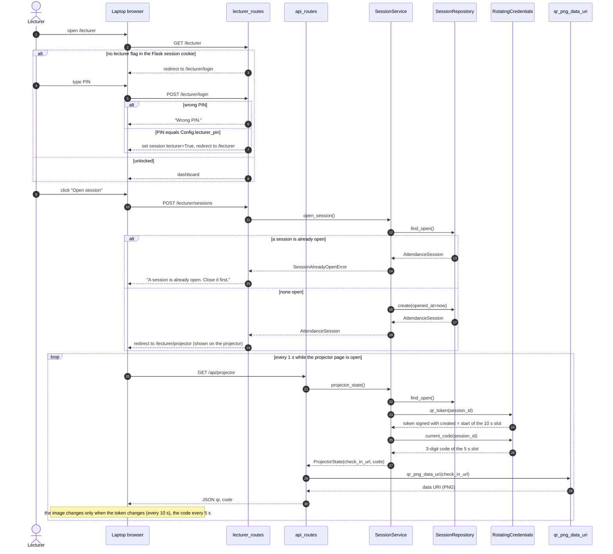

### SD-2 Student first check-in, full D30 path with the D32 network origin (UC-2; FR-1.2-FR-1.12, FR-1.19)

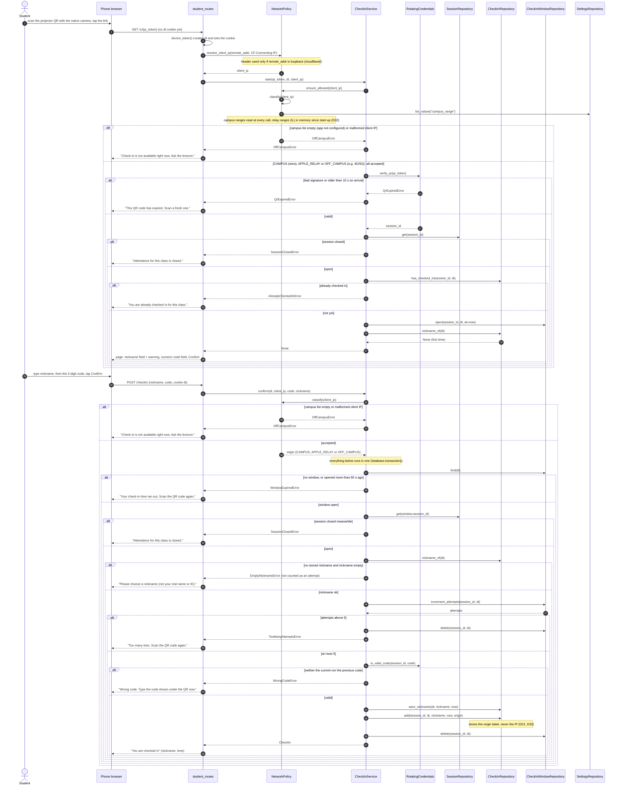

### SD-3 Returning student check-in (UC-2 alternative 4a; FR-1.10)

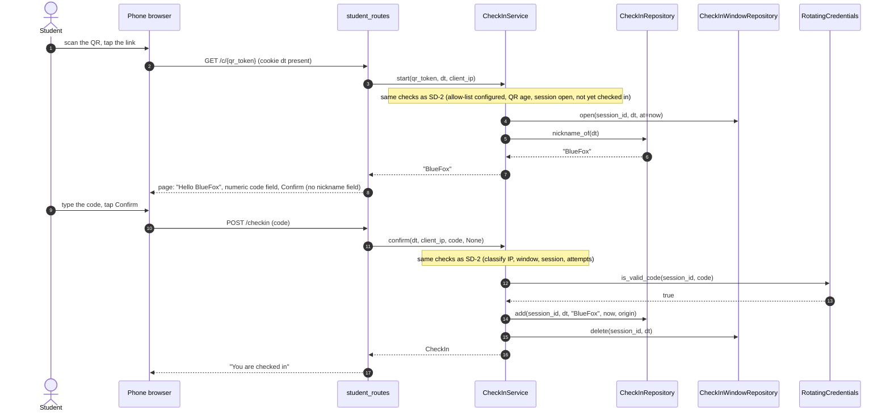

### SD-4 Photo head count and consistency alert (UC-4; FR-1.15-FR-1.17)

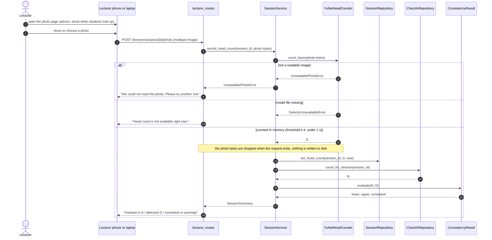

### SD-5 Live table and spreadsheet export (UC-5; FR-1.14, FR-1.18)

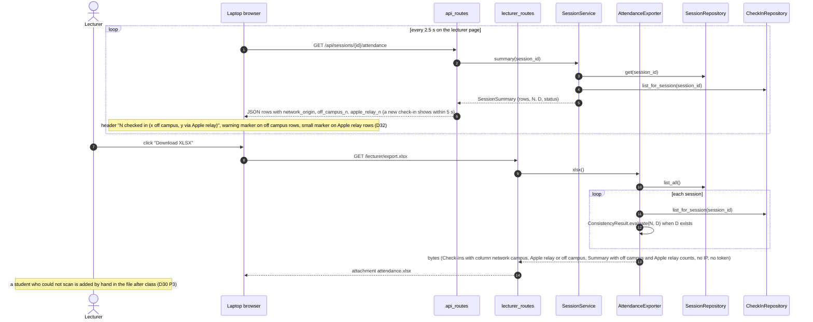

### SD-6 Campus allow-list edit (UC-6; FR-1.4)

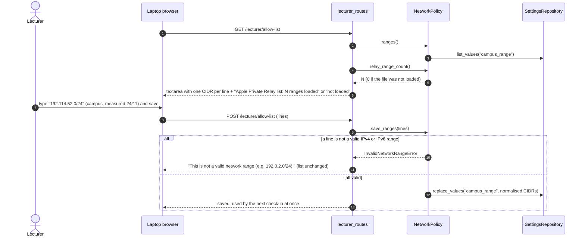

### SD-11 Apple relay range list: update before class, load at start-up (D32; FR-1.19)

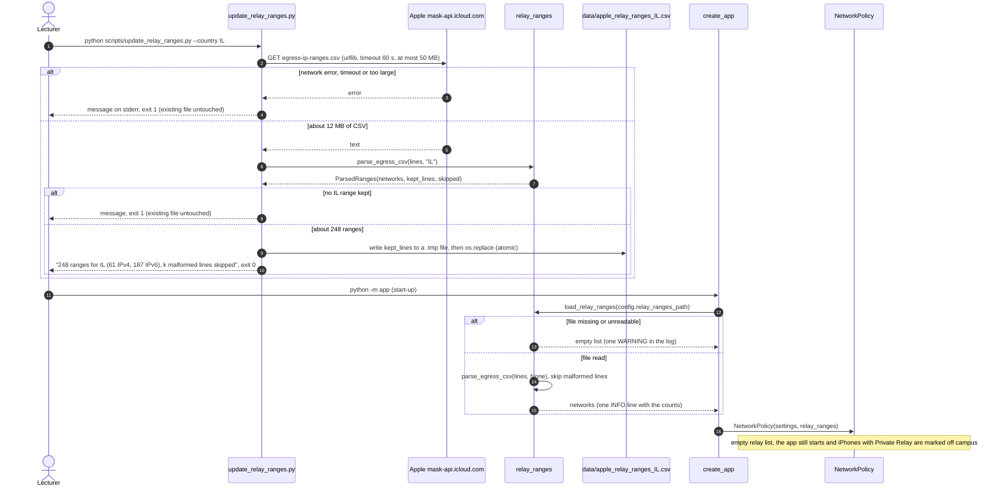

### SD-7 F3 poll: create, vote, live results, close (UC-9, UC-10, UC-11; FR-3.1-FR-3.4)

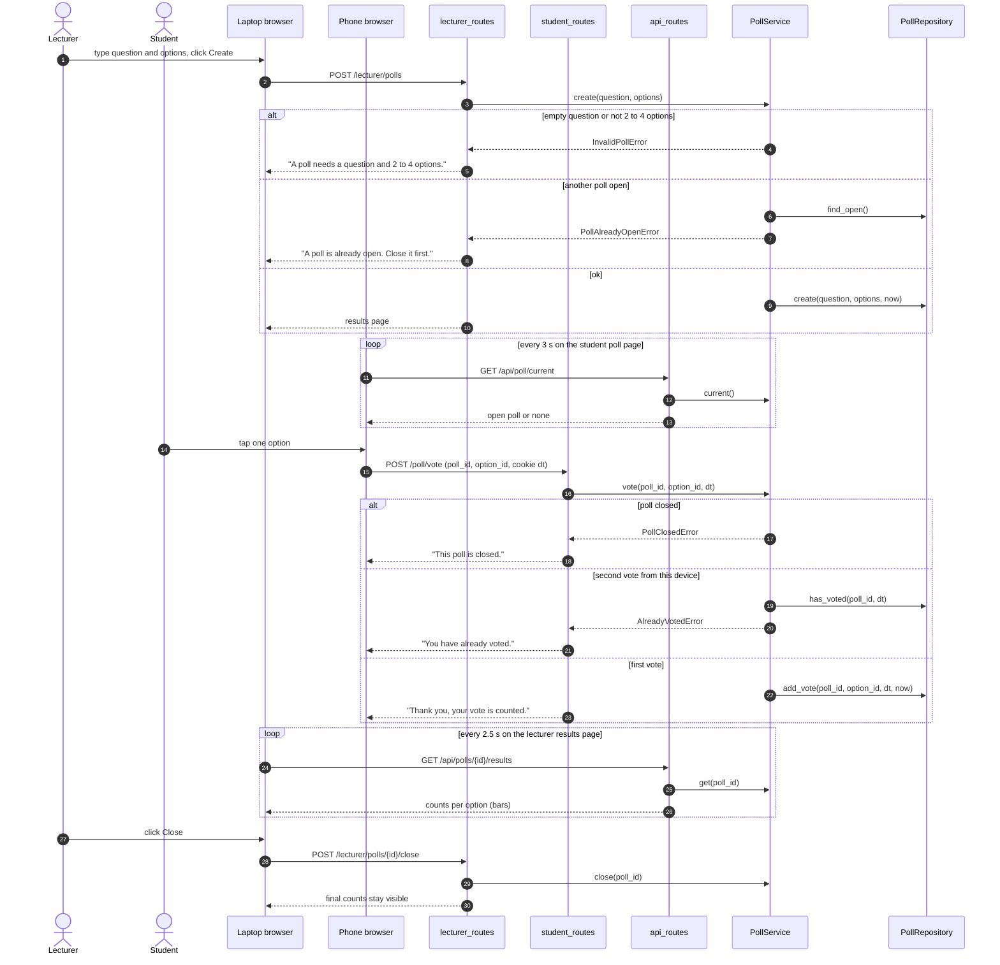

### SD-8 F2 comment, live and after class (UC-7, UC-8; FR-2.1-FR-2.4)

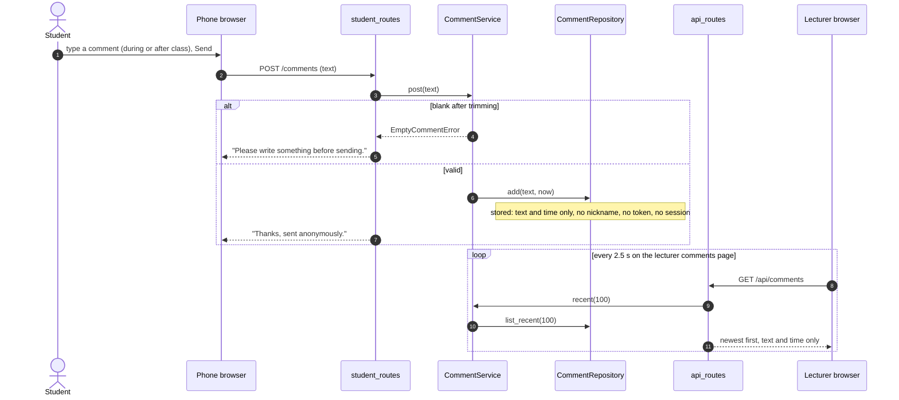

### SD-9 F5 homework review with anonymised comparison (UC-13; FR-5.1-FR-5.5)

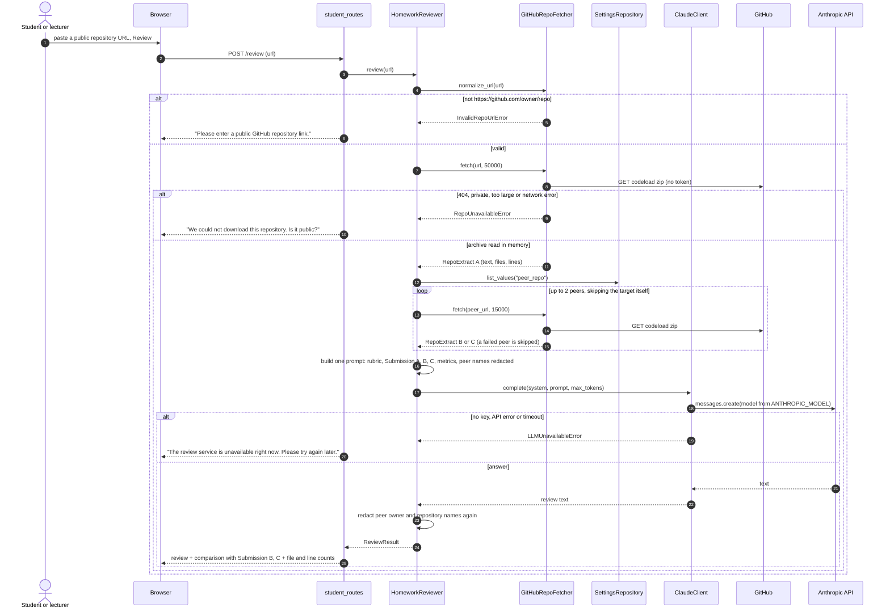

### SD-10 F4 video summary (UC-12; FR-4.1-FR-4.4) - DEFERRED (D10), not implemented before the D10 revisit

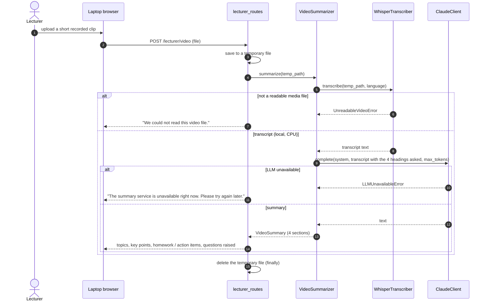

## 5. Data model (SQLite, D3)

One file `instance/app.db` (git-ignored). **No column holds a name, ID, e-mail, IP address, photo or video**
(R16, D21, FR-1.3, FR-1.17). The device token is a random value with no link to a person (D6).

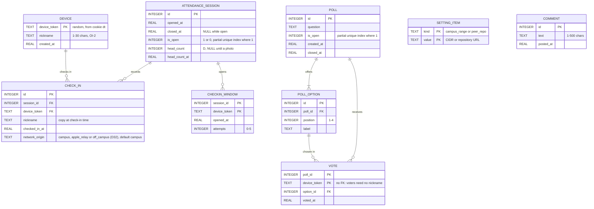

Constraints that back the business rules (defence in depth, the services check first):

| Rule | Constraint |
|---|---|
| One open session (D27) | `CREATE UNIQUE INDEX one_open_session ON attendance_session(is_open) WHERE is_open = 1` |
| One check-in per device per session (FR-1.12) | `UNIQUE(session_id, device_token)` on `check_in` |
| One window per device per session | primary key `(session_id, device_token)` on `checkin_window` |
| One open poll (D28) | `CREATE UNIQUE INDEX one_open_poll ON poll(is_open) WHERE is_open = 1` |
| One vote per device per poll (D28) | primary key `(poll_id, device_token)` on `vote` |
| No duplicate allow-list entry | primary key `(kind, value)` on `setting_item` |

Expired windows are harmless (checked by age) and are deleted on success, on too many attempts, or replaced by the
next scan; no clean-up job is needed. The check-in code and QR token are never stored (derived by HMAC).

**Schema change for D32.** `schema.sql` declares `network_origin TEXT NOT NULL DEFAULT 'campus' CHECK
(network_origin IN ('campus', 'apple_relay', 'off_campus'))` in `check_in` (new databases). An existing database
(created before T19) gets the same column at start-up from `Database.init_schema` (`ALTER TABLE check_in ADD COLUMN
...` with the same definition, when `PRAGMA table_info(check_in)` lacks it), so its old rows read as `campus`
(correct: before D32 every stored check-in had passed the campus filter). The Apple relay ranges are **not** in the
database: they are static data read from the git-ignored file at start-up (a lecturer cannot edit them).

## 6. Principles, patterns and decisions

### 6.1 Principles applied

| Principle | Where | One-line justification |
|---|---|---|
| Single responsibility | One class per rule set: `NetworkPolicy` (where from), `RotatingCredentials` (what proves presence), `CheckInService` (order of the D30 rules), repositories (SQL only), exporter (file formats) | Each D30 rule can be tested and changed alone (D25). |
| Open/closed (where it pays) | Ports `HeadCounter`, `LLMClient`, `RepoFetcher`, `Transcriber` | A detector or LLM provider can be swapped without touching the services (D7 threshold, D12 model by env var). |
| Liskov | Every fake in `tests/fakes.py` honours the same contract and raises the same `AppError` subclasses | Services are tested exactly as they run. |
| Interface segregation | Ports have one or two methods | Fakes stay a few lines long. |
| Dependency inversion | Services receive ports and repositories in their constructor; `create_app()` is the only place that names concrete classes | Tests inject `FakeClock`, fakes and a temporary database (NFR-12). |
| Encapsulation | Repositories return frozen dataclasses, never cursors; services expose no SQL and no library object; constants (60 s, 5 attempts, 15 s) live in the class that enforces them | Callers cannot bypass a rule or depend on the storage. |
| Composition over inheritance | Services are composed of repositories and ports; inheritance is used only for exceptions and for port realisations | No class hierarchy to maintain. |
| Fail closed | Empty allow-list refuses all (every origin, D32); malformed client IP refused; any token/code doubt refuses; a malformed relay line is skipped, never widened | Security rules of NFR-8. |
| Inform rather than block (D32) | Off-campus and relay check-ins accepted but labelled, live and in the export | A flaky campus Wi-Fi must not lock present students out; the lecturer keeps the information. |
| Degrade, do not crash (D32) | Missing relay file -> relay phones labelled off campus, app starts | The class demo must not depend on a file downloaded from Apple (NFR-9). |
| KISS / YAGNI | No ORM, no DI container, no event bus, no job queue, no generic base repository | R17 and the Ex1 lesson. |

### 6.2 Patterns used and why (each with its present reason)

| Pattern | Applied to | Present reason | Trace |
|---|---|---|---|
| Layered architecture (thin controllers) | web -> services -> repositories | Business rules tested without HTTP; routes stay a few lines | R17, D25 |
| Repository | 6 repository classes | SQL isolated as decided; schema changes stay local | D3 |
| Ports and Adapters | `HeadCounter`, `LLMClient`, `RepoFetcher`, `Transcriber` | Tests run offline, without key, model or network | D7, D12, D25 |
| Injected clock (Strategy for time) | `Clock` / `SystemClock` / `FakeClock` | The 10 s / 15 s / 5 s / 1 min rules are tested without sleeping | D25, D30 |
| Application factory + constructor injection | `create_app(config, ...)` | One composition root; tests build an app with fakes | D25 |
| Value object | `ConsistencyResult`, `ProjectorState`, dataclasses | Immutable results are easy to compare in tests | D7 |
| Exception translation | `AppError` family + one Flask handler | Exact SRS messages, no internal detail leaks | D23 |
| Stateless derived secrets (HMAC of a time slot) | `RotatingCredentials` | Nothing to store, rotate or clean up; same code on every poll | D30, tools report 2.2 |

### 6.3 Rejected alternatives

| Alternative | Why rejected |
|---|---|
| ORM (SQLAlchemy) | D3: stdlib `sqlite3` with repositories; a dependency with no gain for 9 tables. |
| WebSockets / SSE | D4: polling; SSE is not supported by the quick tunnel (tools report 2.9). |
| `itsdangerous` for the QR token | Equally tested (tools report 2.2), but the stdlib version gives explicit control of the creation time; kept as fallback. |
| Storing the rotating code / token in the database | Derivable by HMAC from the time slot; storage would need clean-up. |
| Keeping windows in a Python dict | Lost on restart, not shared safely between threads; SQLite already gives atomic updates. |
| Werkzeug `ProxyFix` / `X-Forwarded-For` | Would trust a header from any peer; D30 trusts only `CF-Connecting-IP` from loopback. |
| Separate `HeadCountService`, `DeviceRepository`, `AllowListRepository` + `PeerRepoRepository` | Each would only forward calls; merged into `SessionService`, `CheckInRepository` and `SettingsRepository`. |
| Background job queue (Celery, threads) for F4/F5 | The calls fit in a request (F5 about 5-30 s; F4 runs on `localhost`); a queue adds failure modes live. |
| In-page QR scanner (jsQR) | D30 / tools report 2.4: HTTPS and permission prompt; the native camera does it with zero code. |
| Generic `BaseRepository` / abstract service classes | No second implementation exists; would be speculative (R17). |
| SVG QR without Pillow | Not the tested path (the tools report tested PNG). |
| Apple relay ranges stored in `setting_item` and edited on the allow-list page (D32) | 248 static ranges the lecturer never edits; mixing them with the campus list would hide which path accepted a check-in (the label needs two sets). |
| Boolean flags `via_relay` + `off_campus` (D32) | Two booleans allow an impossible state (both true); one enum column with a `CHECK` cannot. |
| Browser geolocation for non-campus IPs (D32) | Location is personal data (R16, D5); permission prompt; unreliable indoors. |
| Committing Apple's CSV, or downloading it at each app start (D32) | Unknown licence and changing data (same policy as the YuNet model); a start-up download would make the demo depend on Apple's server. A manual script + git-ignored file instead. |
| Filtering the relay list by region or city (D32) | Measured unreliable: 178 IL rows have no region, Ariel never appears, the relay at Ariel is labelled Tel Aviv. Country only. |
| A `RelayRangeRepository` / `RelayRangeProvider` class (D32) | No state beyond a list read once; two module functions are enough. |
| Storing the client IP or the relay range matched (D32) | D21: only the origin label is needed to tell the lecturer. |

## 7. Implementation tasks (T1-T19)

Status: **T1-T17 done** (`pytest` green); **T18 deferred** (D10); **T19 to do** (D32, added 24/11 after the on-site
measurement; F1, so it goes before any other remaining work).

Order: F1 first and complete (R4, D1), then F3 > F2 > F5 > F4 (D1). Every task ends with `pytest` green and a
commit (D24). Tests use the Flask test client, a temporary SQLite file, `FakeClock` and fakes (D25). T1-T2 give a
runnable skeleton.

| T | Goal | Files | Interface delivered | Acceptance tests (done when) | Trace |
|---|---|---|---|---|---|
| **T1** | Runnable skeleton | `app/__init__.py` (`create_app`), `app/__main__.py`, `app/config.py`, `app/clock.py`, `app/errors.py`, `app/templates/base.html`, `app/static/pico.min.css` (vendored, MIT), `requirements.txt` (pinned, `av<17`), `.env.example`, `tests/conftest.py`, `tests/fakes.py` (`FakeClock`) | `Config.from_env`, `Clock`, `SystemClock`, `AppError` family (all classes of 3.8), `create_app(config, **fakes)`, `GET /ping`, error handler | `python -m app` serves `/ping` 200; missing `LECTURER_PIN` / `SECRET_KEY` / `BASE_URL` -> `ConfigError`; an `AppError` raised in a test route renders its `user_message` and status; an unexpected exception renders "Something went wrong. Please try again." with no traceback in the body | FR-6.3, NFR-8, NFR-10, D2, D23 |
| **T2** | Storage for F1 | `app/db.py`, `app/schema.sql`, `app/repositories/sessions.py`, `checkins.py`, `windows.py`, `settings.py` | `Database`, `SessionRepository`, `CheckInRepository`, `CheckInWindowRepository`, `SettingsRepository`, dataclasses `AttendanceSession`, `CheckIn`, `CheckInWindow` | CRUD round-trips; second open session violates the partial index; duplicate `(session, device)` check-in violates `UNIQUE`; `increment_attempts` returns 1, 2, ...; schema introspection: no column named like `ip`, `name`, `email` | FR-1.3, FR-1.11, FR-1.12, D3, D21, D27 |
| **T3** | Rotating QR token and code | `app/services/credentials.py` | `RotatingCredentials` | (FakeClock) token at t and t+10 differ, same within a slot; accepted at age 15 s, rejected at 15.001 s; tampered token rejected; 2,000 random tokens verify (regression of tools report 2.2); current and previous code accepted, the one before and a wrong / non-digit code rejected; code always 3 digits | FR-1.5, FR-1.6, FR-1.8, D30 P1 |
| **T4** | Campus network filter | `app/services/network.py` | `NetworkPolicy` | IPv4 and IPv6 inside / outside the ranges; IPv4-mapped IPv6 normalised; header honoured from `127.0.0.1` and `::1`, ignored from any other peer; invalid line -> `InvalidNetworkRangeError` and list unchanged; empty list refuses all; an edit is used at once | FR-1.2, FR-1.3, FR-1.4, D13, D30 |
| **T5** | Lecturer PIN, open / close session | `app/web/auth.py`, `app/web/lecturer_routes.py`, `app/services/sessions.py` (open, close, current), templates `login.html`, `lecturer.html` | `lecturer_required`, `SessionService.open_session`, `close_session`, `current` | Lecturer pages redirect without PIN; wrong PIN -> "Wrong PIN."; open works; second open -> "A session is already open. Close it first."; close then open again works | FR-1.1, FR-1.13, FR-6.1, UC-1, UC-3, UC-14, D22, D27 |
| **T6** | Projector page | `app/adapters/qr.py`, `app/web/api_routes.py` (`/api/projector`), `app/static/projector.js`, `projector.html`; `SessionService.projector_state` | `qr_png_data_uri`, `GET /api/projector` | JSON has a decodable PNG QR whose URL starts with `BASE_URL` and a 3-digit code; with FakeClock the QR changes after 10 s and the code after 5 s; closed session -> no QR, no code; no page requests camera access | FR-1.5, FR-1.8, FR-1.13, FR-6.3, UC-1 |
| **T7** | Check-in rules (domain, no web) | `app/services/checkin.py` | `CheckInService.start`, `confirm` | One test per error of SD-2 (off-campus, expired / tampered QR, closed session, already checked in, window at 60 s accepted and 60.001 s rejected, other device token rejected, empty nickname, wrong code, 6th attempt rejected even when right); success records one check-in and deletes the window; returning device returns its nickname; an abandoned window creates no record | FR-1.6-FR-1.12, UC-2, D6, D30 P1-P2 |
| **T8** | Student check-in pages | `app/web/device.py` (`device_token`, `client_ip`), `app/web/student_routes.py` (`/`, `/c/<token>`, `/checkin`), templates `checkin.html`, `checked_in.html`, `message.html` | Routes of 2.1 | End-to-end with the test client (REMOTE_ADDR and header injected): first visit shows nickname field + warning + `inputmode="numeric"` field; second visit shows no nickname field; every SRS check-in message appears verbatim; cookie `dt` is HttpOnly; `/checkin` with no open session shows "There is no attendance check-in right now." | FR-1.2, FR-1.7, FR-1.10, FR-6.2, NFR-1, NFR-4, UC-2 |
| **T9** | Allow-list editor | `lecturer_routes.py` (`/lecturer/allow-list`), `allow_list.html` | Route of SD-6 | Valid IPv4 + IPv6 saved and used at once by `/c/<token>`; invalid line shows the message and keeps the list; page warns when the list is empty; unreachable without PIN | FR-1.4, UC-6 |
| **T10** | Live attendance table | `api_routes.py` (`/api/sessions/<id>/attendance`), `app/static/poll_json.js`, `lecturer.html`; `SessionService.summary` | `SessionSummary` JSON | After a check-in, the JSON lists it with N + 1; an open window without a correct code does not change N | FR-1.14, NFR-2, UC-5 |
| **T11** | Photo head count + alert | `app/adapters/head_counter.py`, `app/services/consistency.py`, `SessionService.record_head_count`, `photo.html`; `tests/fakes.py` (`FakeHeadCounter`) | `HeadCounter`, `YuNetHeadCounter`, `ConsistencyResult` | Alert boundaries N = 45: D = 37 anomaly, 38 / 50 consistent, 51 anomaly; N = 10: 2 anomaly, 3 / 14 consistent, 15 anomaly; N = 0 cases; unreadable bytes -> message; missing model -> message; no file written (check upload / temp dirs); default threshold 0.4; real YuNet on a non-personal test image within the D25 tolerance (skipped if the model file is absent), timed under 1 s | FR-1.15-FR-1.17, NFR-3, UC-4, D7 |
| **T12** | Export CSV / XLSX | `app/services/export.py`, routes in `lecturer_routes.py` | `AttendanceExporter.checkins_csv`, `summary_csv`, `xlsx` | Files re-read with `csv` / `openpyxl` equal the live table and summary; header has no IP or token column; summary status equals the page | FR-1.18, UC-5, D8 |
| **T13** | F3 polls | `app/repositories/polls.py`, `app/services/polls.py`, routes, `poll.html`, `lecturer_poll.html` | `PollRepository`, `PollService` | 2 and 4 options accepted, 1 and 5 or empty question rejected; second open poll rejected; second vote rejected and not counted; vote without nickname works; vote after close rejected, counts unchanged; results JSON reflects a vote | FR-3.1-FR-3.4, UC-9-UC-11, D9, D28 |
| **T14** | F2 comments | `app/repositories/comments.py`, `app/services/comments.py`, routes, `comments.html`, `lecturer_comments.html` | `CommentRepository`, `CommentService` | Blank comment rejected; 501 characters rejected, 500 accepted; comment posted with no session stored; stored row has only text and time; listed newest first; still listed after re-creating the app on the same DB file | FR-2.1-FR-2.4, UC-7, UC-8, D29 |
| **T15** | LLM port | `app/adapters/llm.py`; `tests/fakes.py` (`FakeLLMClient`) | `LLMClient`, `ClaudeClient` | No key -> `LLMUnavailableError`; SDK error (mocked) -> `LLMUnavailableError`; one real call with the default model `claude-sonnet-5-5` run once by hand to confirm D12 (not in the automated suite) | D12, FR-5.3, FR-4.4 |
| **T16** | Repository fetcher | `app/adapters/repo_fetcher.py`; `FakeRepoFetcher` | `RepoFetcher`, `GitHubRepoFetcher` | URL validation table (valid, `.git`, trailing slash, non-GitHub, missing repo part); extraction tested on an in-memory zip built in the test (cap respected, README first, vendored dirs skipped, counts right); one manual real download of a public repository, recorded in the tools report (R25) | FR-5.1, FR-5.2, D11 |
| **T17** | Homework review + peer list | `app/services/homework.py`, routes `/review`, `/lecturer/peers`, `review.html`, `peers.html` | `HomeworkReviewer` | With fakes: prompt contains Submission A / B / C and metrics; peer owner and repository names absent from prompt and output; target excluded from peers; failed peer skipped; no peer -> "No other submission was available for comparison."; LLM failure -> message; nothing stored; `/lecturer/peers` needs the PIN | FR-5.3-FR-5.5, UC-13, D11, D31 |
| **T18** | F4 video summary (**only after the D10 revisit**) | `app/adapters/transcriber.py`, `app/services/video.py`, route `/lecturer/video`; `FakeTranscriber` | `Transcriber`, `WhisperTranscriber`, `VideoSummarizer` | With fakes: four sections displayed; temporary file deleted also on error; unreadable file -> message; no key -> message; no network call carries the video | FR-4.1-FR-4.4, UC-12, D10 |
| **T19** | Network origin of each check-in: campus / Apple relay (IL) / off campus, all accepted and labelled | `app/adapters/relay_ranges.py` (new), `app/services/network.py`, `app/services/checkin.py`, `app/services/sessions.py`, `app/repositories/checkins.py`, `app/schema.sql`, `app/db.py`, `app/config.py`, `app/__init__.py`, `app/web/lecturer_routes.py`, `app/web/api_routes.py`, `app/services/export.py`, `app/static/poll_json.js`, `app/templates/lecturer.html`, `app/templates/allow_list.html`, `scripts/update_relay_ranges.py` (new), `.env.example`, `.gitignore`, README "How to run" (one line: run the script before class), tests `tests/test_relay_ranges.py`, `tests/test_update_relay_ranges.py` (new) + updates of the T4, T7, T8, T10, T12 tests | `parse_egress_csv`, `load_relay_ranges`, `ParsedRanges`, `NetworkOrigin` (+ `label`), `count_origins`, `NetworkPolicy(settings, relay_ranges)`, `.classify`, `.relay_range_count`, `CheckIn.network_origin`, `CheckInRepository.add(..., origin)`, `SessionSummary.origin_counts`, `Config.relay_ranges_path`, `services["network"]`, script `main(argv, fetch)` | See the T19 acceptance list below | FR-1.2, FR-1.3, FR-1.14, FR-1.18, FR-1.19, D21, D30, D31, D32 |

**T19 acceptance tests** (all offline: no test touches the network; IPs from the documentation ranges
`192.0.2.0/24`, `198.51.100.0/24`, `2001:db8::/32` plus the measured campus `192.114.52.0/24`):

1. *Relay matching, IPv4 boundaries* (`NetworkPolicy` with campus `192.114.52.0/24` and relay `198.51.100.0/25`):
   `198.51.100.0` and `198.51.100.127` -> `APPLE_RELAY`; `198.51.100.128` and `198.51.99.255` -> `OFF_CAMPUS`
   (accepted, not refused).
2. *Relay matching, IPv6 boundaries* (relay `2001:db8:4000::/64`): `2001:db8:4000::` and
   `2001:db8:4000:0:ffff:ffff:ffff:ffff` -> `APPLE_RELAY`; `2001:db8:4000:1::` and `2001:db8:3fff:ffff:ffff:ffff:ffff:ffff`
   -> `OFF_CAMPUS`. The address really seen on campus, `2a02:26f7:df88:4000:6000::`, is `APPLE_RELAY` with relay
   `2a02:26f7:df88:4000::/64`.
3. *IPv4-mapped IPv6*: `::ffff:198.51.100.5` -> `APPLE_RELAY`; `::ffff:192.114.52.10` -> `CAMPUS`; an IPv4 address
   never matches an IPv6 range and vice versa (no exception).
4. *Overlap*: an address in both a campus range and a relay range -> `CAMPUS` (no marker).
5. *Campus boundaries*: `192.114.52.0`, `192.114.52.6`, `192.114.52.10`, `192.114.52.255` -> `CAMPUS`;
   `192.114.51.255` and `192.114.53.0` -> `OFF_CAMPUS`.
6. *Off campus accepted*: an IPv4 (`192.0.2.7`) and an IPv6 (`2001:db8:1::7`) address in no list -> `OFF_CAMPUS`;
   `ensure_allowed` does **not** raise for them.
7. *Empty campus list*: a campus-like, a relay and an off-campus address are **all refused** with `OffCampusError`
   (D31 fail closed kept by D32), and through the routes they create no window and no row.
8. *Malformed client IP* (campus list not empty): `classify("not-an-ip")`, `classify("")`,
   `classify("1.2.3.4, 5.6.7.8")` -> `OffCampusError`; through the routes, a malformed `CF-Connecting-IP` from a
   loopback peer is refused with the off-campus message.
   - (8b) *No relay list*: `NetworkPolicy(settings)` (no relay ranges): `2a02:26f7:df88:4000:6000::` ->
     `OFF_CAMPUS`; `relay_range_count() == 0`. The pre-T19 T4 tests "outside the ranges -> refused" are rewritten
     to expect `OFF_CAMPUS`; the other T4 tests stay green unchanged.
   - (8c) *`NetworkOrigin`*: stored values `campus`, `apple_relay`, `off_campus`; `label()` gives `campus`,
     `Apple relay`, `off campus`; `count_origins([])` has the three members at 0.
9. *Parser* (`parse_egress_csv`), on an in-test list of lines: valid IPv4 and IPv6 rows kept with `country="IL"`;
   a `FR` row (even a malformed one) ignored and **not** counted as skipped; rows `garbage`, `999.1.1.0/24,IL,,,`,
   `2a02:zz::/64,IL,,,` and a lone `,IL,,,` counted in `skipped`; blank lines ignored; country compared
   case-insensitively and trimmed (`il`, ` IL `); a row with host bits (`198.51.100.1/24,IL,,,`) is normalised to
   `198.51.100.0/24`; with `country=None` every valid row is kept whatever its country and a header-like
   `range,country,region,city` is counted in `skipped`; `kept_lines` equal the original kept lines.
10. *Loader* (`load_relay_ranges`): missing path -> `[]`, no exception, one WARNING logged; a directory path or
    non-UTF-8 bytes -> `[]`, no exception; a file with 3 valid and 2 malformed lines -> 3 networks; the log never
    contains a client address (only counts and the file path).
11. *Start-up*: `create_app` with `RELAY_RANGES_PATH` pointing to a missing file starts and serves `/ping`; with a
    temporary relay file, `services["network"].relay_range_count()` equals its valid line count, and the same
    instance is used by `CheckInService` (a relay IP checks in through the routes and is labelled `apple_relay`).
12. *End-to-end origin* (Flask test client, `REMOTE_ADDR=127.0.0.1` + `CF-Connecting-IP`): three devices check in
    from a campus, a relay and an off-campus address and the rows store `campus`, `apple_relay`, `off_campus`; the
    student sees the same success page in the three cases (no marker shown to the student). The origin comes from the
    **confirm** request (scan from campus, confirm from off campus -> `off_campus`).
13. *API*: `GET /api/sessions/<id>/attendance` rows contain `network_origin` with one of the three strings, and the
    top level has `off_campus_n` and `apple_relay_n` matching the rows (e.g. 3 check-ins: 1 campus, 1 relay, 1 off
    campus -> `n = 3`, `off_campus_n = 1`, `apple_relay_n = 1`); no IP field anywhere in the JSON.
14. *Live table*: the lecturer page shows "N checked in (x off campus, y via Apple relay)"; `poll_json.js` renders
    the warning-style marker "off campus network" for `off_campus` rows and the discreet "Apple relay" marker for
    `apple_relay` rows, nothing for `campus` (checked by a test that the page / script contains both marker texts and
    the warning class, plus the manual rehearsal).
15. *Export*: `checkins.csv` and the XLSX sheet "Check-ins" have the header `session date, nickname, check-in time,
    network` and the values `campus` / `Apple relay` / `off campus`; `summary.csv` and the sheet "Summary" end with
    the columns `off campus` and `via Apple relay` holding the right counts per session (0 / 0 for a session with
    campus check-ins only; equal to the JSON counters for the same session); no IP and no token column (existing T12
    assertions kept).
16. *Old database migration*: a SQLite file created with the pre-T19 `check_in` table (no `network_origin`) and two
    rows -> `create_app` adds the column, keeps both rows, reads them as `campus` (table, JSON and export);
    calling `init_schema` twice is harmless; a fresh database has the column, and inserting `'elsewhere'` violates
    its `CHECK`.
17. *Allow-list page*: shows "Apple Private Relay list: N ranges loaded" with N > 0, and "not loaded" when N = 0;
    still PIN-protected; saving campus ranges does not change N.
18. *Script, no network* (`main(argv, fetch=fake)`; `fake` returns an in-test CSV string mixing IL, FR, malformed
    and blank lines): writes only the valid IL lines to `--output` in `tmp_path`, returns 0, prints the counts;
    `--country fr` keeps the FR lines; `fetch` raising `OSError` (or `URLError` / `TimeoutError`) -> returns 1 and an
    **existing** output file is byte-for-byte unchanged; a CSV with no line for the country -> returns 1, file
    unchanged; no `.tmp` file left behind in either case; the output parent directory is created if missing.
    `download` itself is not called by the automated tests (it is the only network code); one manual run is recorded
    in the tools report (R25).
19. *Repository hygiene*: `.gitignore` ignores `data/apple_relay_ranges_*.csv`; `.env.example` lists
    `RELAY_RANGES_PATH=data/apple_relay_ranges_IL.csv`; `git ls-files` lists no relay CSV.
20. *Unchanged rules*: the full existing suite stays green, except the T4 / T7 / T8 tests that expected a refusal
    for an address outside the campus ranges, which now expect an `off_campus` check-in (QR 10 s / 15 s, code 5 s
    with P1, 1-minute window, 5 attempts, one check-in per device, device cookie flow and the off-campus message
    wording unchanged). An off-campus device still needs a fresh QR token and the current code: an expired QR or a
    wrong code from an off-campus address is refused exactly like from campus.

After T12, a manual checkpoint on real phones (tools report section 3, tests 1-9) is advised before starting F3.
After T19, a manual check on campus is advised before the class demo: a phone on the campus Wi-Fi (no marker), an
iPhone with Private Relay **on** ("Apple relay" marker) and a phone on 4G/5G ("off campus network" warning marker),
all three accepted, with the counters and the export matching.
Demo data (fictitious nicknames) and the demo script belong to Phase 6, not to these tasks.

## 8. Performance notes (only where the SRS asks)

- **NFR-3 (head count < 1 s):** YuNet is loaded once and reused; images are resized to at most 2000 px (measured
  median 86 ms, tools report 2.5.2).
- **NFR-4 (check-in < 1 s):** a scan or confirm is one HMAC and 3-6 indexed SQLite statements in one transaction
  (milliseconds); WAL mode lets the polling readers run during writes. D32 adds a linear scan of about 250 in-memory
  networks per request (microseconds); no index or trie is needed. The 12 MB Apple file is never read by the app,
  only by the script.
- **NFR-2 (visible within 5 s):** lecturer pages poll every 2.5 s; the projector polls every 1 s from `localhost`
  so the shown QR is at most about 11 s old, leaving about 4 s of the 15 s window for the phone (OI-8).
- **NFR-5 (capacity):** student pages do not poll except the poll page (one request every 3 s per phone, about 20
  requests/s for 60 phones), far below the tunnel limit of 200 in-flight requests; Flask runs with `threaded=True`.

## 9. Open points (all VALIDATED by Ron on 23/11, recorded as D31)

| ID | Topic | Validated choice | Impact |
|---|---|---|---|
| OI-1 | Source of the 1-2 submissions used for the F5 comparison (D11) | **VALIDATED (23/11).** The lecturer pastes public repository URLs on `/lecturer/peers` (PIN); stored in the local, git-ignored database (`setting_item`, kind `peer_repo`); the first 2 of the list, excluding the reviewed repository, are used | `HomeworkReviewer`, one page |
| OI-2 | Nickname rules (D6) | **VALIDATED (23/11).** 1-30 characters after trimming; **not unique** (the device token is the identity; duplicates are visible to the lecturer in the table) | `CheckInService` validation |
| OI-3 | Campus IP ranges (D30) | **VALIDATED (23/11).** Runtime data entered with UC-6, no code change; nothing hard-coded. Value measured on site on 24/11: `192.114.52.0/24`; iPhones behind iCloud Private Relay handled by D32 (T19) | None in code (D32: T19) |
| OI-4 | Device token storage (D6 said cookie + localStorage) | **VALIDATED (23/11).** Cookie only (server-set, HttpOnly, 1 year). Known limit: the quick-tunnel host name changes at each start, so after a tunnel restart phones look "new" (nickname typed again) | `device_token()` helper only |
| OI-5 | Second photo for the same session | **VALIDATED (23/11).** The last photo replaces D (re-shooting is not a manual correction) | `SessionService.record_head_count` |
| OI-6 | Export format details (FR-1.18) | **VALIDATED (23/11).** All sessions in one export; XLSX with sheets "Check-ins" and "Summary"; CSV as two files (`checkins.csv`, `summary.csv`) | `AttendanceExporter`, 3 routes |
| OI-7 | Attempt counter after a new scan | **VALIDATED (23/11).** A new scan opens a new 1-minute window with 0 attempts; guessing still needs a fresh QR, on campus | `CheckInWindowRepository.open` |
| OI-8 | Projector polling interval | **VALIDATED (23/11).** 1 s for the projector page only (local, one client); 2-3 s elsewhere (2.5 s lecturer pages, 3 s student poll page, D4) | `projector.js` constant |
| OI-9 | Personal data inside F5 extracts | **VALIDATED (23/11).** Mask the peers' owner / repository names, tell the model not to name people, never store reviews; residual risk accepted (D12) | `HomeworkReviewer` |
| OI-10 | Cost / abuse of the open F5 page | **VALIDATED (23/11).** Page open without PIN, accepted for the demo; mitigation: spending limit on the Anthropic account, URL known only in class, `max_tokens` cap; no rate limit | none |
| OI-11 | Maximum comment length | **VALIDATED (23/11).** 500 characters, message "Please keep your comment under 500 characters." (SRS section 5) | `CommentService` |
| OI-12 | F5 when no peer can be fetched (R10) | **VALIDATED (23/11).** Show the review with "No other submission was available for comparison." rather than failing | `HomeworkReviewer` |
| OI-13 | Tool evidence for the GitHub archive download (R25) | **VALIDATED (23/11).** Record one real download in the tools report during T16 (stdlib `urllib` + `zipfile`, no new library) | tools report |

Design choices validated with them (D31): QR creation time = start of its 10 s slice; `CF-Connecting-IP` trusted
only from a loopback peer; an empty allow-list refuses everyone; an empty-nickname rejection does not count as an
attempt; the nickname is stored at the first successful check-in; one `SECRET_KEY` with domain prefixes; message
"Scan the QR code on the projector." for `GET /checkin` without token.
