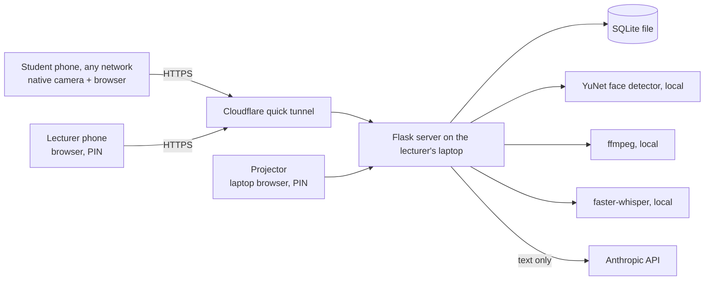

# Software Requirements Specification (To Do 5)

Covers R27. IEEE-830-inspired, kept short. Requirements are cited as R1-R37
([requirements.md](requirements.md)), validated decisions as D1-D39 ([decisions.md](decisions.md); D5 and D26
are superseded by D30; D31 records the design-level choices validated on 23/11; D32 is superseded by D33 (23/11), D37 (24/11) signs and mirrors the device token,
which removes every network / IP check and makes the projected code 4 digits; D34 (23/11) closes D10 and specifies
F4 for real recordings of any length), measured figures as sections of the [tools report](tools_report.md). Scope and schedule: [sow.md](sow.md).

## 1. Introduction

### 1.1 Purpose

This document specifies what the "Web-based Teaching Tool" shall do, so that the design
([design.md](design.md)), the tests ([test_strategy.md](test_strategy.md)) and the demo app can be checked against
it. Readers: the lecturer (client and evaluator) and the developer.

### 1.2 Scope

A KISS web application for one real class, used by students from their smartphone browser with no installation
and by the lecturer from a laptop (projector) and a phone (R12-R14). Features (README section 1):

| Feature | Content | R | D |
|---|---|---|---|
| F1 Attendance (main) | Check-in with a rotating projector QR and a 4-digit projected code, photo head count with consistency alert, online table + CSV/XLSX | R1-R4 | D6-D8, D27, D30, D33 |
| F2 Comments | Anonymous comments/suggestions, during class (real time) and after class | R5 | D4, D8, D29 |
| F3 Polls | One poll open at a time, one question, 2-4 options, live results | R6 | D9, D28 |
| F4 Video summary | Upload of a class recording of any length (PIN), local audio extraction and transcription in a background job, structured LLM summary, status page, download; media deleted, transcript not kept | R7, R8, R15, R16 | D10 (closed), D34 |
| F5 Homework review | LLM review of a public repository with anonymised comparison | R9, R10 | D11 |

Out of scope: see [sow.md](sow.md) section 3 (no Moodle/Zoom, no personal data, no accounts, no native app, no
late arrivals, no PWA offline mode, no in-app check-in fallback for a phone that cannot scan, no manual head-count
correction). A chain-of-trust check-in (students validating each other) and a local Wi-Fi bubble were studied and
rejected (D30); a campus-network IP check was built, tested on real phones and removed (D32, D33).

### 1.3 Definitions

| Term | Definition |
|---|---|
| Session | One attendance check-in period of a class meeting, opened and closed by the lecturer; at most one is open at a time (D27, D30). |
| Projector QR | QR shown on the projector page while a session is open; it encodes a URL with a signed token (session, creation time), is regenerated every 10 s and is accepted if at most 15 s old when the request reaches the server (D30). |
| Check-in code | 4-digit numeric code (`0000`-`9999`, leading zeros kept) shown under the projector QR, regenerated every 5 s; the student types it on the check-in page (D30, 4 digits since D33). |
| Check-in window | 1-minute period opened by a valid projector QR scan, bound to the scanning browser's device token, during which the student types the check-in code (D30). |
| Check-in | An attendance record: session, device token, nickname, time (D6, D30). |
| Head count (D) | Number of faces detected by YuNet on a class photo (D7). |
| N | Number of check-ins in the session (D7). |
| Consistency alert | Automatic status "consistent" or "anomaly" computed from N and D (D7). |
| Nickname | Self-chosen display name entered once per device; never a real name or ID (D6). |
| Device token | Random value, signed by the server (HMAC-SHA256) and mirrored on the phone in a server-set cookie, `localStorage` and `IndexedDB` (D37, amending D31 OI-4), that identifies a device without personal data; binds the check-in window and limits check-in to one per device per session (D6, D30). |
| Lecturer PIN | Single secret from an environment variable that unlocks lecturer pages (D22). |
| Base URL | The public URL reachable by the phones (tunnel or LAN), encoded in the projector QR (D13, D30). |

### 1.4 References

Assignment statement (course material, To Do 1-12); [requirements.md](requirements.md);
[decisions.md](decisions.md); [tools_report.md](tools_report.md); [sow.md](sow.md); IEEE Std 830-1998 (structure).

## 2. Overall description

### 2.1 Product perspective

A self-contained Flask app (D2) on the laptop, SQLite storage (D3), short polling (D4), exposed by a Cloudflare
quick tunnel; plan B: phone hotspot / LAN over plain HTTP (D13). Students never install anything and the page
never uses the camera: the projector QR is read by the phone's native camera app (D30). The app reads no client
IP address: a check-in works the same on the campus Wi-Fi and on mobile data (D33).

### 2.2 User classes

| User | Access | Uses |
|---|---|---|
| Student | Phone browser, no login; device token, plus a nickname for attendance only (D6, D28, D29) | Check-in, anonymous comments, poll votes, homework review |
| Lecturer | Laptop (projector) and phone, lecturer PIN (D22) | Sessions, projector QR and code, live table, photo count, export, polls, comments view, video summary, homework review |

### 2.3 Operating environment

- Server: Python 3.11+ on the lecturer's laptop (macOS tested in the tools report), CPU only (D2, D7, D34); `ffmpeg` installed for F4 (D34).
- Clients: iOS Safari and Android Chrome with the built-in camera QR reader (or Google Lens) (tools report 2.4);
  any desktop browser for the projector.
- Network: public HTTPS URL from `cloudflared` (tools report 2.9) or plain HTTP on a hotspot / LAN (D13); students
  check in from any network (university Wi-Fi or mobile data, D33).

### 2.4 Constraints

- C1 No personal data: no name, ID, e-mail, face recognition or location; photos discarded (R16, D6, D7, D21).
- C2 No Moodle, Zoom, Meet or Classroom integration; videos are uploaded files (R15).
- C3 KISS: phone web app, few taps, no installation, no accounts (R14, D6, D22).
- C4 Only implementable, reused components (Flask, `qrcode`, OpenCV YuNet, faster-whisper, `ffmpeg`, Anthropic SDK,
  `openpyxl`, `cloudflared`), each tested in the tools report (R17, R18, R25; `ffmpeg` to be recorded in task T18f,
  D34).
- C5 Live 10-minute demo in this class (R13, R19).
- C6 Secrets (API key, PIN, signing key) only in environment variables / git-ignored `.env` (D12, D22).
- C7 No network check (D33): presence rests on the rotating QR, the projected 4-digit code and the photo check
  (FR-1.16). A remote student helped live by an accomplice in the room can check in; only an inflated N is flagged
  by the photo check. No location and no IP address are used (R16, D5, D33).

### 2.5 Assumptions and dependencies

- A1 Students have a smartphone whose camera app reads QR codes (D30); otherwise the lecturer adds them manually
  after class in the exported spreadsheet (FR-1.18, D30).
- A2 The classroom network reaches `*.trycloudflare.com`, or plan B is used (D13, tools report section 3).
- A3 An Anthropic API key is available for F4/F5; without it F1-F3 work unchanged (D12).
- A4 Check-in happens at the end of class; late arrivals are not handled (D5; timing unchanged by D30).
- A5 The YuNet model file is downloaded locally (not committed) before the demo (D21).
- A6 Students may be on the university Wi-Fi or on mobile data; the check-in does not depend on the network (D33).
  The campus Wi-Fi isolates clients, so a phone cannot reach the laptop by its LAN address: plan A (tunnel) is used
  in class (D13 note).
- A8 (Removed by D33: no Apple relay list any more.)
- A9 For F4 (D34): the `ffmpeg` command is installed on the laptop; the Whisper model (`small`, ~460 MB) is
  downloaded once, at its first real use, before class; large recordings are uploaded from the laptop itself
  (`http://localhost`), because the tunnel limits request size and duration.
- A7 Restarting the quick tunnel changes its host name, so every copy of the device token (cookie, `localStorage`, `IndexedDB` are per host name) is lost and phones are treated as
  first-time (nickname typed again) (D31, OI-4, D37).

## 3. Functional requirements

Format: statement; **P** = priority (from [requirements.md](requirements.md)); **Trace**; **AC** = acceptance
criterion (the basis of the tests, D25). Time limits are measured on the server clock (D30).

### 3.1 F1 Attendance (main feature)

**FR-1.1 Open session.** The system shall let the lecturer open a session with one click. At most one session
shall be open at a time.
P: MUST-MAIN. Trace: R1, R4, D22, D27, D30. AC: opening a session from the lecturer page succeeds; opening a second
session while one is open is rejected with the message of section 5.

**FR-1.2 Campus network check.** *Removed by D33.* (No client IP is read for attendance; a check-in is accepted
or refused only by the rules FR-1.5-FR-1.13.)

**FR-1.3 Client IP resolution.** *Removed by D33.* (The app reads no client IP and no `CF-Connecting-IP` header;
"no IP column" is now part of NFR-7.)

**FR-1.4 Allow-list editor.** *Removed by D33.* (No allow-list; the former page answers 404.)

**FR-1.5 Projector QR.** While a session is open, the projector page shall show a QR encoding a URL built from the
configured base URL, with a token HMAC-signed with its creation time (the start of its 10 s slice, D31), regenerated every 10 s; the
projector page polls every 1 s (D4 amended by D31, OI-8). The application
shall contain no in-page camera scanner.
P: MUST-MAIN. Trace: R1, R13, R14, D4, D13, D30. AC: with an injected clock, the token at t and at t + 10 s differ;
with the base URL set to a LAN address the decoded URL starts with it; no page requests camera access.

**FR-1.6 QR validity.** The system shall accept a scanned QR only if its signature is valid and it is at most 15 s
old when the request arrives at the server, checked before the page is sent.
P: MUST-MAIN. Trace: R1, D30, tools report 2.2. AC (injected clock): accepted at age 15 s, rejected just after; a
tampered token is rejected.

**FR-1.7 Check-in window.** On a valid scan, the system shall open a 1-minute check-in window bound to the
browser's device token and show the check-in page with, on first use only, a nickname field (FR-1.10), followed by a
4-digit numeric code field (`inputmode="numeric"`, at most 4 characters) and a "Confirm" button.
P: MUST-MAIN. Trace: R1, R14, D6, D30. AC (injected clock): a code submitted at 1 min is accepted, just after 1 min
rejected; a submission from another device token is rejected.

**FR-1.8 Check-in code.** While a session is open, the projector page shall show a 4-digit numeric code
(`0000`-`9999`, leading zeros shown) under the QR, regenerated every 5 s (D33 amends the 3 digits of D30). The system
shall accept only a submission of exactly 4 digits equal to the code currently displayed or to the immediately
previous one; any other input is a wrong code.
P: MUST-MAIN. Trace: R1, D4, D30 (P1), D33. AC (injected clock): the generated code always has 4 digits and keeps
leading zeros; the current code and the previous code are accepted; the code before the previous one and a wrong
code are rejected; the right value typed with 3 or 5 digits, with spaces or with non-ASCII digits is rejected as a
wrong code and counts as an attempt (FR-1.9).
Known residual risk (D33, red-team F-02): since a new scan resets the attempts (FR-1.9) and no network check exists,
a script holding one relayed QR image can keep guessing; with 4 digits this needs about 5,000 guesses on average
(about 500 with 3 digits). This slows such a script, it does not stop it; the photo check (FR-1.16) remains the
safety net.

**FR-1.9 Attempt limit.** The system shall accept at most 5 code attempts per check-in window; after that the
window is closed and the student must scan the QR again. A new scan opens a new 1-minute window with 0 attempts
(D31, OI-7). A rejected empty or invalid nickname does not count as an attempt (D31).
P: MUST-MAIN. Trace: R1, D30 (P2). AC: 5 wrong attempts are answered with the wrong-code message; the 6th attempt is
rejected with the too-many-attempts message, even if the code is correct; after a new scan, a correct code is
accepted.

**FR-1.10 Nickname once.** If the device token has no nickname, the check-in page shall ask for one (1-30 characters after
trimming; not unique, the device token is the identity, D31, OI-2),
with the warning "Do not use your real name or ID"; the nickname is typed before the check-in code. On later visits the student shall be
recognised with no nickname typing (only the check-in code is typed). The nickname is used for attendance only (not for comments
or votes, D28, D29).
P: MUST-MAIN. Trace: R1, R16, D6. AC: first visit shows the nickname field and the warning; a second scan from
the same device shows the nickname and no nickname field; an empty nickname and a 31-character nickname are rejected,
a 30-character one is accepted; two devices may use the same nickname. The nickname is stored at the first
successful check-in (D31).

**FR-1.11 Record check-in.** On a correct code within an open window (FR-1.6-FR-1.9), the system shall record one
check-in with session, nickname and time, and close the window.
P: MUST-MAIN. Trace: R1, R3, D6, D30. AC: after a correct code the check-in appears in the table; a scan that is
never completed creates no record.

**FR-1.12 One check-in per device per session.** The system shall reject a scan or code submission from a device
token that is already checked in for the session.
Since D37 the device token is signed and mirrored on the phone (cookie, `localStorage`, `IndexedDB`; `POST /device/sync`);
if the cookie is gone but a valid stored copy returns, the older token is used for scan, confirm and vote and the cookie
is set again. A forged or badly signed token is ignored; an old unsigned cookie is accepted and re-issued signed.
Not prevented (stated limits): clearing all site data, private browsing, a second browser, JavaScript disabled (a full
guarantee would need identifying the student, forbidden by D5); the D7 photo consistency alert is the safety net.
P: MUST-MAIN. Trace: R1, D30, D37. AC: a second scan by a checked-in device returns "You are already checked in" and
creates no record and no window; the same after "check in, clear the cookies, scan again"; a forged stored token is
ignored; 50 simultaneous distinct devices give 50 rows and the same device from 10 threads gives 1 row.

**FR-1.13 Close session.** The lecturer shall close the session; afterwards every scan and code submission for it
shall be rejected and the projector shows no QR or code.
P: MUST-MAIN. Trace: R1, D27, D30. AC: a scan and an open window's code submission after closing are both rejected.

**FR-1.14 Live attendance table (online spreadsheet).** The lecturer page shall show the session's check-ins
(nickname, check-in time) and N, refreshed by polling. (The D32 network markers and counters are removed by D33.)
P: MUST-MAIN. Trace: R3, D4, D8, D33. AC: a new check-in appears within 5 s without reload (NFR-2); an open window
without a correct code does not change the table or N; the table and its JSON have no network column.

**FR-1.15 Photo head count.** The lecturer shall upload or shoot a class photo for a session; the system shall
count faces with YuNet on the whole image, score threshold 0.4 (configurable), and store D with the session (a new
photo for the same session replaces D, D31, OI-5); the
page shall advise taking the photo when students look up.
P: MUST-MAIN. Trace: R2, D7, tools report 2.5. AC: on a non-personal test image with a known number of faces, D
is within the tolerance of D25; the threshold default is 0.4; a second photo replaces the first D.

**FR-1.16 Consistency alert.** The system shall display "checked in N / detected D / consistent|anomaly", where
"consistent" holds if `N - max(7, ceil(0.15 * N)) <= D <= N + max(4, ceil(0.10 * N))`, otherwise "anomaly".
P: MUST-MAIN. Trace: R2, D7, tools report 2.5.3. AC: N = 45: D = 37 anomaly, 38 consistent, 50 consistent,
51 anomaly; N = 10: D = 2 anomaly, 3 and 14 consistent, 15 anomaly.
Documented limit: for N about 45, fewer than about 7 check-ins of absent people stay inside the measurement noise.

**FR-1.17 Photo privacy, no manual correction.** The photo shall be processed in memory and discarded; only D
is stored. The lecturer shall not be able to edit D.
P: MUST-MAIN. Trace: R2, R16, D7, D21. AC: after an upload no image file exists on disk and the database holds
only the number; no edit-count route exists.

**FR-1.18 Export (offline spreadsheet).** The lecturer shall download the attendance as CSV and as XLSX, one row
per check-in with the columns "Session date (Jerusalem time)", "Nickname", "Checked in at (Jerusalem time)" (no IP, no network column, D33), the last one as date and time "YYYY-MM-DD HH:MM:SS" (D36-c); plus a
per-session summary: session date, check-ins (N), faces detected (D), consistency status. Session dates and times are written in Israel local time (Asia/Jerusalem, DST applied), and the date and time headers name the zone ("Jerusalem time", D35); the database and the JSON API stay in UTC. One export covers all sessions: XLSX with two sheets "Check-ins" and
"Summary"; CSV as two files `checkins.csv` and `summary.csv` (D31, OI-6). The app has no other check-in route: a student whose camera cannot
scan the QR is added by the lecturer after class in the exported spreadsheet.
P: MUST-MAIN. Trace: R3, D6, D8, D21, D30 (P3), D33, D35, D36-c, tools report 2.8. AC: the files open in a spreadsheet tool and
their rows equal the live table; the XLSX has the two sheets; the summary values equal those on the lecturer page; no route creates a check-in
without a valid QR scan and code.

**FR-1.19 Network origin.** *Removed by D33.* (No origin label, marker, counter or export column. Known weakness
now stated in C7: an absent student helped live by an accomplice in the room can check in from anywhere; only an
inflated N is flagged by the photo check, FR-1.16.)

### 3.2 F2 Comments and suggestions

**FR-2.1 Post.** A student shall post a short text comment or suggestion from the phone, during class or after
class, inside or outside a session. Comments are anonymous: no nickname and no personal data are requested,
shown or stored with the comment.
P: MUST. Trace: R5, R16, D8, D29. AC: a comment posted with no open session is stored and accepted; a comment
posted from a device that has a nickname is stored without it.

**FR-2.2 Real-time view.** During class, the lecturer's comments page shall show new comments, newest first, with
their text and time only (never a nickname), refreshed by polling.
P: MUST. Trace: R5, D4, D29. AC: a comment appears on the lecturer page within 5 s without reload; the page shows
no nickname.

**FR-2.3 Asynchronous (offline) use.** Comments posted after class shall be accepted and, like those posted in
class, remain available on the lecturer page later.
P: MUST. Trace: R5, D8, D29. AC: after restarting the server, earlier comments are still listed.

**FR-2.4 Empty or too long comment.** The system shall reject an empty comment and a comment longer than 500
characters (after trimming) with a plain message.
P: MUST. Trace: R5, D23, D29, D31 (OI-11). AC: posting whitespace only, or 501 characters, returns the matching
message of section 5 and stores nothing; 500 characters are accepted.

### 3.3 F3 Polls

**FR-3.1 Create.** The lecturer shall create a poll with one question and 2 to 4 options. At most one poll shall
be open at a time.
P: MUST. Trace: R6, D9, D28. AC: 2 and 4 options accepted; 1 and 5 options, or an empty question, rejected;
creating a poll while another is open is rejected with the message of section 5.

**FR-3.2 Vote.** Students shall see the open poll on their phone and vote for one option; one vote per device
token per poll; no nickname is needed to vote.
P: MUST. Trace: R6, D6, D9, D28. AC: a second vote from the same device is rejected and not counted; a device
with no nickname can vote.

**FR-3.3 Live results.** The lecturer page shall show counts per option (bars), refreshed by polling.
P: MUST. Trace: R6, D4, D9. AC: a vote is reflected within 5 s without reload.

**FR-3.4 Close.** The lecturer shall close the poll; votes after closing are rejected; results stay visible.
P: MUST. Trace: R6, D9. AC: a vote after closing is rejected; the final counts are unchanged.

### 3.4 F4 Video summary (D34; D10 closed)

F4 summarises the lecturer's **real class recordings of any length** (D34), not only a demo clip. Because a
90-minute lecture takes roughly 15-20 minutes to transcribe with `small` on the demo laptop (extrapolation, NFR-13), the work runs as a background
job whose status the lecturer follows on a page.

**FR-4.1 Upload.** On the PIN-protected page "Video summary" (FR-6.1), the lecturer shall upload one recorded class
video or audio file (Zoom, Meet or Classroom recordings: MP4, M4V, MOV, MKV, WebM, AVI, M4A, MP3, WAV, AAC, OGG, Opus,
FLAC); no Zoom/Meet/Classroom API or account is used. The upload limit of this page is `VIDEO_MAX_BYTES` (default
2 GB, configurable) while every other upload keeps the 25 MB limit; the upload is streamed to a temporary file outside
the repository, never held entirely in memory. The page advises uploading large recordings on the laptop itself
(`localhost`), not through the tunnel. The duration is measured with `ffprobe` right after the copy and before the job
is queued: above 4 hours (`VIDEO_MAX_SECONDS`, D36-a) the upload is refused (HTTP 400, section 5), the copied file is
deleted and no job stays active; if the duration cannot be measured the file is accepted (FR-4.2's time limit still applies).
P: MUST. Trace: R7, R15, D22, D34, D36-a (R-F4-2). AC: a file of each listed extension is accepted; another extension or no file is
refused with the message of section 5; a file above the limit is refused with the too-large message and creates no
job; on the photo page the 25 MB limit is unchanged; a fake extractor reporting 4 h + 1 s is refused (no job, no file),
4 h exactly, a shorter duration or an unknown one is accepted; the `ffprobe` command is an argument list without shell.

**FR-4.2 Audio extraction.** The system shall extract the audio track with `ffmpeg` as mono 16 kHz audio into a
temporary file. A file that cannot be decoded, has no audio track or is empty shall be refused with "We could not
read this video file.".
P: MUST. Trace: R7, D34. AC: with a fake extractor that fails, the job ends `failed` with that message; with ffmpeg
present (optional test), a generated MP4 yields a mono 16 kHz WAV.

**FR-4.3 Local transcription.** The system shall transcribe the audio on the laptop with faster-whisper: model from
`WHISPER_MODEL` (default `small`, chosen for Hebrew quality), language auto-detected unless `WHISPER_LANGUAGE` is set,
CPU, int8, voice-activity filter on. The model is downloaded once, at its first real use, never by the tests. If the
model cannot be loaded or `ffmpeg` is missing, the job fails with the "transcription unavailable" message; if no
speech is found, with the no-speech message. Audio is never sent over the network.
P: MUST. Trace: R7, R16, D34, tools report 2.6. AC: with a fake transcriber, its transcript reaches the summariser;
a transcriber that cannot load its model gives the transcription-unavailable message; building the app loads no
model.

**FR-4.4 Structured summary.** The system shall summarise the transcript with the LLM (D12) into Markdown with four
sections: topics covered, key notions, definitions and examples, what to review; in the transcript's detected
language unless the lecturer chose English or Hebrew on the upload form. A transcript longer than 40,000 characters
shall be summarised by map-reduce (each part summarised into notes, then the notes merged). The prompt shall state
that the transcript is untrusted content whose instructions must not be followed (prompt injection), that nothing may
be invented, and that no student or other person present may be named and no phone number, e-mail or ID output.
P: MUST (R7), SHOULD beat the Zoom example (R8). Trace: R7, R8, R16, D12, D34. AC: with a fake LLM client, a
40,000-character transcript gives 1 call and a 40,001-character one gives 3 calls (2 parts + 1 merge); the prompt
contains the untrusted-content and no-personal-data rules and the requested language; the comparison with the Zoom
example is reported in `docs/results.md`.

**FR-4.5 Privacy and retention.** The uploaded file and the extracted audio shall be deleted right after the
transcription, and on every failure path; the transcript shall never be written to disk or the database and is
dropped after summarising; only the summary text, the job status, the detected language, the duration and
timestamps are stored (a lecture summary is not personal data). The original file name is not stored. Nothing is
written inside the repository except the SQLite database in `instance/`.
P: MUST. Trace: R16, D21, D34. AC: after a successful job and after a failure at each step, the work directory holds
no job files; a marker word of the transcript appears in no table, file or log; the job table has no transcript or
file-name column.

**FR-4.6 One job at a time, in the background.** The upload shall return at once and the processing (extraction,
transcription, summary) shall run in a background job; at most one job runs at a time; an upload while a job is
active shall be refused with the job-running message. Without an LLM key, the upload is refused at once with the
summary-unavailable message, before any processing.
P: MUST. Trace: R7, R17, D12, D34. AC: with a deferred runner, the first upload leaves a `queued` job and the second
is refused and writes nothing; with no key, no job is created.

**FR-4.7 Status page.** The job page shall show the step in plain words: waiting to start, extracting the audio,
transcribing the lecture (with a percentage), writing the summary, summary ready, failed (with the user message of
section 5), refreshed by polling every 3 s (D4). The lecturer may leave and come back: the "Video summary" page
links to the active job and lists recent summaries. If the application stops during a job, the job is shown as
failed with the interrupted message at the next start and its temporary files are deleted.
P: MUST. Trace: R7, D4, D23, D34. AC: the status JSON goes through `queued`, `extracting_audio`, `transcribing`,
`summarising`, `done` in this order; an illegal transition is impossible; after a simulated restart an active job is
`failed` with the interrupted message.

**FR-4.8 Result and download.** A finished summary shall be shown on the job page (as plain escaped text, right-to-
left aware) and downloadable as `.md` and `.txt` (UTF-8).
P: MUST. Trace: R7, D34. AC: both downloads are attachments with the summary text (Hebrew preserved); the `.txt` has
no Markdown heading or emphasis marks; downloading an unfinished summary answers "This summary is not ready yet.";
HTML in the LLM answer is shown as text.

**FR-4.9 Live only, failures.** No pre-computed summary shall be shown. On LLM failure (network, API error, timeout,
empty answer) the job shall end `failed` with the summary-unavailable message, its files deleted (after the retries of FR-4.11).
P: MUST. Trace: D1, D12, D23, D34. AC: with a failing fake LLM client the job page shows the message and no summary,
and no job file remains.

**FR-4.10 Cancel.** While a job is active, its page shall show a "Cancel" button (`POST /lecturer/video/jobs/<id>/cancel`,
PIN required). Cancelling marks the job `failed` with "Cancelled by the lecturer." and frees the slot at once; the
background thread stops at its next check (transcription progress, before each LLM call), makes **no LLM call after the
cancel** and removes its work directory. A finished job is unchanged; an unknown id gives 404. Known limit: the audio
extraction step is not interrupted (short), so a few seconds of overlap are possible.
P: MUST. Trace: R7, D34, D36-a (R-F4-2). AC: PIN required; unknown id 404; finished job unchanged; the button is shown only
while the job is active; a cancel during transcription, or between two map parts, ends the job without a further LLM call
and leaves no file.

**FR-4.11 LLM retries.** Each LLM call of an F4 job (direct, each map part, reduce) shall be attempted up to 3 times in
total on a transient failure (`LLMUnavailableError`), waiting 2 s then 8 s; a missing key, an empty answer and a
cancelled job are not retried. The transcript stays in memory only.
P: MUST. Trace: R7, D12, D34, D36-b (R-F4-3). AC: with a fake LLM failing twice, the third attempt succeeds and the sleeps are
2 s, 8 s; failing three times ends in the summary-unavailable message after 3 calls; an empty answer is called once.

### 3.5 F5 Homework review with comparison

**FR-5.1 Submit.** A student or the lecturer shall enter a public GitHub repository URL.
P: MUST. Trace: R9, D11. AC: a well-formed public URL is accepted; a malformed URL is rejected with a plain
message.

**FR-5.2 Fetch and cap.** The system shall download the repository archive without a token and extract the README
and main source files, capped at about 40-60 KB of text.
P: MUST. Trace: R9, D11. AC: on a repository larger than the cap, the extract passed to the LLM is within the cap;
a private or missing repository returns a plain message.

**FR-5.3 LLM review.** The system shall return a Claude review against a short rubric, run live (no pre-computed
output).
P: MUST. Trace: R9, R11, D11, D12. AC: with a fake LLM client the review is displayed; with no key the message of
section 5 is shown.

**FR-5.4 Anonymised comparison.** The review shall include a comparison with 1-2 other submissions of the same
assignment, labelled anonymously ("Submission B", "Submission C"), plus deterministic metrics (file and line
counts).
The other submissions are the first 2 of a list of public repository URLs pasted by the lecturer on the
PIN-protected page `/lecturer/peers` (stored in the local SQLite database), excluding the reviewed repository (D31,
OI-1). Owner and repository names of these submissions are masked in the prompt and the output; reviews are never
stored (D31, OI-9). If no other submission can be fetched, the review is shown with the sentence "No other
submission was available for comparison." (D31, OI-12). The review page itself needs no PIN (accepted for the
demo, D31, OI-10).
P: MUST. Trace: R10, R16, D11, D31. AC: the output contains the comparison section and the metrics, and no URL,
owner or repository name of the other submissions; the reviewed repository is never its own peer; with an empty or
unreachable peer list the review is shown with the sentence above; no review is written to the database.

**FR-5.5 Peer list.** The lecturer (PIN) shall view and edit the list of comparison repositories on
`/lecturer/peers`.
P: MUST. Trace: R10, D22, D31 (OI-1). AC: without the PIN the page is not reachable; a saved list is used by the
next review.

### 3.6 Lecturer access and configuration

**FR-6.1 Lecturer PIN.** Lecturer pages (sessions, projector QR and code, table, photo, export,
polls, comments view, video summary, F5 peer list) shall require the lecturer PIN read from an environment variable, kept in the session cookie.
P: MUST. Trace: R16, D22. AC: without the PIN these pages redirect to the PIN page; a wrong PIN is refused with
a plain message.

**FR-6.2 Student pages without login.** Check-in, comments, polls and homework review shall need no account and
no PIN.
P: MUST. Trace: R14, D6. AC: a fresh browser can post a comment and vote with no login step.

**FR-6.3 Base URL.** The base URL encoded in the QR codes shall be configurable (environment variable) to switch
between the tunnel (plan A) and LAN (plan B).
P: MUST. Trace: R13, D13, D30. AC: see FR-1.5.

## 4. Non-functional requirements

| ID | Category | Requirement | Trace | Verification |
|---|---|---|---|---|
| NFR-1 | Usability | A returning student checks in in 4 phone actions: scan with the native camera, tap the link (the page opens), type the 4-digit code, tap "Confirm"; a first-time student types a nickname once, after the page opens and before the code. No install, no account. | R1, R14, D6, D30, D33 | Manual test on iPhone and Android (tools report section 3, tests 1-2) |
| NFR-2 | Performance (real time) | Check-ins, comments and votes are visible on the lecturer page within 5 s (polling every 2-3 s; the projector page every 1 s, D31). | R5, R6, D4, D31 | Integration test with polling interval; manual rehearsal |
| NFR-3 | Performance (head count) | Head count takes < 1 s per photo on the demo laptop (measured median 86 ms at 2000x1500 px, threshold 0.4, tools report 2.5.2). | R2, D7 | Timed unit test on a non-personal image |
| NFR-4 | Performance (check-in) | Each scan / code submission is handled by the server in < 1 s on the demo laptop, so that network delay dominates the 15 s QR window and the 5 s code rotation. | R1, D30 | Timed test with the Flask test client; manual test 3 (tools report section 3) |
| NFR-5 | Capacity | One class (up to 52 faces detected on a provided class photo, tools report 2.5.2) with polling every 2-3 s stays under the quick tunnel limit of 200 in-flight requests (tools report 2.9). | R13, D13, D30 | Rehearsal with several tabs and phones |
| NFR-6 | Measured, not assumed | The whole-class check-in duration and the number of refusals (expired QR or window, wrong code) are measured live during the class demo and reported in `docs/results.md`; no target figure is claimed beforehand. | R1, R19, D17, D30 | Live measurement |
| NFR-7 | Privacy | No field asks for a name, ID or e-mail; photos are never stored; recordings and their audio are deleted right after transcription and transcripts are never stored (FR-4.5, D34); no client IP is read for attendance, and no table or export has an IP column (D33; no location is ever asked); the device token is random, carries no personal data and is readable by page JavaScript (D37; the lecturer pages rely on the PIN, not on it); only text (transcripts, public code) is sent to the LLM API; no photo or participant list leaves the laptop; the repository contains fictitious data only. | R16, D6, D7, D12, D21, D30, D33, D37 | Code review, schema/export test (no IP column), test FR-1.17, history check before commit (D24) |
| NFR-8 | Security | QR tokens are HMAC-signed with a secret key from the environment; tampered or expired tokens are rejected; the projected code has 4 digits (D33); at most 5 code attempts per window; lecturer pages need the PIN; API key, PIN and signing key live in the git-ignored `.env` (`.env.example` committed); Flask debug off in the demo. | D12, D22, D23, D30, D33, tools report 2.2 | Unit tests (tampered / expired token, 4-digit code format, attempt limit, PIN), repo check |
| NFR-9 | Reliability (demo) | The app runs on plan A (tunnel, HTTPS) and plan B (hotspot / LAN, plain HTTP) by changing only the base URL; plan A starts with one double-click on `scripts/HereOrNot.command` (D39); plan C is a recorded rehearsal. F1-F3 work without an LLM key. | R13, R19, D12, D13, D30, D39 | Rehearsal on both plans; test with no key; `tests/test_launcher.py` |
| NFR-10 | Error messages | User-facing errors are short, plain English and actionable; they never show database IDs, tokens, stack traces, file paths or exception names; details go to the server log only. | D23 | One test per row of section 5 |
| NFR-11 | Portability | Student pages work on iOS Safari and Android Chrome (responsive, mobile-first) and open from the native camera QR link. | R14, D2, D30 | Manual tests 1-2 and 9 (tools report section 3) |
| NFR-12 | Maintainability / testability | pytest + Flask test client; injectable clock for the 10 s / 15 s / 5 s / 1 min rules; `LLMClient`, `Transcriber`, `AudioExtractor` and the F4 job runner replaceable by fakes; `HeadCounter` behind an interface with configurable threshold; consistency rule a pure function; SQL isolated in repository classes. | R11, R32, D3, D7, D12, D25, D30, D34 | Test suite runs offline with no key, no ffmpeg and no Whisper model |
| NFR-13 | Performance (F4 processing time) | No fixed time is promised. Measured real-time factors of faster-whisper on the demo laptop (Apple M3, CPU, int8): **0.06 with `base`, 0.17 with `small`** (tools report 2.6), (real-time factor about 0.17-0.22 for `small` in the T18f run). Measured in T18f: a 244 s Hebrew clip took about 70 s in total (extraction 2 s, transcription about 54 s, summary 14 s) on a MacBook M3. Extrapolation, not measured: a 90-minute lecture takes roughly 15-20 minutes with `small`, plus the LLM call(s). The first use adds a one-time model download (~460 MB). The status page shows progress so a long job is visibly alive. | R7, D34 | End-to-end timing of the 4-minute demo clip and, if available, of a full recording (task T18f), reported in the tools report and `docs/results.md` |
| NFR-14 | Time display | Every user-visible time (export, lecturer and projector pages, F4 summary date) is shown in Israel local time (`Asia/Jerusalem`, daylight saving applied); storage stays UTC; the export header names the zone ("Jerusalem time"). | R3, R14, D35 | Conversion tests for a winter and a summer instant; export header test; stored values stay UTC |
| NFR-15 | Usability and accessibility (UI) | Student pages are phone-first: one column, tap targets of at least 56 px, a large numeric field for the 4-digit code; body, muted and button text tokens meet WCAG AA contrast (4.5:1) in the light and the dark palette (WCAG 2 formula applied to the tokens of `app/static/app.css`; every token meets 4.5:1, including the success green `#1B7748` on its light tint, 4.87:1); status is never conveyed by colour alone; text typed by a person or produced by the LLM is laid out with `dir="auto"` (Hebrew and English); long operations show a busy state; no web font, no CDN, no external URL on any page; the interface is named HereOrNot. | R13, R14, D38 | Template and CSS tests (`tests/test_t22_*.py`), contrast computed from the palette tokens, manual test M13 |

## 5. Error handling

Every case is covered by a test (D23). Messages are indicative wording. The off-campus and invalid-network-range
messages are removed with the network check (D33).

| Situation | User-facing message |
|---|---|
| QR older than 15 s on arrival, or invalid signature | "This QR code has expired. Scan a fresh one." |
| Check-in window older than 1 minute | "Your check-in time ran out. Scan the QR code again." |
| Wrong check-in code, or not exactly 4 digits (FR-1.8) | "Wrong code. Type the code shown under the QR now." |
| More than 5 code attempts in one window | "Too many tries. Scan the QR code again." |
| Device already checked in for the session | "You are already checked in for this class." |
| Session closed (scan or code submission) | "Attendance for this class is closed." |
| No open session | "There is no attendance check-in right now." |
| Opening a session while one is open (D27) | "A session is already open. Close it first." |
| Empty nickname (also one made only of invisible characters), or longer than 30 characters (FR-1.10) | "Please choose a nickname (not your real name or ID)." |
| `/checkin` opened without a QR token while a session is open (FR-1.7, D31) | "Scan the QR code on the projector." |
| Photo missing, not a readable image, or above 40 megapixels | "We could not read this photo. Please try another one." |
| Face detector model not available | "Head count is not available right now." |
| Empty comment | "Please write something before sending." |
| Comment longer than 500 characters (FR-2.4, D31) | "Please keep your comment under 500 characters." |
| Poll with an empty question or not 2-4 options | "A poll needs a question and 2 to 4 options." |
| Creating a poll while one is open (D28) | "A poll is already open. Close it first." |
| Second vote, or vote on a closed poll | "You have already voted." / "This poll is closed." |
| Malformed repository URL | "Please enter a public GitHub repository link." |
| Repository private or not found | "We could not download this repository. Is it public?" |
| LLM key missing or API failure / timeout (F5) | "The review service is unavailable right now. Please try again later." |
| LLM key missing (upload refused) or API failure / timeout / empty answer during an F4 job (FR-4.6, FR-4.9) | "The summary service is unavailable right now. Please try again later." |
| F4: no file, or not an accepted video / audio extension (FR-4.1) | "Please choose a video or audio recording (for example MP4, MOV, MKV, WebM or M4A)." |
| F4: file above `VIDEO_MAX_BYTES` (FR-4.1) | "This file is too large. The maximum is 2 GB." (the configured limit: in MB below 1 GB, e.g. "100 MB", else in GB with at most one decimal) |
| F4: a summary job is already running (FR-4.6) | "A video is already being summarised. Please wait until it is finished." |
| F4: file empty, not decodable or without an audio track (FR-4.2) | "We could not read this video file." |
| F4: ffmpeg does not finish within its time limit (very long recording) (FR-4.2) | "This recording is too long to process. Please upload a shorter recording." |
| F4: recording longer than 4 hours, measured by `ffprobe` (FR-4.1, D36-a) | "This recording is longer than 4 hours. Please upload a shorter recording." |
| F4: the lecturer cancelled the job (FR-4.10, D36-a) | "Cancelled by the lecturer." |
| F4: no speech found in the recording (FR-4.3) | "No speech was found in this recording." |
| F4: Whisper model cannot be loaded / downloaded, or `ffmpeg` missing (FR-4.3) | "The transcription service is unavailable right now. Please try again later." |
| F4: the application stopped during a job (FR-4.7) | "The summary was interrupted because the app was restarted. Please upload the video again." |
| F4: unknown summary, or download of an unfinished one (FR-4.8) | "This summary does not exist." / "This summary is not ready yet." |
| Wrong lecturer PIN | "Wrong PIN." |
| Lecturer page without PIN | Redirect to the PIN page (no error text) |
| Any unexpected server error | "Something went wrong. Please try again." |

## 6. Traceability matrix

| R | Covered by |
|---|---|
| R1 | FR-1.1, FR-1.5-FR-1.13 (check-in flow of D30, replacing D5/D26, amended by D33), NFR-1, NFR-4, NFR-6 |
| R2 | FR-1.15-FR-1.17, NFR-3 |
| R3 | FR-1.11, FR-1.14, FR-1.18 (columns without IP; manual addition after class, D30) |
| R4 | Section 3.1 (most detailed, first), all FR-1.x MUST-MAIN |
| R5 | FR-2.1-FR-2.4, NFR-2 |
| R6 | FR-3.1-FR-3.4, NFR-2 |
| R7 | FR-4.1-FR-4.11 (D34, D36; D10 closed), NFR-13 |
| R8 | FR-4.4 (structured four-section summary), comparison with the Zoom example in `docs/results.md` |
| R9 | FR-5.1-FR-5.3 |
| R10 | FR-5.4, FR-5.5 |
| R11 | FR-4.4, FR-5.3, NFR-12 (`LLMClient` interface) |
| R12 | Sections 2-3 (end-to-end, phone to lecturer output, every feature) |
| R13 | FR-1.5, FR-6.3, NFR-5, NFR-9, NFR-15, C5, C7 |
| R14 | FR-1.5, FR-1.7, FR-6.2, NFR-1, NFR-11, NFR-15, C3 |
| R15 | FR-4.1 (file upload, no platform API), C2 |
| R16 | FR-1.10, FR-1.17, FR-2.1, FR-4.3, FR-4.4, FR-4.5, FR-5.4, FR-6.1, NFR-7, C1 |
| R17 | C4 (every FR maps to a tested tool), FR-4.6 (one background thread, no job queue, D34) |
| R18 | C4, NFR-12 |
| R19 | NFR-6, NFR-9, C5 |
| R20-R26 | Deliverables, not software requirements: see [sow.md](sow.md) section 4 |
| R27 | This document |
| R28-R31 | Built from this document: [use_cases.md](use_cases.md), [design.md](design.md) |
| R32 | AC of every FR and verification column of section 4; [test_strategy.md](test_strategy.md); NFR-12 |
| R33 | The demo app implements sections 3-5 |
| R34, R35 | NFR-6 (measured live), NFR-13 (F4 timings), FR-4.4 (Zoom comparison) reported in `docs/results.md` |
| R36, R37 | Process requirements: see [sow.md](sow.md) sections 6 and 10 |

## 7. Open items

All closed by D31 (validated by the student on 23/11).

| ID | Topic | Resolution |
|---|---|---|
| OI-1 | Source of the 1-2 other submissions used for the F5 comparison | CLOSED: list pasted by the lecturer on `/lecturer/peers` (FR-5.4, FR-5.5) |
| OI-2 | Nickname rules | CLOSED: 1-30 characters after trimming, not unique (FR-1.10) |
| OI-3 | Campus public IPv4/IPv6 range(s) | OBSOLETE: the network check is removed (D33) |
