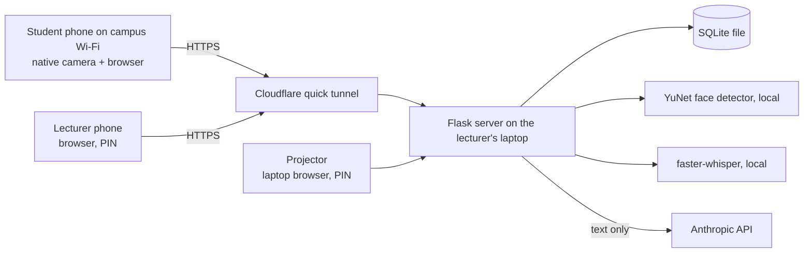

# Software Requirements Specification (To Do 5)

Covers R27. IEEE-830-inspired, kept short. Requirements are cited as R1-R37
([requirements.md](requirements.md)), validated decisions as D1-D30 ([decisions.md](decisions.md); D5 and D26
are superseded by D30), measured figures as sections of the [tools report](tools_report.md). Scope and schedule: [sow.md](sow.md).

## 1. Introduction

### 1.1 Purpose

This document specifies what the "Web-based Teaching Tool" shall do, so that the design
([design.md](design.md)), the tests ([test_strategy.md](test_strategy.md)) and the demo app can be checked against
it. Readers: the lecturer (client and evaluator) and the developer.

### 1.2 Scope

A KISS web application for one real class, used by students from their smartphone browser with no installation
and by the lecturer from a laptop (projector) and a phone (R12-R14). Features (README section 1):

| Feature | Content | R | D |
|---|---|---|---|
| F1 Attendance (main) | Check-in on the campus network with a projector QR and a 3-digit code, photo head count with consistency alert, online table + CSV/XLSX | R1-R4 | D6-D8, D27, D30 |
| F2 Comments | Anonymous comments/suggestions, during class (real time) and after class | R5 | D4, D8, D29 |
| F3 Polls | One poll open at a time, one question, 2-4 options, live results | R6 | D9, D28 |
| F4 Video summary | Local transcription + LLM summary; **deferred** | R7, R8 | D10 |
| F5 Homework review | LLM review of a public repository with anonymised comparison | R9, R10 | D11 |

Out of scope: see [sow.md](sow.md) section 3 (no Moodle/Zoom, no personal data, no accounts, no native app, no
late arrivals, no PWA offline mode, no in-app check-in fallback for a phone that cannot scan, no manual head-count
correction). A chain-of-trust check-in (students validating each other) and a local Wi-Fi bubble were studied and
rejected (D30).

### 1.3 Definitions

| Term | Definition |
|---|---|
| Session | One attendance check-in period of a class meeting, opened and closed by the lecturer; at most one is open at a time (D27, D30). |
| Projector QR | QR shown on the projector page while a session is open; it encodes a URL with a signed token (session, creation time), is regenerated every 10 s and is accepted if at most 15 s old when the request reaches the server (D30). |
| Check-in code | 3-digit numeric code shown under the projector QR, regenerated every 5 s; the student types it on the check-in page (D30). |
| Check-in window | 1-minute period opened by a valid projector QR scan, bound to the scanning browser's device token, during which the student types the check-in code (D30). |
| Campus allow-list | List of IPv4/IPv6 network ranges (CIDR notation) of the campus network, edited by the lecturer; check-in requests from other addresses are refused (D30). |
| Client IP | Address of the phone as seen by the server: the `CF-Connecting-IP` header behind the tunnel, otherwise the socket address; used only for the allow-list check, never stored (D13, D21, D30). |
| Check-in | An attendance record: session, device token, nickname, time (D6, D30). |
| Head count (D) | Number of faces detected by YuNet on a class photo (D7). |
| N | Number of check-ins in the session (D7). |
| Consistency alert | Automatic status "consistent" or "anomaly" computed from N and D (D7). |
| Nickname | Self-chosen display name entered once per device; never a real name or ID (D6). |
| Device token | Random value stored in the browser (cookie + localStorage) that identifies a device without personal data; binds the check-in window and limits check-in to one per device per session (D6, D30). |
| Lecturer PIN | Single secret from an environment variable that unlocks lecturer pages (D22). |
| Base URL | The public URL reachable by the phones (tunnel or LAN), encoded in the projector QR (D13, D30). |

### 1.4 References

Assignment statement (course material, To Do 1-12); [requirements.md](requirements.md);
[decisions.md](decisions.md); [tools_report.md](tools_report.md); [sow.md](sow.md); IEEE Std 830-1998 (structure).

## 2. Overall description

### 2.1 Product perspective

A self-contained Flask app (D2) on the laptop, SQLite storage (D3), short polling (D4), exposed by a Cloudflare
quick tunnel; plan B: phone hotspot / LAN over plain HTTP (D13). Students never install anything and the page
never uses the camera: the projector QR is read by the phone's native camera app (D30). Check-in requests are
accepted only from the campus allow-list; the tunnel passes the phone's address in `CF-Connecting-IP` (D30).

### 2.2 User classes

| User | Access | Uses |
|---|---|---|
| Student | Phone browser, no login; device token, plus a nickname for attendance only (D6, D28, D29) | Check-in (on the campus Wi-Fi), anonymous comments, poll votes, homework review |
| Lecturer | Laptop (projector) and phone, lecturer PIN (D22) | Sessions, projector QR and code, campus allow-list, live table, photo count, export, polls, comments view, video summary, homework review |

### 2.3 Operating environment

- Server: Python 3.11+ on the lecturer's laptop (macOS tested in the tools report), CPU only (D2, D7, D10).
- Clients: iOS Safari and Android Chrome with the built-in camera QR reader (or Google Lens) (tools report 2.4);
  any desktop browser for the projector.
- Network: public HTTPS URL from `cloudflared` (tools report 2.9) or plain HTTP on a hotspot / LAN (D13); students
  check in from the university Wi-Fi (D30).

### 2.4 Constraints

- C1 No personal data: no name, ID, e-mail, face recognition or location; photos discarded (R16, D6, D7, D21).
- C2 No Moodle, Zoom, Meet or Classroom integration; videos are uploaded files (R15).
- C3 KISS: phone web app, few taps, no installation, no accounts (R14, D6, D22).
- C4 Only implementable, reused components (Flask, `qrcode`, OpenCV YuNet, faster-whisper, Anthropic SDK,
  `openpyxl`, `cloudflared`), each tested in the tools report (R17, R18, R25).
- C5 Live 10-minute demo in this class (R13, R19).
- C6 Secrets (API key, PIN, signing key) only in environment variables / git-ignored `.env` (D12, D22).
- C7 Check-in only from the campus network; the filter proves "on the campus network", not "in this room" (D30).

### 2.5 Assumptions and dependencies

- A1 Students have a smartphone whose camera app reads QR codes (D30); otherwise the lecturer adds them manually
  after class in the exported spreadsheet (FR-1.18, D30).
- A2 The classroom network reaches `*.trycloudflare.com`, or plan B is used (D13, tools report section 3).
- A3 An Anthropic API key is available for F4/F5; without it F1-F3 work unchanged (D12).
- A4 Check-in happens at the end of class; late arrivals are not handled (D5; timing unchanged by D30).
- A5 The YuNet model file is downloaded locally (not committed) before the demo (D21).
- A6 Students in the room can join the university Wi-Fi; the university has no VPN; the campus public IP range(s)
  are measured on site on 23/11 and placeholders are used until then (D30, OI-3).

## 3. Functional requirements

Format: statement; **P** = priority (from [requirements.md](requirements.md)); **Trace**; **AC** = acceptance
criterion (the basis of the tests, D25). Time limits are measured on the server clock (D30).

### 3.1 F1 Attendance (main feature)

**FR-1.1 Open session.** The system shall let the lecturer open a session with one click. At most one session
shall be open at a time.
P: MUST-MAIN. Trace: R1, R4, D22, D27, D30. AC: opening a session from the lecturer page succeeds; opening a second
session while one is open is rejected with the message of section 5.

**FR-1.2 Campus network check.** The system shall accept a check-in request (QR scan and code submission) only if
the client IP (FR-1.3) belongs to a range of the campus allow-list (IPv4 and IPv6, CIDR notation, matched with
stdlib `ipaddress`); otherwise it shall refuse it with the off-campus message of section 5.
P: MUST-MAIN. Trace: R1, R13, D30. AC (injected client IP): an IPv4 and an IPv6 address inside the list are
accepted; an IPv4 and an IPv6 address outside it are refused with the message and create no window and no record.

**FR-1.3 Client IP resolution.** The system shall take the client IP from the `CF-Connecting-IP` header only when
the socket peer is localhost (request coming through the local tunnel, plan A); otherwise it shall use the socket
address (plan B). The client IP shall be used only for the check of FR-1.2 and never stored.
P: MUST-MAIN. Trace: R13, R16, D13, D21, D30. AC: the header is honoured from peer 127.0.0.1 / ::1 and ignored from
any other peer (spoofing attempt); no table or export has an IP column.

**FR-1.4 Allow-list editor.** The lecturer (PIN) shall view and edit the campus allow-list in the app; an invalid
range shall be rejected with a plain message. For plan B the LAN / hotspot range is added the same way.
P: MUST-MAIN. Trace: R13, D13, D22, D30. AC: without the PIN the editor is not reachable; a valid IPv4 and IPv6 CIDR
are saved and used by FR-1.2 at once; an invalid entry is rejected and the list is unchanged.
**OPEN:** the real campus ranges (section 7, OI-3).

**FR-1.5 Projector QR.** While a session is open, the projector page shall show a QR encoding a URL built from the
configured base URL, with a token HMAC-signed with its creation time, regenerated every 10 s. The application
shall contain no in-page camera scanner.
P: MUST-MAIN. Trace: R1, R13, R14, D4, D13, D30. AC: with an injected clock, the token at t and at t + 10 s differ;
with the base URL set to a LAN address the decoded URL starts with it; no page requests camera access.

**FR-1.6 QR validity.** The system shall accept a scanned QR only if its signature is valid and it is at most 15 s
old when the request arrives at the server, checked before the page is sent.
P: MUST-MAIN. Trace: R1, D30, tools report 2.2. AC (injected clock): accepted at age 15 s, rejected just after; a
tampered token is rejected.

**FR-1.7 Check-in window.** On a valid scan, the system shall open a 1-minute check-in window bound to the
browser's device token and show the check-in page with, on first use only, a nickname field (FR-1.10), followed by a
numeric code field (`inputmode="numeric"`) and a "Confirm" button.
P: MUST-MAIN. Trace: R1, R14, D6, D30. AC (injected clock): a code submitted at 1 min is accepted, just after 1 min
rejected; a submission from another device token is rejected.

**FR-1.8 Check-in code.** While a session is open, the projector page shall show a 3-digit numeric code under the
QR, regenerated every 5 s. The system shall accept the code currently displayed or the immediately previous one.
P: MUST-MAIN. Trace: R1, D4, D30 (P1). AC (injected clock): the current code and the previous code are accepted;
the code before the previous one and a wrong code are rejected.

**FR-1.9 Attempt limit.** The system shall accept at most 5 code attempts per check-in window; after that the
window is closed and the student must scan the QR again.
P: MUST-MAIN. Trace: R1, D30 (P2). AC: 5 wrong attempts are answered with the wrong-code message; the 6th attempt is
rejected with the too-many-attempts message, even if the code is correct.

**FR-1.10 Nickname once.** If the device token has no nickname, the check-in page shall ask for one (non-empty),
with the warning "Do not use your real name or ID"; the nickname is typed before the check-in code. On later visits the student shall be
recognised with no nickname typing (only the check-in code is typed). The nickname is used for attendance only (not for comments
or votes, D28, D29).
P: MUST-MAIN. Trace: R1, R16, D6. AC: first visit shows the nickname field and the warning; a second scan from
the same device shows the nickname and no nickname field; an empty nickname is rejected.
**OPEN — to be decided by the student:** nickname uniqueness (within a session or globally) and maximum length
(see section 7, OI-2).

**FR-1.11 Record check-in.** On a correct code within an open window (FR-1.6-FR-1.9), the system shall record one
check-in with session, nickname and time, and close the window.
P: MUST-MAIN. Trace: R1, R3, D6, D30. AC: after a correct code the check-in appears in the table; a scan that is
never completed creates no record.

**FR-1.12 One check-in per device per session.** The system shall reject a scan or code submission from a device
token that is already checked in for the session.
P: MUST-MAIN. Trace: R1, D30. AC: a second scan by a checked-in device returns "You are already checked in" and
creates no record and no window.

**FR-1.13 Close session.** The lecturer shall close the session; afterwards every scan and code submission for it
shall be rejected and the projector shows no QR or code.
P: MUST-MAIN. Trace: R1, D27, D30. AC: a scan and an open window's code submission after closing are both rejected.

**FR-1.14 Live attendance table (online spreadsheet).** The lecturer page shall show the session's check-ins
(nickname, check-in time) and N, refreshed by polling.
P: MUST-MAIN. Trace: R3, D4, D8. AC: a new check-in appears within 5 s without reload (NFR-2); an open window
without a correct code does not change the table or N.

**FR-1.15 Photo head count.** The lecturer shall upload or shoot a class photo for a session; the system shall
count faces with YuNet on the whole image, score threshold 0.4 (configurable), and store D with the session; the
page shall advise taking the photo when students look up.
P: MUST-MAIN. Trace: R2, D7, tools report 2.5. AC: on a non-personal test image with a known number of faces, D
is within the tolerance of D25; the threshold default is 0.4.

**FR-1.16 Consistency alert.** The system shall display "checked in N / detected D / consistent|anomaly", where
"consistent" holds if `N - max(7, ceil(0.15 * N)) <= D <= N + max(4, ceil(0.10 * N))`, otherwise "anomaly".
P: MUST-MAIN. Trace: R2, D7, tools report 2.5.3. AC: N = 45: D = 37 anomaly, 38 consistent, 50 consistent,
51 anomaly; N = 10: D = 2 anomaly, 3 and 14 consistent, 15 anomaly.
Documented limit: for N about 45, fewer than about 7 check-ins of absent people stay inside the measurement noise.

**FR-1.17 Photo privacy, no manual correction.** The photo shall be processed in memory and discarded; only D
is stored. The lecturer shall not be able to edit D.
P: MUST-MAIN. Trace: R2, R16, D7, D21. AC: after an upload no image file exists on disk and the database holds
only the number; no edit-count route exists.

**FR-1.18 Export (offline spreadsheet).** The lecturer shall download the attendance as CSV and as XLSX, one row
per check-in with the columns session date, nickname, check-in time (no IP); plus a per-session summary: check-ins
(N), faces detected (D), consistency status. The app has no other check-in route: a student whose camera cannot
scan the QR is added by the lecturer after class in the exported spreadsheet.
P: MUST-MAIN. Trace: R3, D6, D8, D21, D30 (P3), tools report 2.8. AC: the files open in a spreadsheet tool and
their rows equal the live table; the summary values equal those on the lecturer page; no route creates a check-in
without a valid QR scan and code.

### 3.2 F2 Comments and suggestions

**FR-2.1 Post.** A student shall post a short text comment or suggestion from the phone, during class or after
class, inside or outside a session. Comments are anonymous: no nickname and no personal data are requested,
shown or stored with the comment.
P: MUST. Trace: R5, R16, D8, D29. AC: a comment posted with no open session is stored and accepted; a comment
posted from a device that has a nickname is stored without it.

**FR-2.2 Real-time view.** During class, the lecturer's comments page shall show new comments, newest first, with
their text and time only (never a nickname), refreshed by polling.
P: MUST. Trace: R5, D4, D29. AC: a comment appears on the lecturer page within 5 s without reload; the page shows
no nickname.

**FR-2.3 Asynchronous (offline) use.** Comments posted after class shall be accepted and, like those posted in
class, remain available on the lecturer page later.
P: MUST. Trace: R5, D8, D29. AC: after restarting the server, earlier comments are still listed.

**FR-2.4 Empty comment.** The system shall reject an empty comment with a plain message.
P: MUST. Trace: R5, D23. AC: posting whitespace only returns the message of section 5 and stores nothing.

### 3.3 F3 Polls

**FR-3.1 Create.** The lecturer shall create a poll with one question and 2 to 4 options. At most one poll shall
be open at a time.
P: MUST. Trace: R6, D9, D28. AC: 2 and 4 options accepted; 1 and 5 options, or an empty question, rejected;
creating a poll while another is open is rejected with the message of section 5.

**FR-3.2 Vote.** Students shall see the open poll on their phone and vote for one option; one vote per device
token per poll; no nickname is needed to vote.
P: MUST. Trace: R6, D6, D9, D28. AC: a second vote from the same device is rejected and not counted; a device
with no nickname can vote.

**FR-3.3 Live results.** The lecturer page shall show counts per option (bars), refreshed by polling.
P: MUST. Trace: R6, D4, D9. AC: a vote is reflected within 5 s without reload.

**FR-3.4 Close.** The lecturer shall close the poll; votes after closing are rejected; results stay visible.
P: MUST. Trace: R6, D9. AC: a vote after closing is rejected; the final counts are unchanged.

### 3.4 F4 Video summary — deferred (D10)

These requirements are kept for the design; their implementation is deferred until F1-F3 are done (D1, D10).

**FR-4.1 Upload.** The lecturer shall upload a recorded class video file; no Zoom/Meet/Classroom API is used.
P: MUST, deferred. Trace: R7, R15, D10. AC: an MP4 file is accepted; no external platform account is needed.

**FR-4.2 Local transcription.** The system shall transcribe the audio locally with faster-whisper (language
configurable); the video never leaves the laptop.
P: MUST, deferred. Trace: R7, R16, D10, tools report 2.6. AC: with a fake transcriber, the transcript is passed
to the summariser; no network call carries the video.

**FR-4.3 Structured summary.** The system shall produce, with one LLM call, a summary with the sections topics,
key points, homework / action items, questions raised.
P: MUST (R7), SHOULD beat the Zoom example (R8), deferred. Trace: R7, R8, D10, D12. AC: with a fake LLM client
the four sections are displayed; the comparison with the Zoom example is reported in `docs/results.md`.

**FR-4.4 Live only.** No pre-computed summary shall be shown; without an LLM key or on API failure the plain
message of section 5 is shown.
P: MUST, deferred. Trace: D1, D10, D12, D23. AC: with no key set, the page shows the message and no summary.

### 3.5 F5 Homework review with comparison

**FR-5.1 Submit.** A student or the lecturer shall enter a public GitHub repository URL.
P: MUST. Trace: R9, D11. AC: a well-formed public URL is accepted; a malformed URL is rejected with a plain
message.

**FR-5.2 Fetch and cap.** The system shall download the repository archive without a token and extract the README
and main source files, capped at about 40-60 KB of text.
P: MUST. Trace: R9, D11. AC: on a repository larger than the cap, the extract passed to the LLM is within the cap;
a private or missing repository returns a plain message.

**FR-5.3 LLM review.** The system shall return a Claude review against a short rubric, run live (no pre-computed
output).
P: MUST. Trace: R9, R11, D11, D12. AC: with a fake LLM client the review is displayed; with no key the message of
section 5 is shown.

**FR-5.4 Anonymised comparison.** The review shall include a comparison with 1-2 other submissions of the same
assignment, labelled anonymously ("Submission B", "Submission C"), plus deterministic metrics (file and line
counts).
P: MUST. Trace: R10, R16, D11. AC: the output contains the comparison section and the metrics, and no URL or
owner name of the other submissions.
**OPEN — to be decided by the student:** where the other submissions come from (candidate: the lecturer pastes a
list of public repository URLs per assignment); see section 7, OI-1.

### 3.6 Lecturer access and configuration

**FR-6.1 Lecturer PIN.** Lecturer pages (sessions, projector QR and code, allow-list editor, table, photo, export,
polls, comments view, video summary) shall require the lecturer PIN read from an environment variable, kept in the session cookie.
P: MUST. Trace: R16, D22. AC: without the PIN these pages redirect to the PIN page; a wrong PIN is refused with
a plain message.

**FR-6.2 Student pages without login.** Check-in, comments, polls and homework review shall need no account and
no PIN.
P: MUST. Trace: R14, D6. AC: a fresh browser can post a comment and vote with no login step.

**FR-6.3 Base URL.** The base URL encoded in the QR codes shall be configurable (environment variable) to switch
between the tunnel (plan A) and LAN (plan B).
P: MUST. Trace: R13, D13, D30. AC: see FR-1.5.

## 4. Non-functional requirements

| ID | Category | Requirement | Trace | Verification |
|---|---|---|---|---|
| NFR-1 | Usability | A returning student checks in in 4 phone actions: scan with the native camera, tap the link (the page opens), type the 3-digit code, tap "Confirm"; a first-time student types a nickname once, after the page opens and before the code. No install, no account. | R1, R14, D6, D30 | Manual test on iPhone and Android (tools report section 3, tests 1-2) |
| NFR-2 | Performance (real time) | Check-ins, comments and votes are visible on the lecturer page within 5 s (polling every 2-3 s). | R5, R6, D4 | Integration test with polling interval; manual rehearsal |
| NFR-3 | Performance (head count) | Head count takes < 1 s per photo on the demo laptop (measured median 86 ms at 2000x1500 px, threshold 0.4, tools report 2.5.2). | R2, D7 | Timed unit test on a non-personal image |
| NFR-4 | Performance (check-in) | Each scan / code submission is handled by the server in < 1 s on the demo laptop, so that network delay dominates the 15 s QR window and the 5 s code rotation. | R1, D30 | Timed test with the Flask test client; manual test 3 (tools report section 3) |
| NFR-5 | Capacity | One class (up to 52 faces detected on a provided class photo, tools report 2.5.2) with polling every 2-3 s stays under the quick tunnel limit of 200 in-flight requests (tools report 2.9). | R13, D13, D30 | Rehearsal with several tabs and phones |
| NFR-6 | Measured, not assumed | The whole-class check-in duration and the number of refusals (off-campus, expired QR or window, wrong code) are measured live during the class demo and reported in `docs/results.md`; no target figure is claimed beforehand. | R1, R19, D17, D30 | Live measurement |
| NFR-7 | Privacy | No field asks for a name, ID or e-mail; photos are never stored; client IPs are used only for the allow-list check and never stored; only text (transcripts, public code) is sent to the LLM API; no photo or participant list leaves the laptop; the repository contains fictitious data only. | R16, D6, D7, D12, D21, D30 | Code review, tests FR-1.3 and FR-1.17, history check before commit (D24) |
| NFR-8 | Security | QR tokens are HMAC-signed with a secret key from the environment; tampered or expired tokens are rejected; `CF-Connecting-IP` is trusted only from the local tunnel; at most 5 code attempts per window; lecturer pages and the allow-list editor need the PIN; API key, PIN and signing key live in the git-ignored `.env` (`.env.example` committed); Flask debug off in the demo. | D12, D22, D23, D30, tools report 2.2 | Unit tests (tampered / expired token, header spoofing, attempt limit, PIN), repo check |
| NFR-9 | Reliability (demo) | The app runs on plan A (tunnel, HTTPS) and plan B (hotspot / LAN, plain HTTP) by changing only the base URL and adding the LAN range to the allow-list; plan C is a recorded rehearsal. F1-F3 work without an LLM key. | R13, R19, D12, D13, D30 | Rehearsal on both plans; test with no key |
| NFR-10 | Error messages | User-facing errors are short, plain English and actionable; they never show database IDs, tokens, stack traces, file paths or exception names; details go to the server log only. | D23 | One test per row of section 5 |
| NFR-11 | Portability | Student pages work on iOS Safari and Android Chrome (responsive, mobile-first) and open from the native camera QR link. | R14, D2, D30 | Manual tests 1-2 and 9 (tools report section 3) |
| NFR-12 | Maintainability / testability | pytest + Flask test client; injectable clock for the 10 s / 15 s / 5 s / 1 min rules and injectable client IP; `LLMClient` and `Transcriber` replaceable by fakes; `HeadCounter` behind an interface with configurable threshold; consistency rule a pure function; SQL isolated in repository classes. | R11, R32, D3, D7, D12, D25, D30 | Test suite runs offline with no key |

## 5. Error handling

Every case is covered by a test (D23). Messages are indicative wording.

| Situation | User-facing message |
|---|---|
| Client IP outside the campus allow-list (e.g. 4G/5G) | "Check-in only works on the university Wi-Fi. Please connect to it and scan again." |
| QR older than 15 s on arrival, or invalid signature | "This QR code has expired. Scan a fresh one." |
| Check-in window older than 1 minute | "Your check-in time ran out. Scan the QR code again." |
| Wrong check-in code | "Wrong code. Type the code shown under the QR now." |
| More than 5 code attempts in one window | "Too many tries. Scan the QR code again." |
| Device already checked in for the session | "You are already checked in for this class." |
| Session closed (scan or code submission) | "Attendance for this class is closed." |
| No open session | "There is no attendance check-in right now." |
| Opening a session while one is open (D27) | "A session is already open. Close it first." |
| Empty nickname | "Please choose a nickname (not your real name or ID)." |
| Invalid range in the allow-list editor (lecturer) | "This is not a valid network range (e.g. 192.0.2.0/24)." |
| Photo missing or not a readable image | "We could not read this photo. Please try another one." |
| Face detector model not available | "Head count is not available right now." |
| Empty comment | "Please write something before sending." |
| Poll with an empty question or not 2-4 options | "A poll needs a question and 2 to 4 options." |
| Creating a poll while one is open (D28) | "A poll is already open. Close it first." |
| Second vote, or vote on a closed poll | "You have already voted." / "This poll is closed." |
| Malformed repository URL | "Please enter a public GitHub repository link." |
| Repository private or not found | "We could not download this repository. Is it public?" |
| LLM key missing or API failure / timeout | "The review service is unavailable right now. Please try again later." (same wording with "summary" for F4) |
| Video not readable (F4, deferred) | "We could not read this video file." |
| Wrong lecturer PIN | "Wrong PIN." |
| Lecturer page without PIN | Redirect to the PIN page (no error text) |
| Any unexpected server error | "Something went wrong. Please try again." |

## 6. Traceability matrix

| R | Covered by |
|---|---|
| R1 | FR-1.1-FR-1.13 (check-in flow of D30, replacing D5/D26), NFR-1, NFR-4, NFR-6 |
| R2 | FR-1.15-FR-1.17, NFR-3 |
| R3 | FR-1.11, FR-1.14, FR-1.18 (columns without IP; manual addition after class, D30) |
| R4 | Section 3.1 (most detailed, first), all FR-1.x MUST-MAIN |
| R5 | FR-2.1-FR-2.4, NFR-2 |
| R6 | FR-3.1-FR-3.4, NFR-2 |
| R7 | FR-4.1-FR-4.4 (deferred, D10) |
| R8 | FR-4.3 |
| R9 | FR-5.1-FR-5.3 |
| R10 | FR-5.4 |
| R11 | FR-4.3, FR-5.3, NFR-12 (`LLMClient` interface) |
| R12 | Sections 2-3 (end-to-end, phone to lecturer output, every feature) |
| R13 | FR-1.2-FR-1.5, FR-6.3, NFR-5, NFR-9, C5, C7 |
| R14 | FR-1.5, FR-1.7, FR-6.2, NFR-1, NFR-11, C3 |
| R15 | FR-4.1, C2 |
| R16 | FR-1.3, FR-1.10, FR-1.17, FR-2.1, FR-4.2, FR-5.4, FR-6.1, NFR-7, C1 |
| R17 | C4 (every FR maps to a tested tool) |
| R18 | C4, NFR-12 |
| R19 | NFR-6, NFR-9, C5 |
| R20-R26 | Deliverables, not software requirements: see [sow.md](sow.md) section 4 |
| R27 | This document |
| R28-R31 | Built from this document: [use_cases.md](use_cases.md), [design.md](design.md) |
| R32 | AC of every FR and verification column of section 4; [test_strategy.md](test_strategy.md); NFR-12 |
| R33 | The demo app implements sections 3-5 |
| R34, R35 | NFR-6 (measured live), FR-4.3 (Zoom comparison) reported in `docs/results.md` |
| R36, R37 | Process requirements: see [sow.md](sow.md) sections 6 and 10 |

## 7. Open items

Not decided yet; they are **OPEN — to be decided by the student** and nothing in this document assumes an answer.

| ID | Topic | Affects | Candidate (not validated) |
|---|---|---|---|
| OI-1 | Source of the 1-2 other submissions used for the F5 comparison | FR-5.4, R10, D11 | The lecturer pastes a list of public repository URLs per assignment |
| OI-2 | Nickname rules: uniqueness (per session or global) and maximum length | FR-1.10, FR-1.14, FR-1.18, D6 | None proposed |
| OI-3 | Real campus public IPv4/IPv6 range(s) for the allow-list | FR-1.2, FR-1.4, D30 | Measured on site by the student on 23/11; placeholders (and the student's home IP for testing) until then |
