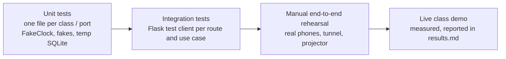

# Test Strategy (To Do 9)

Covers R32 ("a testing strategy that addresses the classes of To Do 7"). Built from the [design](design.md)
(classes of section 3, exceptions of 3.8, tasks T1-T18 of section 7), the [SRS](srs.md) (FR-x.y, NFR-n, error table
of section 5), the [use cases](use_cases.md) (UC-1 to UC-14), the validated decisions D1-D31
([decisions.md](decisions.md); D25 = test tooling, D7 = consistency rule, D30 / D31 = check-in rules) and the
[tools report](tools_report.md). Class, port, method and exception names are exactly those of `design.md`.

## 1. Approach

### 1.1 Test levels

| Level | What | How | When | Trace |
|---|---|---|---|---|
| Unit | Every class and port of design section 3 (section 2 below) | `pytest`, fixtures, `FakeClock`, fakes of the ports, a temporary SQLite file per test (`tmp_path`) | Each task T1-T18, before its commit | D24, D25, NFR-12 |
| Integration | Every route of design 2.1, grouped by use case (section 3 below) | Flask test client on `create_app(config, clock=..., head_counter=..., llm=..., fetcher=..., transcriber=...)`; client IP injected with `environ_base={"REMOTE_ADDR": ...}` and the `CF-Connecting-IP` header | Each task that adds a route (T5-T18) | D25, design 2.1 |
| Manual end-to-end | Real phones on campus Wi-Fi and 4G, projector QR, tunnel, export in a spreadsheet tool | Checklist of section 5 (= tools report section 3, tests 1-9) | After T12 (design section 7), again before the demo | D25, NFR-1, NFR-11 |
| Live demo | The real class, 10 minutes, F1 first | Demo script (Phase 6); whole-class check-in duration and refusals measured | Demo day | R19, NFR-6, D17 |

### 1.2 Tools

- `pytest` 9.2.0 + Flask test client: adopted in [tools report 2.10](tools_report.md) (D25).
- `pytest-cov` for coverage (section 6). It is a test-only dependency to add with T1.
- Fixtures in `tests/conftest.py`: `config` (fixed `LECTURER_PIN`, `SECRET_KEY`, `BASE_URL=https://test.example`,
  `DATABASE_PATH` under `tmp_path`), `clock` (`FakeClock(1_000_000.0)`), `db` (fresh `Database` with `init_schema()`),
  `app` / `client` (built with fakes), `lecturer_client` (PIN already entered), `campus` (allow-list preset to the
  documentation ranges `192.0.2.0/24` and `2001:db8::/32`, RFC 5737 / RFC 3849, so no real address appears in tests).
- Fakes in `tests/fakes.py` (not production classes, design 3.1). Each honours the port contract and raises the same
  `AppError` subclasses as the real adapter (Liskov, design 6.1):

| Fake | Port | Behaviour |
|---|---|---|
| `FakeClock` | `Clock` | `now()` returns a stored float; `set(t)`, `advance(seconds)` |
| `FakeHeadCounter` | `HeadCounter` | Returns a preset count, or raises a preset `UnreadablePhotoError` / `DetectorUnavailableError`; records the call count |
| `FakeLLMClient` | `LLMClient` | Returns a preset text (or a function of the prompt), or raises `LLMUnavailableError`; records `system`, `prompt`, `max_tokens` |
| `FakeRepoFetcher` | `RepoFetcher` | Real `normalize_url` rules; `fetch` returns a preset `RepoExtract` per URL or raises `RepoUnavailableError`; records `(url, max_chars)` |
| `FakeTranscriber` | `Transcriber` | Returns a preset transcript or raises `UnreadableVideoError` (T18 only) |

### 1.3 What is not automated, and why

| Not automated | Why | Replaced by |
|---|---|---|
| Scanning the projector QR with a phone's native camera | Needs a real phone and screen (tools report 2.4) | Manual tests M1, M2, M9 (section 5); automated: the QR PNG is decoded back with OpenCV `QRCodeDetector` (path of tools report 2.3) |
| YuNet accuracy on the provided class photos | The photos are personal data: never in the repository or in tests (R16, D21); measured locally only (tools report 2.5: recall 94 %, precision 96 % on 4 photos) | Unit tests with `FakeHeadCounter`; one real-model test on a non-personal image with a tolerance (D25), skipped when the model file is absent |
| Real Anthropic call | Needs the key and costs money; the suite must run offline with no key (NFR-12) | `FakeLLMClient` and a mocked SDK; one manual smoke test with the key from the environment (`python tools_tests/llm_call.py <text_file_outside_repo> claude-sonnet-5-5`, T15) |
| Real GitHub download | Network | In-memory zip built in the test; one manual real download recorded in the tools report (T16, OI-13) |
| Real faster-whisper transcription (F4, deferred) | Model download, CPU time | `FakeTranscriber`; manual run of `tools_tests/transcribe.py` (tools report 2.6) |
| Client IP seen through the real tunnel, campus range | Needs the campus network | Unit tests with injected IPs; manual tests M5-M7 |
| Whole-class check-in time | Only measurable live (NFR-6) | Measured in the demo, reported in `docs/results.md` |

Rules for every test: no sleeping (time comes from `FakeClock`, D25); no network; no `ANTHROPIC_API_KEY` needed;
only fictitious nicknames (e.g. "BlueFox") and documentation IP ranges (D21).

## 2. Unit tests per class

Each subsection gives: responsibility, test type, doubles, key cases (input -> expected), boundaries, errors
(exact SRS section 5 message, checked verbatim through `user_message`), and trace. Times are relative to the
`FakeClock` start `t0 = 1_000_000.0` (a multiple of 10, so it starts a QR slice and a code slice).

### 2.1 Core (T1, T2)

#### `Config`
- **Responsibility:** read all settings from environment variables. **Type:** unit. **Doubles:** a plain `dict` as `environ`.
- **Key cases:** all three required variables set -> `Config` with defaults `database_path="instance/app.db"`,
  `face_score_threshold=0.4`, `anthropic_model="claude-sonnet-5-5"`, `whisper_model="base"`; `FACE_SCORE_THRESHOLD="0.5"`
  -> `0.5`; no `ANTHROPIC_API_KEY` -> `anthropic_api_key is None` and no error (NFR-9).
- **Boundaries / errors:** each of `LECTURER_PIN`, `SECRET_KEY`, `BASE_URL` missing or empty -> `ConfigError`
  (3 parametrised cases); `ConfigError` is not an `AppError`.
- **Trace:** FR-6.3, NFR-8, NFR-9; T1.

#### `Clock` (port) and `SystemClock`
- **Responsibility:** give the current time. **Type:** unit. **Doubles:** none.
- **Key cases:** `SystemClock().now()` is within 1 s of `time.time()`; `FakeClock` satisfies the `Clock` protocol
  (used by every time test below). **Trace:** D25, NFR-12; T1.

#### `Database`
- **Responsibility:** per-thread SQLite connection, schema, transactions. **Type:** unit. **Doubles:** `tmp_path` file.
- **Key cases:** `init_schema()` twice -> no error (idempotent); `PRAGMA foreign_keys` = 1, `journal_mode` = `wal`;
  `transaction()` commits on success and rolls back when the block raises (row absent afterwards); two threads get
  two different connections.
- **Privacy case (D21, FR-1.3):** schema introspection of every table: no column is named `ip`, `ip_address`,
  `client_ip`, `name`, `first_name`, `last_name`, `email`, `student_id`, `photo` or `image` (the column `nickname` is
  allowed, D6).
- **Trace:** D3, D21, NFR-7; T2.

#### `AppError` family and the error handler
- **Responsibility:** carry the exact SRS message and HTTP status. **Type:** unit + integration (test route).
- **Key cases:** one parametrised test over the table of design 3.8: for each of the 25 concrete `AppError` subclasses,
  `user_message` equals the SRS section 5 text and `http_status` equals the table value (e.g. `OffCampusError` 403,
  `TooManyAttemptsError` 429, `LLMUnavailableError` 503, `WrongPinError` 401) and it is an instance of its group
  base of design 3.8 (`CheckInError`, `PhotoError`, `CommentError`, `PollError`, `ReviewError`); a test route raising an `AppError`
  renders its message and status in HTML, and under `/api/` returns JSON `{"error": message}`; a test route raising
  `RuntimeError` returns 500 "Something went wrong. Please try again." with no traceback, file path or exception
  name in the body, and the traceback is in the log (`caplog`).
- **Trace:** D23, NFR-10; T1.

#### `create_app()` (composition root)
- **Key cases:** with all fakes -> `app.extensions["services"]` holds every service; `app.debug is False` (NFR-8);
  `GET /ping` -> 200; starts with no Anthropic key (NFR-9). **Trace:** D2, D25; T1.

### 2.2 F1 check-in (T2-T4, T7)

#### `RotatingCredentials`
- **Responsibility:** derive and verify the rotating QR token (10 s) and the 3-digit code (5 s). **Type:** unit.
  **Doubles:** `FakeClock`; fixed test key.
- **Key cases (QR):** `qr_token(1)` at `t0` and at `t0 + 9.999` are equal; at `t0 + 10` it differs;
  `verify_qr(qr_token(1))` -> `1`; 2,000 tokens with random keys and session ids all verify (regression of the
  separator bug of tools report 2.2).
- **Boundaries (QR, creation = start of the slice, D31):** token made at `t0` (created `t0`): `verify_qr` at
  `t0 + 15.0` -> accepted, at `t0 + 15.001` -> `QrExpiredError`. Token made at `t0 + 9.9` (also created `t0`): rejected
  at `t0 + 15.001` (the age counts from the slice start, not from the poll).
- **Errors (QR):** one character changed, signature of another key, truncated token, `"abc"`, `""` ->
  `QrExpiredError` "This QR code has expired. Scan a fresh one."
- **Key cases (code):** `current_code(1)` matches `^\d{3}$` for 2,000 consecutive slices (leading zeros kept);
  equal at `t0` and `t0 + 4.999`, may change at `t0 + 5`.
- **Boundaries (code, P1):** with `c_k` = code at `t0` (slice k) and the clock at `t0 + 5` (slice k+1):
  `is_valid_code(1, current)` true; `is_valid_code(1, c_k)` true (previous); at `t0 + 10` (slice k+2) `c_k` -> false
  (two slices old); a wrong 3-digit code (one not equal to the current or previous) -> false; `"12"`, `"1234"`,
  `"12a"`, `""` -> false (no exception).
- **Trace:** FR-1.5, FR-1.6, FR-1.8, NFR-8, D30 (P1), D31; T3.

#### `NetworkPolicy`
- **Responsibility:** resolve the client IP and accept only campus ranges. **Type:** unit. **Doubles:** real
  `SettingsRepository` on a temp DB.
- **Key cases `resolve_client_ip(peer, cf)`** (static):

| peer | `CF-Connecting-IP` | Expected |
|---|---|---|
| `127.0.0.1` | `192.0.2.10` | `192.0.2.10` (plan A, through cloudflared) |
| `::1` | `2001:db8::5` | `2001:db8::5` |
| `::ffff:127.0.0.1` | `192.0.2.10` | `192.0.2.10` (IPv4-mapped loopback normalised) |
| `127.0.0.1` | none | `127.0.0.1` |
| `198.51.100.7` | `192.0.2.10` | `198.51.100.7` (spoofing from a non-loopback peer ignored) |
| `192.0.2.20` | none | `192.0.2.20` (plan B) |

- **Key cases `ensure_allowed`** with ranges `192.0.2.0/24`, `2001:db8::/32`: `192.0.2.0` and `192.0.2.255` pass;
  `192.0.1.255` and `192.0.3.0` -> `OffCampusError`; `2001:db8::1` passes, `2001:db9::1` -> `OffCampusError`;
  `::ffff:192.0.2.10` passes (normalised); an IPv4 address against an IPv6-only list -> `OffCampusError` (no
  exception from `ipaddress`); `"not-an-ip"` -> `OffCampusError` (fail closed, design 6.1).
- **Boundaries:** empty list -> every address refused (D31); `save_ranges` then `ensure_allowed` without restart ->
  new list used at once (FR-1.4).
- **Key cases `save_ranges`:** `["192.0.2.1/24", "", "  ", "2001:db8::/32"]` -> stored `["192.0.2.0/24",
  "2001:db8::/32"]` (blank lines dropped, `strict=False` normalised); `"192.0.2.7"` -> `"192.0.2.7/32"`.
- **Errors:** `"300.1.1.1/24"`, `"192.0.2.0/33"`, `"hello"` (alone or among valid lines) ->
  `InvalidNetworkRangeError` "This is not a valid network range (e.g. 192.0.2.0/24)." and `ranges()` unchanged.
- **Privacy:** no repository method receives the client IP (asserted with a spy on `SettingsRepository`).
- **Trace:** FR-1.2, FR-1.3, FR-1.4, NFR-8, D13, D21, D30, D31; T4.

#### `CheckInService`
- **Responsibility:** apply the D30 rules in the order of SD-2. **Type:** unit (domain, no HTTP). **Doubles:**
  `FakeClock`, real `RotatingCredentials` with a test key, real repositories on a temp DB, `NetworkPolicy` with the
  `campus` ranges. Helpers: `scan()` = `start(credentials.qr_token(sid), "dev-A", "192.0.2.10")`; `code()` =
  `credentials.current_code(sid)` at confirm time.
- **Key cases:** first device: `start` -> `None` (no nickname), `confirm(..., code(), "BlueFox")` -> `CheckIn` with
  nickname "BlueFox", time `now`; afterwards `count_for_session` = 1 and the window is deleted. Returning device
  (session 2): `start` -> `"BlueFox"`, `confirm(..., code(), None)` -> `CheckIn` "BlueFox". The code of the
  previous 5 s slice is accepted (P1). A scan never confirmed -> no `CheckIn` (FR-1.11).
- **Boundaries:**

| Rule | Accepted | Rejected |
|---|---|---|
| QR age on `start` (FR-1.6) | 15.0 s after slice start | 15.001 s -> `QrExpiredError` |
| Window (FR-1.7) | `confirm` at `opened_at + 60.0` | `opened_at + 60.001` -> `WindowExpiredError` |
| Attempts (FR-1.9, P2) | 4 wrong codes then right code on the 5th -> `CheckIn` | 5 wrong codes (each `WrongCodeError`), 6th with the right code -> `TooManyAttemptsError`, window deleted |
| New scan after 6c (OI-7) | new `start` -> 0 attempts, right code -> `CheckIn` | - |
| Nickname (FR-1.10, OI-2) | 1 and 30 characters after trimming; `"  BlueFox  "` stored as `"BlueFox"`; two devices with the same nickname | `""`, `"   "`, 31 characters -> `EmptyNicknameError` |
| Nickname rejection not an attempt (D31) | 5 empty-nickname submissions then 5 wrong codes -> all `WrongCodeError`; the 6th code attempt is the first `TooManyAttemptsError` | - |
| One per device (FR-1.12) | another device token in the same session | second `start` by a checked-in device -> `AlreadyCheckedInError`, no window created |

- **Errors (message verbatim, no window and no record created in each case):** off-campus IP on `start` and on
  `confirm` -> `OffCampusError` (confirm: attempts not incremented); tampered QR -> `QrExpiredError`; session closed
  before `start` or between `start` and `confirm` -> `SessionClosedError`; `confirm` from device "dev-B" holding no
  window -> `WindowExpiredError`; wrong code -> `WrongCodeError`; second `confirm` after a success -> rejected
  (`WindowExpiredError`, window already deleted) and still one record (`UNIQUE` also tested in 2.3).
- **Transaction:** if `add` fails (simulated `IntegrityError`), no nickname, record or attempt change remains.
- **Trace:** FR-1.6-FR-1.12, UC-2, D6, D30 (P1, P2), D31; T7.

### 2.3 F1 repositories (T2)

Type: unit on a temp DB (`db` fixture); doubles: none. All return frozen dataclasses (never `sqlite3.Row`).

| Class | Responsibility | Key cases | Boundaries / constraint errors | Trace |
|---|---|---|---|---|
| `SessionRepository` | SQL of `attendance_session` | `create(t)` -> open session with `head_count None`; `get` round-trip; `find_open`; `close(id, t)` -> `is_open()` false; `set_head_count(id, 42, t)` then a second call with 40 -> 40 (OI-5); `list_all` oldest first | second open row -> `sqlite3.IntegrityError` (partial index `one_open_session`); `get(999)` -> `None` | FR-1.1, FR-1.15, D27 |
| `CheckInRepository` | SQL of `device` and `check_in` | `nickname_of` unknown token -> `None`; `save_nickname` then `nickname_of` -> value; `add` -> `CheckIn`; `has_checked_in` true / false; `list_for_session` oldest first; `count_for_session` | duplicate `(session, device)` -> `IntegrityError` (`UNIQUE`) | FR-1.10-FR-1.12 |
| `CheckInWindowRepository` | SQL of `checkin_window` | `open` then `find` -> attempts 0; `increment_attempts` -> 1, 2, 3; `open` again -> attempts 0 (OI-7); `find` returns the most recent window of the device across sessions; `delete` -> `find` `None` | `find` of another token -> `None` | FR-1.7, FR-1.9 |
| `SettingsRepository` | Lists `setting_item(kind, value)` | `replace_values("campus_range", [...])` then `list_values` -> same list; kinds `campus_range` and `peer_repo` isolated; `replace_values(kind, [])` empties only that kind | - | FR-1.4, FR-5.5 |

### 2.4 F1 session, projector, head count, export (T5, T6, T10-T12)

#### `SessionService`
- **Responsibility:** session lifecycle, projector state, summary N / D / status, photo count. **Type:** unit.
  **Doubles:** `FakeClock`, `FakeHeadCounter`, real repositories, real `RotatingCredentials`.
- **Key cases:** `open_session()` -> open session; `current()` returns it; `close_session()` -> `current()` `None`;
  `close_session()` with none open -> no error; close then open -> a new session (FR-1.13, UC-3).
  `projector_state()` -> `check_in_url` starts with `f"{BASE_URL}/c/"` and its token passes `verify_qr`; `code`
  matches `^\d{3}$`; at `t0 + 10` the URL differs, at `t0 + 5` the code may differ, the URL not (FR-1.5, FR-1.8);
  closed session -> `None` (FR-1.13). `record_head_count(id, b"img")` with `FakeHeadCounter(40)` and N = 45 ->
  `SessionSummary` with D 40 and status "consistent"; a second photo with 30 replaces D (OI-5) -> "anomaly";
  `summary(id)` before any photo -> `consistency is None`.
- **Errors:** second `open_session()` -> `SessionAlreadyOpenError` "A session is already open. Close it first.";
  `FakeHeadCounter` raising `UnreadablePhotoError` / `DetectorUnavailableError` -> same error propagated and the
  stored D unchanged.
- **Privacy:** the service has no method that sets D by hand (asserted on the public attribute list, FR-1.17).
- **Trace:** FR-1.1, FR-1.5, FR-1.8, FR-1.13-FR-1.17, D7, D27; T5, T6, T10, T11.

#### `ConsistencyResult` (D7)
- **Responsibility:** pure rule `lower = N - max(7, ceil(0.15 N))`, `upper = N + max(4, ceil(0.10 N))`.
  **Type:** unit, exhaustive. **Doubles:** none.
- **Key and boundary cases** (`evaluate(n, d)`; each row tests `lower - 1`, `lower`, `upper`, `upper + 1` when
  `lower - 1 >= 0`). The rows cover both floors (`max(7, ...)` active up to N = 46, `max(4, ...)` up to N = 40) and the
  switch points (N = 46/47 for the lower bound, N = 40/41 for the upper bound):

| N | lower | upper | anomaly below | consistent | anomaly above |
|---|---|---|---|---|---|
| 0 | -7 | 4 | - | 0, 4 | 5 |
| 1 | -6 | 5 | - | 0, 5 | 6 |
| 7 | 0 | 11 | - | 0, 11 | 12 |
| 8 | 1 | 12 | 0 | 1, 12 | 13 |
| 10 | 3 | 14 | 2 | 3, 14 | 15 |
| 40 | 33 | 44 | 32 | 33, 44 | 45 |
| 41 | 34 | 46 | 33 | 34, 46 | 47 |
| 45 | 38 | 50 | 37 | 38, 50 | 51 |
| 46 | 39 | 51 | 38 | 39, 51 | 52 |
| 47 | 39 | 52 | 38 | 39, 52 | 53 |
| 60 | 51 | 66 | 50 | 51, 66 | 67 |

- **Oracle test:** for every N in 0..200 and D in 0..N+30, `consistent` equals the integer formula
  `n - max(7, -(-15*n // 100)) <= d <= n + max(4, -(-10*n // 100))` (guards against float rounding in `ceil`).
- `label()` -> `"consistent"` / `"anomaly"`; the object is frozen (assignment raises).
- **Trace:** FR-1.16, D7, tools report 2.5.3; T11 (rows N = 45 and N = 10 are the T11 / FR-1.16 acceptance values).

#### `HeadCounter` (port) and `YuNetHeadCounter`
- **Responsibility:** count faces on image bytes in memory. **Type:** unit; real-model tests marked
  `@pytest.mark.model` and skipped if `YUNET_MODEL_PATH` does not exist (model file is git-ignored, A5).
- **Key cases:** `FakeHeadCounter` satisfies the port. Real model: a synthetic 4000 x 3000 blank image (generated
  with numpy in the test) -> 0 faces, no error, input resized (long side 2000); default threshold 0.4 from `Config`;
  the non-personal sample image of section 4 -> count within +/- 20 % of its recorded count (D25) and timed under 1 s
  (`time.perf_counter`, NFR-3); 4 threads calling `count_faces` at once -> same count each (lock).
- **Errors:** `b"not an image"` and `b""` -> `UnreadablePhotoError` "We could not read this photo. Please try
  another one."; model path that does not exist -> `DetectorUnavailableError` "Head count is not available right
  now." (runs without the model file).
- **Privacy:** after `count_faces`, no new file in `tmp_path`, `instance/` or `tempfile.gettempdir()` (directory
  listing before / after, FR-1.17).
- **Trace:** FR-1.15, FR-1.17, NFR-3, D7, D21, D25; T11.

#### `qr_png_data_uri()` (function)
- **Key cases:** result starts with `data:image/png;base64,`; the base64 PNG decoded with OpenCV `QRCodeDetector`
  gives back the input URL (a 100-character URL, tools report 2.3). **Trace:** FR-1.5; T6.

#### `AttendanceExporter`
- **Responsibility:** CSV and XLSX of all sessions. **Type:** unit. **Doubles:** real repositories with 2 sessions
  of fictitious check-ins (one with D, one without).
- **Key cases:** `checkins_csv()` re-read with `csv`: header = session date, nickname, check-in time (3 columns,
  in this order), one row per check-in, oldest first, rows equal `list_for_session`; `summary_csv()`: session date,
  check-ins (N), faces detected (D), consistency status, the status equal to `ConsistencyResult.evaluate(N, D).label()`,
  D and status empty for the session without a photo; `xlsx()` re-read with `openpyxl`: sheets "Check-ins" and
  "Summary" with the same rows as the CSV files, header row frozen (`freeze_panes == "A2"`).
- **Boundaries:** no session -> header rows only; a nickname with a comma or quote survives the CSV round trip.
- **Privacy:** no header contains `ip` or `token`; no device token value appears in any cell (FR-1.3, NFR-7).
- **Trace:** FR-1.18, D8, D31 (OI-6), tools report 2.8; T12.

### 2.5 F2 comments and F3 polls (T13, T14)

#### `CommentService` and `CommentRepository`
- **Type:** unit. **Doubles:** `FakeClock`, temp DB.
- **Key cases:** `post("  Slower please  ")` -> `Comment` text `"Slower please"`, time `now`; `post` with no open
  session works (D8); `recent()` newest first; 101 comments -> `recent(100)` returns the 100 newest;
  `CommentRepository.add` / `list_recent` round-trip; the `comment` table has exactly the columns `id`, `text`,
  `posted_at` (anonymity by construction, FR-2.1, D29); a new `Database` on the same file still lists earlier
  comments (FR-2.3).
- **Boundaries:** 500 characters -> accepted; 501 -> rejected; 500 characters plus surrounding spaces -> accepted
  (length after trimming).
- **Errors:** `""`, `"   "` -> `EmptyCommentError` "Please write something before sending."; 501 characters ->
  `CommentTooLongError` "Please keep your comment under 500 characters."; nothing stored in both cases.
- **Trace:** FR-2.1-FR-2.4, D8, D29, D31 (OI-11); T14.

#### `PollService` and `PollRepository`
- **Type:** unit. **Doubles:** `FakeClock`, temp DB.
- **Key cases:** `create("Q?", ["A", "B"])` and with 4 options -> open `Poll`; `create("  Q? ", ["A", "", " B "])`
  -> question `"Q?"`, options `["A", "B"]` (trimmed, empty dropped); `vote` by "dev-A" -> option count 1,
  `total_votes()` 1; a device with no nickname votes (FR-3.2); `close(id)` -> `is_open` false, `current()` `None`,
  `latest()` returns the closed poll with unchanged counts (FR-3.4); a new poll can be created after closing.
- **Boundaries:** 2 and 4 options accepted; 1 and 5 options rejected; `["A", "  "]` (1 option after dropping) rejected.
- **Errors:** empty question or wrong option count -> `InvalidPollError` "A poll needs a question and 2 to 4
  options."; second open poll -> `PollAlreadyOpenError` "A poll is already open. Close it first."; second vote by
  the same device -> `AlreadyVotedError` "You have already voted." and count unchanged; vote after close ->
  `PollClosedError` "This poll is closed." and counts unchanged.
- **Repository constraints:** second open poll row -> `IntegrityError` (`one_open_poll`); duplicate `(poll_id,
  device_token)` vote -> `IntegrityError`.
- **Trace:** FR-3.1-FR-3.4, D9, D28; T13.

### 2.6 F5 homework review (T15-T17)

#### `LLMClient` (port) and `ClaudeClient`
- **Type:** unit. **Doubles:** `monkeypatch` of `anthropic.Anthropic` (no network).
- **Key cases:** mocked SDK returns a message -> `complete` returns its text; the SDK receives the model from
  `Config.anthropic_model`, the `system` text and `max_tokens` passed in.
- **Errors:** key `None` -> `LLMUnavailableError` and the SDK is never constructed; mocked `anthropic.APIError` and a
  timeout -> `LLMUnavailableError` "The review service is unavailable right now. Please try again later."
- **Manual:** one real call (section 1.3). **Trace:** FR-5.3, FR-4.4, D12, NFR-9; T15.

#### `RepoFetcher` (port) and `GitHubRepoFetcher`
- **Type:** unit. **Doubles:** `monkeypatch` of `urllib.request.urlopen` returning a zip built in memory with
  `zipfile` (fictitious files).
- **Key cases `normalize_url`:**

| Input | Expected |
|---|---|
| `https://github.com/demo-owner/demo-repo` | accepted, canonical form |
| `https://github.com/demo-owner/demo-repo.git` | same canonical form |
| `https://github.com/demo-owner/demo-repo/` | same canonical form |
| `http://github.com/demo-owner/demo-repo` | `InvalidRepoUrlError` (https only) |
| `https://gitlab.com/demo-owner/demo-repo` | `InvalidRepoUrlError` |
| `https://github.com/demo-owner` | `InvalidRepoUrlError` (missing repository) |
| `https://github.com/demo-owner/demo-repo/tree/main` | `InvalidRepoUrlError` |
| `""` | `InvalidRepoUrlError` |

- **Key cases `fetch`:** README text first in `RepoExtract.text`, then source files in path order; files under
  `node_modules/`, `.git/`, `venv/`, `build/`, `dist/` and non-listed extensions (e.g. `.png`) excluded; `file_count`
  and `line_count` equal the known content of the test zip; download URL is the `codeload.github.com` archive.
- **Boundaries:** `max_chars=50000` on a zip with 80,000 characters of text -> `len(text) <= 50000`, `truncated` true;
  a small repository -> `truncated` false.
- **Errors:** mocked HTTP 404, `URLError`, a response larger than 20,000,000 bytes, bytes that are not a zip ->
  `RepoUnavailableError` "We could not download this repository. Is it public?"; invalid URL ->
  `InvalidRepoUrlError` "Please enter a public GitHub repository link."
- **Manual:** one real public download recorded in the tools report (OI-13). **Trace:** FR-5.1, FR-5.2, D11; T16.

#### `HomeworkReviewer`
- **Type:** unit. **Doubles:** `FakeRepoFetcher` (repositories `demo-owner/target`, `peer-one/alpha`,
  `peer-two/beta`, `peer-three/gamma`), `FakeLLMClient`, real `SettingsRepository`.
- **Key cases:** peers `[peer-one, peer-two]` -> one `complete` call whose prompt contains "Submission A",
  "Submission B", "Submission C" and the file / line counts; `fetch` called with 50000 for the target and 15000 for
  each peer; `ReviewResult.comparison_available` true.
- **Boundaries:** peer list `[target.git, peer-one, peer-two]` -> the target is not its own peer (compared after
  normalisation); list of 3 -> only the first 2 eligible are fetched (OI-1); one peer raising
  `RepoUnavailableError` -> skipped, review still returned with the other; empty list or all peers failing ->
  `comparison_available` false and the text contains "No other submission was available for comparison." (OI-12).
- **Redaction (FR-5.4, OI-9):** `peer-one`, `alpha`, `peer-two`, `beta` and their URLs absent from the prompt;
  a `FakeLLMClient` answer that mentions `peer-one/alpha` -> the returned `review_text` shows "Submission B" instead.
- **Errors:** `InvalidRepoUrlError` and target `RepoUnavailableError` propagate (no LLM call); `LLMUnavailableError`
  propagates.
- **Not stored:** row counts of every table except `setting_item` unchanged after `review`.
- **Peer list:** `set_peer_repos([...])` then `peer_repos()` -> same list (kind `peer_repo`), used by the next review.
- **Trace:** FR-5.3-FR-5.5, D11, D31 (OI-1, OI-9, OI-12); T17.

### 2.7 F4 video summary (T18, only after the D10 revisit)

#### `Transcriber` (port), `WhisperTranscriber`, `VideoSummarizer`
- **Type:** unit. **Doubles:** `FakeTranscriber`, `FakeLLMClient`.
- **Key cases:** `summarize(path)` with an LLM answer holding the four headings -> `VideoSummary.sections` with
  topics, key points, homework / action items, questions raised, and `transcript_words` equal to the fake
  transcript's word count; an answer missing a heading -> the whole text under "Summary"; the configured language
  is passed to `transcribe`.
- **Errors:** `b"not a video"` written to a temp file -> `WhisperTranscriber` raises `UnreadableVideoError` "We could
  not read this video file." (marked `model`, skipped without the whisper model); `LLMUnavailableError` -> message
  with "summary".
- **Privacy:** only text reaches `FakeLLMClient` (the prompt holds no bytes of the file) (FR-4.2).
- **Trace:** FR-4.1-FR-4.4, D10; T18.

### 2.8 Web helpers (T5, T8)

| Helper | Key cases | Trace |
|---|---|---|
| `device_token()` | first request -> cookie `dt` set, `HttpOnly`, `SameSite=Lax`, `Max-Age` of one year; second request with the cookie -> same value, no new cookie; two clients -> two different values | D6, D31 (OI-4) |
| `client_ip()` | same table as `NetworkPolicy.resolve_client_ip`, driven through the test client with `REMOTE_ADDR` and the header | FR-1.3 |
| `lecturer_required` | every PIN route of design 2.1 (parametrised list) without the PIN -> redirect to `/lecturer/login`; with the PIN -> not redirected | FR-6.1 |

## 3. Integration tests per use case

Flask test client on an app built with fakes; `lecturer_client` holds the PIN; student requests come from
`REMOTE_ADDR=127.0.0.1` with `CF-Connecting-IP: 192.0.2.10` (campus) unless stated. Every message is checked
verbatim in the response body.

| UC | Main path (expected) | Error / alternative paths (expected) | File |
|---|---|---|---|
| UC-1 Open session | `POST /lecturer/sessions` -> redirect to `/lecturer/projector`; `GET /api/projector` -> JSON with a PNG data URI decoding to `https://test.example/c/...` and a 3-digit code; FakeClock +10 s -> new QR, +5 s -> new code | session already open -> "A session is already open. Close it first."; no PIN -> redirect; no page contains `getUserMedia` (no camera access, FR-1.5) | `test_lecturer_sessions.py`, `test_projector.py` |
| UC-2 Check in | `GET /c/<token>` (first device) -> page with nickname field, warning "Do not use your real name or ID", `inputmode="numeric"` code field, Confirm; `POST /checkin` -> "You are checked in"; second session, same cookie -> no nickname field, "Hello BlueFox"; scan + confirm each answered in < 1 s (`perf_counter`, NFR-4) | 4G address `198.51.100.7` -> off-campus message (403); QR +15.001 s -> expired message; window +60.001 s -> time ran out; wrong code -> wrong-code message; 6th attempt -> "Too many tries. Scan the QR code again."; empty / 31-char nickname -> nickname message; checked-in device scans again -> "You are already checked in for this class."; closed session -> "Attendance for this class is closed."; `GET /checkin` without token: no session -> `NoOpenSessionError` "There is no attendance check-in right now." (404), open session -> "Scan the QR code on the projector."; spoofed header from peer `198.51.100.7` -> refused | `test_checkin_routes.py` |
| UC-3 Close session | `POST /lecturer/sessions/close` -> `GET /api/projector` has no QR and no code | scan after close and confirm of a window opened before close -> "Attendance for this class is closed." | `test_lecturer_sessions.py` |
| UC-4 Head count | `POST /lecturer/sessions/<id>/photo` (multipart, `FakeHeadCounter(40)`, N = 45) -> "checked in 45 / detected 40 / consistent"; page shows the "look up" advice; second photo replaces D | `FakeHeadCounter` raising -> "We could not read this photo. Please try another one." / "Head count is not available right now."; no file left on disk; no route edits D (route list check) | `test_photo_routes.py` |
| UC-5 Table and export | after a check-in, `GET /api/sessions/<id>/attendance` lists it, N + 1, on the next poll; an open window without a right code leaves N unchanged; the three export routes return attachments whose rows equal the JSON | no PIN -> redirect; no route creates a check-in without scan and code (route list check, FR-1.18) | `test_live_table.py`, `test_export_routes.py` |
| UC-6 Allow-list | `POST /lecturer/allow-list` with `192.0.2.0/24` and `2001:db8::/32` -> saved; the next `/c/<token>` from `2001:db8::5` accepted at once | invalid line -> "This is not a valid network range (e.g. 192.0.2.0/24)." and list unchanged; empty list -> page warning and every scan refused; no PIN -> redirect | `test_allow_list_routes.py` |
| UC-7 Post comment | `POST /comments` without login and without session -> "Thanks, sent anonymously."; stored row has text and time only | blank -> "Please write something before sending."; 501 chars -> "Please keep your comment under 500 characters." | `test_comment_routes.py` |
| UC-8 Read comments | `GET /api/comments` (PIN) lists the new comment first, no nickname in the JSON; comments still listed after re-creating the app on the same DB file | no PIN -> redirect | `test_comment_routes.py` |
| UC-9 Create poll | `POST /lecturer/polls` with 2 options -> results page | 1 or 5 options / empty question -> "A poll needs a question and 2 to 4 options."; second poll -> "A poll is already open. Close it first." | `test_poll_routes.py` |
| UC-10 Vote | fresh client (no nickname) `GET /api/poll/current` -> open poll; `POST /poll/vote` -> "Thank you, your vote is counted." | second vote -> "You have already voted."; closed poll -> "This poll is closed." | `test_poll_routes.py` |
| UC-11 Results and close | `GET /api/polls/<id>/results` reflects the vote on the next poll; `POST /lecturer/polls/<id>/close` -> final counts still shown | vote after close refused, counts unchanged | `test_poll_routes.py` |
| UC-12 Video (deferred) | upload -> four sections displayed; temporary file deleted | unreadable file -> "We could not read this video file."; `FakeLLMClient` failing -> "The summary service is unavailable right now. Please try again later."; temp file deleted on error too | `test_video_routes.py` |
| UC-13 Review | `POST /review` without PIN, `FakeRepoFetcher` + `FakeLLMClient` -> review with Submission B / C and metrics, no peer owner or repo name in the page; `/lecturer/peers` (PIN) saves the list used by the next review | malformed URL / unavailable repo / LLM failure -> the three SRS messages; no peer -> "No other submission was available for comparison."; `/lecturer/peers` without PIN -> redirect | `test_review_routes.py` |
| UC-14 Unlock | `POST /lecturer/login` with the right PIN -> redirect to `/lecturer`, later pages open | wrong PIN -> "Wrong PIN." (401); every PIN route without PIN -> redirect | `test_lecturer_access.py` |

Cross-cutting integration tests (`test_privacy.py`, `test_polling.py`):
- After a full UC-2 + UC-4 + UC-5 run: no table holds `192.0.2.10` or any client IP string (full-text scan of the
  SQLite dump); exports contain no IP and no device token; no image file on disk (FR-1.3, FR-1.17, NFR-7).
- Log records at INFO level contain no client IP (`caplog`, design 3.3).
- Polling constants in the static scripts: projector 1000 ms, lecturer pages 2500 ms, student poll page 3000 ms
  (read from `projector.js` / `poll_json.js`), all below the 5 s of NFR-2; with the JSON updated on the next
  request, a change is visible within one interval (NFR-2, D4, D31).

## 4. Test data

- **Synthetic only (R16, D21):** fictitious nicknames ("BlueFox", "RedOwl"), documentation IP ranges
  (`192.0.2.0/24`, `198.51.100.0/24` as off-campus, `2001:db8::/32`), test PIN and key defined in `conftest.py`,
  fictitious repository names (`demo-owner/target`, `peer-one/alpha`, ...).
- **Photos:** the provided class photos are **never** copied into the repository, `tests/` or fixtures; their
  accuracy measurement stays local and reported as numbers only (tools report 2.5). Logic tests use
  `FakeHeadCounter`. Real-model tests use (a) blank or noise images generated with numpy inside the test and (b) one
  non-personal sample image with a known face count, public-domain or CC0, not showing any class member, whose
  source, licence and reference count are recorded in `tests/data/README.md`; tolerance +/- 20 % (D25). If no such
  image is committed, test (b) is skipped and NFR-3 is timed on the manual photo of M8.
- **F5:** zip archives built in memory in each test (`zipfile` + `io.BytesIO`) with fictitious README and source
  files; no real repository of the provided list (`ex1_repo_links.pdf` stays local, D21).
- **F4:** fake transcripts (text in the test); no class video in the repository.
- **Database:** a new SQLite file under `tmp_path` per test; never `instance/app.db`.

## 5. Manual test checklist

Run after T12 (design section 7) and again before the demo. M1-M9 are tests 1-9 of
[tools report section 3](tools_report.md) (same numbers; its test 10, a longer recording, belongs to the deferred F4);
M10-M12 are added here. Results are written in `docs/results.md`.

| # | Test | Expected | Trace |
|---|---|---|---|
| M1 | iPhone native Camera scans the projector QR (tunnel, HTTPS) | link banner opens the check-in page; numeric keypad for the code; nickname asked on the first visit only; check-in in the live table | NFR-1, NFR-11, UC-2 |
| M2 | Same with an Android phone (camera app, Google Lens if needed) | same as M1 | NFR-11 |
| M3 | Scan-to-check-in time on campus Wi-Fi; a QR photo opened more than 15 s later | accepted within 15 s; the late one refused with the expired message | FR-1.6, NFR-4 |
| M4 | Campus Wi-Fi reaches `*.trycloudflare.com` | page opens from a phone | D13, A2 |
| M5 | Same phone on campus Wi-Fi, then on 4G/5G | campus accepted; 4G refused with the off-campus message | FR-1.2, FR-1.3 |
| M6 | IPv6 from campus Wi-Fi / 4G | IPv6 prefix noted; an IPv6 range in the allow-list matches | FR-1.2 |
| M7 | Campus public IP measurement | range(s) entered via UC-6 (ranges only, D21) | D30, OI-3 |
| M8 | Head count on a fresh photo of the real room with the lecturer's phone | D shown with the status in < 1 s; photo not stored | FR-1.15, NFR-3 |
| M9 | Plan B: `http://<laptop-ip>` in the QR, LAN range in the allow-list, iPhone and Android | camera opens the plain-HTTP link; check-in works | NFR-9, D13 |
| M10 | `attendance.xlsx`, `checkins.csv`, `summary.csv` opened in Excel or Numbers | two sheets, rows equal the live table, readable dates and nicknames | FR-1.18, UC-5 |
| M11 | Rehearsal with several browser tabs and 2-3 phones: comment, poll, review | comment and vote visible on the lecturer page within 5 s; review shown | NFR-2, NFR-5, D25 |
| M12 | One real LLM call and one real GitHub download (T15, T16) | answer received; download recorded in the tools report | D12, OI-13 |

## 6. Coverage and exit criteria

- **Measure:** `pytest --cov=app --cov-branch --cov-report=term-missing` (default run, offline, no key; `model`
  tests skipped when the model file is absent). Real-model tests: `pytest -m model`.
- **Goal:** every public method of every class and port in design section 3 has at least one test (checked against
  section 2 of this document), and every row of SRS section 5 has a test with its exact message (D23). Line
  coverage target: 90 % for `app/services/` and `app/repositories/`, 80 % for `app/` overall; the lines that need
  the real YuNet or whisper model are listed, not hidden. The coverage report is quoted in `docs/results.md`.
- **Exit criterion of every task:** all its tests below pass, the whole suite stays green, then commit (D24).

| T | Test files (under `tests/`) | Done when (design section 7) |
|---|---|---|
| T1 | `test_core.py` (Config, Clock, AppError table, error handler, `create_app`, `/ping`) | 2.1 cases pass |
| T2 | `test_db.py`, `test_repositories_f1.py` | 2.1 `Database` + 2.3 pass, privacy column check passes |
| T3 | `test_credentials.py` | QR and code boundaries of 2.2 pass |
| T4 | `test_network.py` | `resolve_client_ip` table, ranges, empty list, invalid lines pass |
| T5 | `test_lecturer_access.py`, `test_lecturer_sessions.py`, `test_sessions.py` (open / close / current) | UC-1, UC-3, UC-14 rows pass |
| T6 | `test_projector.py` (`qr_png_data_uri`, `/api/projector`, `projector_state`) | QR decodes to `BASE_URL`, rotation at 10 s / 5 s, closed -> none |
| T7 | `test_checkin_service.py` | every boundary and error of 2.2 `CheckInService` passes |
| T8 | `test_checkin_routes.py`, `test_device.py` | UC-2 row passes, cookie flags checked |
| T9 | `test_allow_list_routes.py` | UC-6 row passes |
| T10 | `test_live_table.py`, `test_polling.py` | UC-5 live part passes |
| T11 | `test_consistency.py`, `test_head_count.py`, `test_photo_routes.py` | D7 table + oracle, errors, no file written; `model` tests pass when the model is present |
| T12 | `test_export.py`, `test_export_routes.py` | round trips equal the table; no IP / token |
| T13 | `test_polls.py`, `test_poll_routes.py` | UC-9-UC-11 rows pass |
| T14 | `test_comments.py`, `test_comment_routes.py` | UC-7, UC-8 rows pass |
| T15 | `test_llm_client.py` | mocked cases pass; manual call done once (M12) |
| T16 | `test_repo_fetcher.py` | URL table and zip cases pass; manual download recorded (M12) |
| T17 | `test_homework.py`, `test_review_routes.py` | redaction, peer rules, no storage, UC-13 row pass |
| T18 | `test_video.py`, `test_video_routes.py` | UC-12 row passes (only after the D10 revisit) |
| hardening | `test_redteam_fixes.py` | `strip_invisible` and invisible-only nickname refused; XLSX export survives a control character; photo above 40 MP refused before decoding; 25 MB upload cap; werkzeug log silenced; `X-Frame-Options` / `nosniff` on every response; `SameSite=Lax` cookies; glued peer names masked, unrelated words not (T4, T7-T9, T11, T12, T17; design 2.1) |
| all | `test_privacy.py` | no IP, no personal column, no image file after a full run |

Before the demo: full suite green, coverage report taken, M1-M12 done (or the failed ones noted with the plan B used).

## 7. Traceability: FR / NFR -> tests

| Requirement | Unit tests (section 2) | Integration / manual |
|---|---|---|
| FR-1.1 | `SessionService`, `SessionRepository` (one open) | UC-1 |
| FR-1.2 | `NetworkPolicy.ensure_allowed`, `CheckInService` off-campus | UC-2, UC-6; M5, M6 |
| FR-1.3 | `NetworkPolicy.resolve_client_ip`, `client_ip()`, `Database` column check | UC-2 spoofing; `test_privacy.py`; M5 |
| FR-1.4 | `NetworkPolicy.save_ranges`, `SettingsRepository` | UC-6; M7 |
| FR-1.5 | `RotatingCredentials.qr_token`, `SessionService.projector_state`, `qr_png_data_uri` | UC-1; M1, M2 |
| FR-1.6 | `RotatingCredentials.verify_qr`, `CheckInService` QR age | UC-2; M3 |
| FR-1.7 | `CheckInService` window, `CheckInWindowRepository` | UC-2 |
| FR-1.8 | `RotatingCredentials` code cases | UC-1, UC-2 |
| FR-1.9 | `CheckInService` attempts, `CheckInWindowRepository.increment_attempts` | UC-2 |
| FR-1.10 | `CheckInService` nickname, `CheckInRepository` | UC-2; M1 |
| FR-1.11 | `CheckInService` success / abandoned scan | UC-2, UC-5 |
| FR-1.12 | `CheckInService` one per device, `CheckInRepository` `UNIQUE` | UC-2 |
| FR-1.13 | `SessionService.close_session`, `CheckInService` closed session | UC-3 |
| FR-1.14 | `SessionService.summary` | UC-5 |
| FR-1.15 | `YuNetHeadCounter`, `SessionService.record_head_count` | UC-4; M8 |
| FR-1.16 | `ConsistencyResult` (table + oracle) | UC-4 |
| FR-1.17 | `YuNetHeadCounter` no file, `SessionService` no manual D | UC-4; `test_privacy.py` |
| FR-1.18 | `AttendanceExporter` | UC-5; M10 |
| FR-2.1-FR-2.4 | `CommentService`, `CommentRepository` | UC-7, UC-8; M11 |
| FR-3.1-FR-3.4 | `PollService`, `PollRepository` | UC-9, UC-10, UC-11; M11 |
| FR-4.1-FR-4.4 | `VideoSummarizer`, `WhisperTranscriber` (deferred) | UC-12 |
| FR-5.1, FR-5.2 | `GitHubRepoFetcher` | UC-13; M12 |
| FR-5.3 | `ClaudeClient`, `HomeworkReviewer` | UC-13; M12 |
| FR-5.4, FR-5.5 | `HomeworkReviewer` (redaction, peers), `SettingsRepository` | UC-13 |
| FR-6.1 | `lecturer_required` | UC-14 (all PIN routes) |
| FR-6.2 | - | UC-2, UC-7, UC-10, UC-13 (no login step) |
| FR-6.3 | `Config`, `SessionService.projector_state` | UC-1; M9 |
| NFR-1, NFR-11 | - | M1, M2, M9 |
| NFR-2 | - | `test_polling.py`, UC-5, UC-8, UC-11; M11 |
| NFR-3 | `YuNetHeadCounter` timed (`model`) | M8 |
| NFR-4 | - | UC-2 timed requests; M3 |
| NFR-5 | - | M11 |
| NFR-6 | - | live demo, `docs/results.md` |
| NFR-7 | `Database` columns, `AttendanceExporter`, `CommentRepository` columns | `test_privacy.py` |
| NFR-8 | `RotatingCredentials` tampering, `NetworkPolicy` spoofing, `CheckInService` attempts, `create_app` debug off | UC-14 |
| NFR-9 | `Config` without key, `ClaudeClient` without key | M9 |
| NFR-10 | `AppError` table, error handler | every UC error path |
| NFR-12 | the whole suite runs offline with no key | - |
