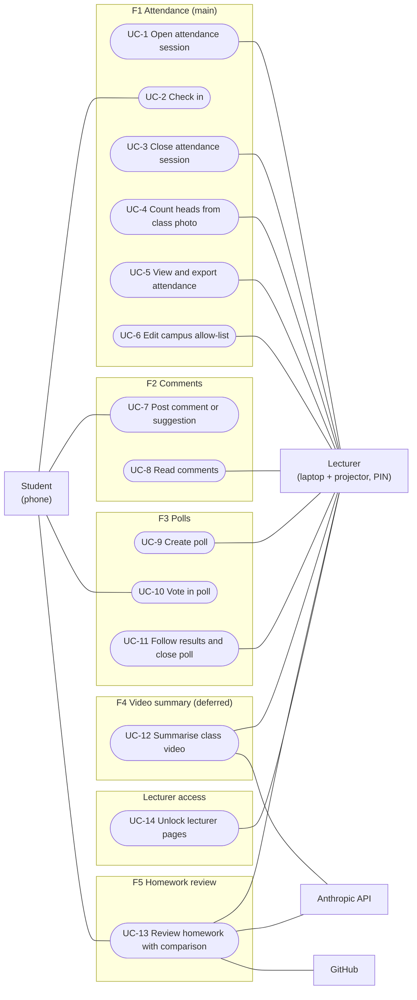
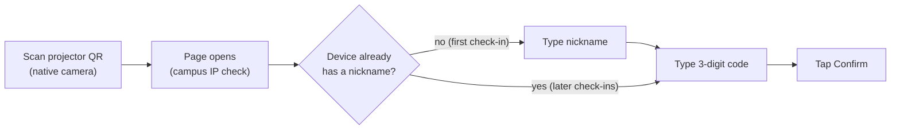

# Use Cases (To Do 6)

Covers R28 ("Define the main use cases (client stories)"). Built from the [SRS](srs.md) (FR-x.y, NFR-n, error
messages of section 5), the requirements R1-R37 ([requirements.md](requirements.md)) and the validated decisions
D1-D31 ([decisions.md](decisions.md); D31 = design-level choices validated on 23/11). The attendance check-in follows **D30**; D5 and D26 are superseded and not
used here. F1 Attendance is the main feature (R4) and comes first.

## 1. Actors

| Actor | Kind | Description | Trace |
|---|---|---|---|
| Student | Primary, human | Uses their own smartphone browser, no installation and no account; identified only by a random device token and, for attendance only, a self-chosen nickname entered once. Scans QR codes with the phone's **native camera app** (the app never uses the camera). | R14, R16, D6, D28, D29, D30 |
| Lecturer | Primary, human | Uses a laptop connected to the projector, and optionally a phone; unlocks lecturer pages with a single PIN. | D22, FR-6.1 |
| Anthropic API | External system | Receives text only (public repository extracts, video transcript) and returns an LLM review or summary. | D11, D12, FR-4.3, FR-5.3 |
| GitHub | External system | Serves the archive of a public repository, downloaded without a token. | D11, FR-5.2 |

Not actors (inside the system boundary, run locally on the laptop): the YuNet face detector (D7) and the
faster-whisper transcriber (D10). The Cloudflare quick tunnel (D13) is transport only.

All lecturer use cases **include** UC-14 (lecturer PIN), except UC-13, which needs no PIN (FR-6.1, FR-6.2).

## 2. Overview diagram

Mermaid has no native UML use-case diagram; actors are drawn on the sides and use cases as rounded nodes, grouped by
feature.

## 3. Use case list

Priority from the SRS: **MUST-MAIN** (F1), **MUST**, **MUST, deferred** (F4, D10).

| ID | Name | Primary actor | Feature | Priority | Trace |
|---|---|---|---|---|---|
| UC-1 | Open attendance session | Lecturer | F1 | MUST-MAIN | FR-1.1, FR-1.5, FR-1.8, FR-6.3; R1, R4; D27, D30 |
| UC-2 | Check in | Student | F1 | MUST-MAIN | FR-1.2, FR-1.3, FR-1.6-FR-1.12, NFR-1, NFR-4; R1, R14, R16; D6, D30 |
| UC-3 | Close attendance session | Lecturer | F1 | MUST-MAIN | FR-1.13; R1; D27, D30 |
| UC-4 | Count heads from class photo (consistency alert) | Lecturer | F1 | MUST-MAIN | FR-1.15-FR-1.17, NFR-3; R2, R16; D7, D21 |
| UC-5 | View and export attendance spreadsheet | Lecturer | F1 | MUST-MAIN | FR-1.14, FR-1.18; R3; D8, D30 (P3) |
| UC-6 | Edit campus allow-list | Lecturer | F1 | MUST-MAIN | FR-1.4; R13; D13, D22, D30 |
| UC-7 | Post a comment or suggestion | Student | F2 | MUST | FR-2.1, FR-2.3, FR-2.4, FR-6.2; R5; D8, D29 |
| UC-8 | Read comments (live and later) | Lecturer | F2 | MUST | FR-2.2, FR-2.3, NFR-2; R5; D4, D29 |
| UC-9 | Create a poll | Lecturer | F3 | MUST | FR-3.1; R6; D9, D28 |
| UC-10 | Vote in the open poll | Student | F3 | MUST | FR-3.2, FR-6.2; R6; D9, D28 |
| UC-11 | Follow live results and close the poll | Lecturer | F3 | MUST | FR-3.3, FR-3.4, NFR-2; R6; D4, D9 |
| UC-12 | Summarise a class video | Lecturer | F4 | MUST, deferred | FR-4.1-FR-4.4; R7, R8, R15; D10, D12 |
| UC-13 | Review a homework with comparison | Student or Lecturer | F5 | MUST | FR-5.1-FR-5.5, FR-6.2; R9, R10, R16; D11, D12, D31 |
| UC-14 | Unlock lecturer pages | Lecturer | Access | MUST | FR-6.1; R16; D22 |

## 4. Detailed use cases (F1 Attendance)

### UC-1 Open attendance session

*Story:* As a lecturer, I want to start attendance with one click and show a QR and a code on the projector, so
that the whole class can check in without me leaving the desk.

- **Goal:** start the check-in period of the current class meeting.
- **Primary actor:** Lecturer.
- **Preconditions:** the lecturer has unlocked the lecturer pages (UC-14); no session is open (D27); the base URL
  of the active hosting plan is configured (FR-6.3, D13); the campus allow-list holds the campus ranges, plus the
  LAN range in plan B (UC-6).
- **Trigger:** end of class, when attendance is taken (A4; late arrivals are out of scope).
- **Main success scenario:**
  1. The lecturer clicks "Open session" on the lecturer page.
  2. The system creates the session and marks it open (FR-1.1).
  3. The projector page shows a QR encoding the base URL with an HMAC-signed token, regenerated every 10 s
     (FR-1.5), and under it a 3-digit code regenerated every 5 s (FR-1.8); both are refreshed by polling,
     every 1 s on the projector page (D4 amended by D31).
  4. The lecturer page shows the live attendance table with N = 0 (UC-5).
- **Alternative / exception flows:**
  - 1a. A session is already open: "A session is already open. Close it first." No new session (FR-1.1).
  - 1b. Lecturer pages not unlocked: redirect to the PIN page (UC-14).
- **Postconditions:** exactly one session is open; the projector shows the rotating QR and code.
- **Trace:** FR-1.1, FR-1.5, FR-1.8, FR-6.3; R1, R4; D4, D22, D27, D30.

### UC-2 Check in

*Story:* As a student, I want to check in from my phone in a few taps, without installing anything or giving my
name, so that my attendance is recorded.

- **Goal:** record one check-in for the student's device in the open session.
- **Primary actor:** Student.
- **Preconditions:** a session is open (UC-1); the student is in the room with a smartphone whose camera app reads
  QR codes (A1) and is connected to the university Wi-Fi (A6).
- **Trigger:** the projector shows the QR and the code.
- **Main success scenario:**
  1. The student scans the projector QR with the phone's native camera and taps the link; the browser opens the
     check-in URL (FR-1.5, NFR-11).
  2. The system resolves the client IP (`CF-Connecting-IP` only from the local tunnel, otherwise the socket
     address; never stored) and checks it against the campus allow-list (FR-1.2, FR-1.3).
  3. The system checks the QR token: valid signature and at most 15 s old on arrival (FR-1.6); the session is open
     and the device token is not yet checked in for it (FR-1.12).
  4. The system opens a 1-minute check-in window bound to the browser's device token (FR-1.7) and returns the
     check-in page: first a nickname field with the warning "Do not use your real name or ID", only if the device
     has no nickname yet (FR-1.10, D6), then a numeric code field.
  5. First check-in on this device: the student types a nickname (1-30 characters, not necessarily unique, D31),
     then the 3-digit code shown under the QR, and taps "Confirm". Later check-ins (device token remembered): the
     student types only the 3-digit code and taps "Confirm".
  6. The system checks again the client IP (FR-1.2), that the window is at most 1 minute old and belongs to this
     device token (FR-1.7), that fewer than 5 attempts were used (FR-1.9), and that the code is the current one or
     the immediately previous one (FR-1.8, P1).
  7. The system records the check-in (session, nickname, time), closes the window (FR-1.11) and confirms it to the
     student.
  8. The check-in appears in the lecturer's live table within 5 s (FR-1.14, NFR-2).
- **Alternative / exception flows** (messages from SRS section 5):
  - 2a. Client IP outside the allow-list (e.g. 4G/5G): "Check-in only works on the university Wi-Fi. Please connect
    to it and scan again." No window, no record. Same check at step 6.
  - 3a. QR older than 15 s on arrival or tampered: "This QR code has expired. Scan a fresh one."
  - 3b. Device already checked in for the session: "You are already checked in for this class." No window, no record.
  - 3c. No open session: "There is no attendance check-in right now."
  - 3d / 6d. Session closed meanwhile (UC-3): "Attendance for this class is closed."
  - 4a. Returning device: the nickname is shown, no nickname field; the code is still typed (FR-1.10, step 5).
  - 6a. Window older than 1 minute: "Your check-in time ran out. Scan the QR code again." The student restarts at
    step 1.
  - 6b. Wrong or stale code (attempts 1-5): "Wrong code. Type the code shown under the QR now." The student retries
    from step 5.
  - 6c. 6th attempt in the same window, even with a correct code: "Too many tries. Scan the QR code again." The
    window is closed (FR-1.9, P2).
  - 6e. Empty nickname, or longer than 30 characters, on first use: "Please choose a nickname (not your real name or
    ID)." Not counted as an attempt (D31).
  - 6f. After 6a or 6c the student scans again: a new 1-minute window opens with 0 attempts (FR-1.9, D31).
  - 1b. The student opens `/checkin` directly (e.g. from the menu) while a session is open: "Scan the QR code on the
    projector." (D31).
  - 1c. The quick tunnel was restarted (new host name): the device cookie is lost, so the device is treated as
    first-time and the nickname is typed again (A7, D31).
  - 1a. The phone's camera cannot scan the QR: no in-app fallback; the lecturer adds the student after class in the
    exported spreadsheet (UC-5, D30 P3).
Student-side order of actions (validated by the student, 23/11):

- **Postconditions:** success: one check-in exists for (session, device token), N increases by 1; failure: no
  record; a scan never completed leaves no record (FR-1.11). No IP address is stored (FR-1.3, NFR-7).
- **Trace:** FR-1.2, FR-1.3, FR-1.5-FR-1.12, FR-1.14, NFR-1, NFR-2, NFR-4, NFR-7; R1, R13, R14, R16; D6, D21, D30
  (points 1-4, P1-P3).
- **Known limit:** the network filter proves "on the campus network", not "in this room" (C7); a live relay from
  someone on campus is caught globally by UC-4 (D30 point 5).

### UC-3 Close attendance session

*Story:* As a lecturer, I want to close attendance, so that nobody can check in afterwards.

- **Goal:** end the check-in period.
- **Preconditions:** a session is open; lecturer pages unlocked (UC-14).
- **Main steps:** 1. The lecturer clicks "Close session". 2. The system marks the session closed; the projector
  shows no QR and no code (FR-1.13).
- **Exceptions:** any later scan or code submission for this session (including from an open window) is refused:
  "Attendance for this class is closed."
- **Postconditions:** no session is open; a new one can be opened (UC-1).
- **Trace:** FR-1.13; R1; D27, D30.

### UC-4 Count heads from class photo (consistency alert)

*Story:* As a lecturer, I want the app to count the faces on a class photo and compare them with the check-ins,
so that I know automatically whether the attendance list is credible.

- **Goal:** obtain the head count D for a session and the consistency status against N (D7).
- **Primary actor:** Lecturer.
- **Preconditions:** lecturer pages unlocked (UC-14); an attendance session exists; the YuNet model file is present
  locally (A5).
- **Trigger:** the lecturer wants to check the attendance of the session.
- **Main success scenario:**
  1. The lecturer opens the photo page of the session; the page advises taking the photo when the students look up
     (FR-1.15).
  2. The lecturer uploads or shoots a class photo.
  3. The system processes the image in memory and counts faces with YuNet on the whole image, score threshold 0.4
     (configurable) (FR-1.15).
  4. The system stores only D with the session (a new photo replaces the previous D, D31) and discards the photo
     (FR-1.17, D21).
  5. The system computes the status: "consistent" if `N - max(7, ceil(0.15 * N)) <= D <= N + max(4, ceil(0.10 * N))`,
     otherwise "anomaly" (FR-1.16).
  6. The page shows "checked in N / detected D / consistent|anomaly".
- **Alternative / exception flows:**
  - 2a. Photo missing or not a readable image: "We could not read this photo. Please try another one." Nothing stored.
  - 3a. Face detector model not available: "Head count is not available right now."
  - 6a. Status "anomaly": the lecturer knows the check-in count is not credible for this session (D7). No manual
    correction of D exists (FR-1.17).
- **Postconditions:** D and the status are attached to the session and appear in the export (UC-5); no image file
  remains on disk.
- **Trace:** FR-1.15-FR-1.17, NFR-3, NFR-7; R2, R16; D7, D21.
- **Documented limit:** for N about 45, fewer than about 7 check-ins of absent people stay inside the measurement
  noise (D7, tools report 2.5).

### UC-5 View and export attendance spreadsheet

*Story:* As a lecturer, I want a live attendance table and a downloadable spreadsheet, so that I can follow
attendance during class and keep the records afterwards.

- **Goal:** consult attendance online and get it offline as a file (D8).
- **Primary actor:** Lecturer.
- **Preconditions:** lecturer pages unlocked (UC-14); at least one session exists.
- **Main success scenario:**
  1. The lecturer opens the attendance page; it shows the session's check-ins (nickname, check-in time) and N,
     refreshed by polling (FR-1.14, D4).
  2. New check-ins (UC-2) appear within 5 s without reload (NFR-2).
  3. The lecturer downloads the attendance of all sessions as XLSX (sheets "Check-ins" and "Summary") or as CSV
     (`checkins.csv` and `summary.csv`) (FR-1.18, D31).
  4. The export contains one row per check-in (session date, nickname, check-in time; no IP) and a per-session summary:
     check-ins (N), faces detected (D, from UC-4), consistency status.
  5. The lecturer opens the file in a spreadsheet tool.
- **Alternative flows:**
  - 3a. Student whose phone could not scan the QR (D30 P3): after class, the lecturer adds a row for that student
    manually in the downloaded spreadsheet. The app itself has no route that creates a check-in without a valid
    QR scan and code (FR-1.18).
- **Postconditions:** the file rows equal the live table; the summary equals the values on the lecturer page.
- **Trace:** FR-1.14, FR-1.18, NFR-2, NFR-7; R3; D4, D6, D8, D21, D30 (P3).

### UC-6 Edit campus allow-list

*Story:* As a lecturer, I want to set the network ranges of the campus, so that only students on the university
Wi-Fi can check in.

- **Goal:** maintain the IPv4/IPv6 ranges used by the check-in network filter (D30 point 1).
- **Primary actor:** Lecturer.
- **Preconditions:** lecturer pages unlocked (UC-14); the campus public ranges are known (runtime data entered here,
  no code change; value pending the on-site measurement, D31, SRS OI-3). An empty list refuses everyone (FR-1.2).
- **Main success scenario:**
  1. The lecturer opens the allow-list editor; the current ranges are listed.
  2. The lecturer adds or removes a range in CIDR notation (IPv4 or IPv6).
  3. The lecturer saves.
  4. The system validates every range with stdlib `ipaddress` and saves the list.
  5. The next check-in request (UC-2) is checked against the new list at once (FR-1.4).
- **Alternative / exception flows:**
  - 4a. Invalid range: "This is not a valid network range (e.g. 192.0.2.0/24)." The list is unchanged.
  - 2a. Plan B (hotspot / LAN, D13): the lecturer adds the LAN range the same way.
  - 1a. Without the PIN, the editor is not reachable (redirect to the PIN page).
- **Postconditions:** the saved list holds network ranges only, never individual student addresses (D21).
- **Trace:** FR-1.2, FR-1.4, NFR-8, NFR-9; R13; D13, D21, D22, D30.

## 5. Short use cases (F2-F5, access)

### UC-7 Post a comment or suggestion (F2)

*Story:* As a student, I want to send an anonymous comment or suggestion during or after class, so that the
lecturer gets honest feedback.

- **Main steps:** 1. The student opens the comments page (no login, FR-6.2). 2. Types a short text (at most 500 characters) and sends it.
  3. The system stores the text and time only, with no nickname, inside or outside a session (FR-2.1, FR-2.3, D29).
- **Exceptions:** empty or whitespace-only text: "Please write something before sending."; more than 500 characters:
  "Please keep your comment under 500 characters." Nothing stored (FR-2.4, D31).
- **Trace:** FR-2.1, FR-2.3, FR-2.4, FR-6.2; R5, R16; D8, D29.

### UC-8 Read comments, live and later (F2)

*Story:* As a lecturer, I want to see comments as they arrive and read later ones after class, so that I can react
in class and improve the next one.

- **Main steps:** 1. The lecturer opens the comments page (UC-14). 2. Comments are listed newest first, text and
  time only, refreshed by polling; a new comment appears within 5 s (FR-2.2, NFR-2). 3. Comments posted after class
  are listed the same way, also after a server restart (FR-2.3).
- **Exceptions:** lecturer page without PIN: redirect to the PIN page.
- **Trace:** FR-2.2, FR-2.3, NFR-2; R5; D4, D8, D29.

### UC-9 Create a poll (F3)

*Story:* As a lecturer, I want to ask a quick question with a few options, so that I can check understanding of the
current material.

- **Main steps:** 1. The lecturer types one question and 2 to 4 options (UC-14). 2. The system opens the poll
  (FR-3.1).
- **Exceptions:** empty question or not 2-4 options: "A poll needs a question and 2 to 4 options."; another poll
  open: "A poll is already open. Close it first." (D28).
- **Trace:** FR-3.1; R6; D9, D28.

### UC-10 Vote in the open poll (F3)

*Story:* As a student, I want to answer the poll with one tap, so that I take part without identifying myself.

- **Main steps:** 1. The student opens the poll page (no login, no nickname needed, FR-6.2). 2. Picks one option.
  3. The system records one vote for the device token (FR-3.2).
- **Exceptions:** second vote from the same device: "You have already voted."; poll closed: "This poll is closed."
- **Trace:** FR-3.2, FR-6.2; R6; D6, D9, D28.

### UC-11 Follow live results and close the poll (F3)

*Story:* As a lecturer, I want to see the votes live and close the poll, so that I can discuss the results with the
class.

- **Main steps:** 1. The lecturer page shows counts per option as bars, refreshed by polling; a vote appears within
  5 s (FR-3.3, NFR-2). 2. The lecturer closes the poll; the final counts stay visible (FR-3.4).
- **Exceptions:** a vote after closing is refused ("This poll is closed.") and the counts are unchanged.
- **Trace:** FR-3.3, FR-3.4, NFR-2; R6; D4, D9.

### UC-12 Summarise a class video (F4, implementation deferred)

Status: designed; implementation **deferred** until F1-F3 are done (D1, D10). The use case is kept so that the
design covers R7-R8.

*Story:* As a lecturer, I want a structured summary of a recorded class, so that I get more than the automatic Zoom
summary.

- **Main steps:** 1. The lecturer uploads a recorded video file (no Zoom/Meet/Classroom API, FR-4.1, R15). 2. The
  system transcribes the audio locally with faster-whisper; the video never leaves the laptop (FR-4.2). 3. The
  system sends the transcript text to the Anthropic API in one call (FR-4.3, D12). 4. The page shows the sections
  topics, key points, homework / action items, questions raised.
- **Exceptions:** video not readable: "We could not read this video file."; no LLM key, API failure or timeout:
  "The summary service is unavailable right now. Please try again later." No pre-computed summary is ever shown
  (FR-4.4, D1).
- **Trace:** FR-4.1-FR-4.4, NFR-7; R7, R8, R15, R16; D1, D10, D12.

### UC-13 Review a homework with comparison (F5)

*Story:* As a student (or lecturer), I want an LLM review of a homework repository compared with other
submissions, so that I see its strengths and weaknesses before (or while) grading.

- **Main steps:** 1. The user enters a public GitHub repository URL (no login, FR-5.1, FR-6.2). 2. The system
  downloads the archive from GitHub without a token and extracts the README and main source files, capped at about
  40-60 KB of text (FR-5.2). 3. The system sends the extract to the Anthropic API and gets a review against a short
  rubric, live (FR-5.3). 4. The output includes a comparison with 1-2 other submissions of the same assignment,
  labelled "Submission B", "Submission C", plus file and line counts, with no URL, owner or repository name of the
  others (FR-5.4). The review is not stored (D31).
- **Exceptions:** malformed URL: "Please enter a public GitHub repository link."; private or missing repository:
  "We could not download this repository. Is it public?"; no LLM key, API failure or timeout: "The review service
  is unavailable right now. Please try again later."
- **Precondition (comparison source, D31):** the lecturer has pasted public repository URLs of the same assignment
  on the PIN-protected page `/lecturer/peers` (UC-14, FR-5.5); the first 2, excluding the reviewed repository, are
  used. The review page itself needs no PIN (accepted for the demo, D31).
- **Alternative:** no other submission can be fetched: the review is shown with "No other submission was available
  for comparison." (D31).
- **Trace:** FR-5.1-FR-5.5, NFR-7; R9, R10, R11, R16; D11, D12, D31.

### UC-14 Unlock lecturer pages (access)

*Story:* As a lecturer, I want my pages protected by a PIN, so that students cannot open or close sessions.

- **Main steps:** 1. The lecturer opens any lecturer page and is redirected to the PIN page. 2. Enters the PIN
  (from an environment variable). 3. The PIN is kept in the session cookie; lecturer pages open (FR-6.1).
- **Exceptions:** wrong PIN: "Wrong PIN."
- **Trace:** FR-6.1, NFR-8; R16; D22.

## 6. Traceability check (SRS -> use cases)

| SRS group | Requirements | Use cases |
|---|---|---|
| F1 sessions | FR-1.1, FR-1.13 | UC-1, UC-3 |
| F1 campus network | FR-1.2, FR-1.3, FR-1.4 | UC-2, UC-6 |
| F1 QR, code, window, check-in | FR-1.5-FR-1.12 | UC-1, UC-2 |
| F1 table and export | FR-1.14, FR-1.18 | UC-5 |
| F1 photo head count | FR-1.15-FR-1.17 | UC-4 |
| F2 Comments | FR-2.1-FR-2.4 | UC-7, UC-8 |
| F3 Polls | FR-3.1-FR-3.4 | UC-9, UC-10, UC-11 |
| F4 Video summary (deferred) | FR-4.1-FR-4.4 | UC-12 |
| F5 Homework review | FR-5.1-FR-5.5 | UC-13 |
| Access and configuration | FR-6.1, FR-6.2, FR-6.3 | UC-14; UC-2, UC-7, UC-10, UC-13; UC-1 |
| Non-functional | NFR-1, NFR-4 / NFR-2 / NFR-3 / NFR-7, NFR-8 | UC-2 / UC-5, UC-8, UC-11 / UC-4 / UC-2, UC-4, UC-6, UC-14 |

Every FR of the SRS is covered by at least one use case, and every user-facing row of the SRS error table
(section 5) appears in an exception flow above, except the generic "Something went wrong. Please try again.",
which applies to all use cases. R28 acceptance ("use cases for each feature, at least for student and lecturer
actors") is met: F1-F5 each have at least one student or lecturer use case.
